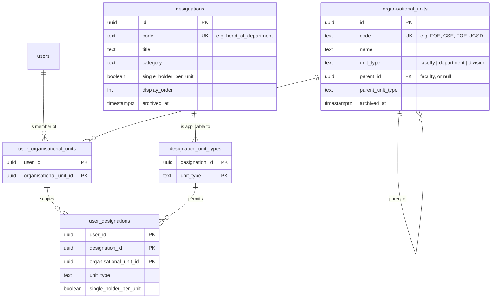

# Organisational Structure & User Affiliations — Phase Plan

This plan adds the university's organisational structure to Unblock AI and lets every user be affiliated with it:

- **Faculties**, **departments** and **divisions** are stored as configurable *organisational units* and managed through the UI.
- **Designations** (Dean, Head of Department, Senior Lecturer, Senior Assistant Registrar, and so on) are stored as a configurable catalogue. Each designation lists the unit types it can be held in.
- A user can be a **member** of any number of organisational units. A user can also **hold designations within** any unit they are a member of.
- The seed data reflects the **University of Moratuwa (UoM)**.

The frontend gets an Organisation configuration area. It also gets complete user management screens (list, create, detail with an affiliation editor) and an affiliations section on the profile page.

Each phase can be built on its own by an agent that first reads **§1 Ground rules**, **§2 Architecture**, **§3 Decisions** and **§4 Contracts**, then its own phase section. Every phase must leave `npm run typecheck && npm test` green in each app it touches, plus `npm run lint` in the web app. **Stop after each phase, run its verification block, then move on.**

> **Status (2026-11-11): all phases (1–11) are implemented.** The migration is applied and the UoM seeders have run, including a `student` designation category and, behind `SEED_SAMPLE_USERS=true`, sixteen sample users `u1@u.c` … `u16@u.c` with test affiliations. Where the build refined this plan, the contracts below have been updated. Implementation notes:
> - Text helpers live in `src/utils/shared/text.util.ts` and field validators in `src/utils/shared/field-validation.util.ts`.
> - Typed error factories live in `src/errors/{organisational-unit,designation,user-affiliation,user}.error.ts`.
> - All repositories are built through `src/repositories/repository-registry.factory.ts` (`createRepositoryRegistry`, `createPostgresRepositoryRegistry`, `createInMemoryRepositoryRegistry`).
> - Unit and designation writes return the *summary* DTOs, including usage counts.

---

## Table of contents

1. [Ground rules for every phase](#1-ground-rules-for-every-phase)
2. [Architecture](#2-architecture)
3. [Decisions](#3-decisions)
4. [Contracts](#4-contracts)
5. [Phase map](#5-phase-map)
6. [Phase 1 — API foundations](#phase-1--api-foundations)
7. [Phase 2 — Postgres schema and repositories](#phase-2--postgres-schema-and-repositories)
8. [Phase 3 — Domain services and business rules](#phase-3--domain-services-and-business-rules)
9. [Phase 4 — HTTP API](#phase-4--http-api)
10. [Phase 5 — University of Moratuwa seed data](#phase-5--university-of-moratuwa-seed-data)
11. [Phase 6 — Web foundations](#phase-6--web-foundations)
12. [Phase 7 — Web UI primitives](#phase-7--web-ui-primitives)
13. [Phase 8 — Organisation configuration UI](#phase-8--organisation-configuration-ui)
14. [Phase 9 — User management UI](#phase-9--user-management-ui)
15. [Phase 10 — Profile affiliations](#phase-10--profile-affiliations)
16. [Phase 11 — Documentation, Postman and final verification](#phase-11--documentation-postman-and-final-verification)
17. [Out of scope and follow-ups](#17-out-of-scope-and-follow-ups)
18. [Appendix A — Seed data verification list](#appendix-a--seed-data-verification-list)

---

## 1. Ground rules for every phase

These rules are mandatory. They carry over the rules of `docs/user-access-and-session-management-phase-plan.md` §1 and add the ones this change request introduces.

### 1.1 Code standards (both apps)

| Rule | What it means here |
|---|---|
| **High standard, maintainable** | Small single-purpose modules. A function does one thing. A file holds one concept. If a component grows past one screen of JSX, split it. |
| **Modular and reusable** | Every rule and every transformation lives in exactly one place. Examples: hierarchy rules, code normalisation, affiliation grouping, the single-holder check, label maps. If you are about to copy logic, extract a util, hook or component instead. The affiliation summary and the affiliation editor are each written once and reused by several screens. |
| **Strict type safety** | No `any`. No unchecked `as` casts on request bodies, API payloads or route params. Request input goes through validators that return typed values. Every exported function has explicit parameter and return types. Use discriminated unions where a shape depends on a type, e.g. `OrganisationalUnitType`. |
| **No hardcoded strings** | Every fixed value is an `enum` or an `as const` object in a constants module: unit types, designation categories, permission codes, error codes, Postgres constraint names, route paths, icon names, seed entities. UI copy lives in typed copy modules. Labels for enum values are `Record<Enum, string>` maps, so adding an enum member fails to compile until it has a label. Never compare against a raw literal such as `"faculty"`. |
| **Migrations are frozen** | Migration files use literal SQL and literal values and never import app enums. This is the only sanctioned exception to "no hardcoded strings". |
| **No unnecessary comments** | New code carries no comments, except a one-line *why* where the reason is truly non-obvious, e.g. why a composite foreign key exists. Do not strip existing comments from files you only touch lightly. |
| **Naming** | Names must be unambiguous. API files follow `<name>.<kind>.ts` (`organisational-unit.service.ts`, `designation.constant.ts`). Web files follow the existing convention: PascalCase components, kebab-case modules. Use British spelling (`organisation`, `organisational`), as the codebase does. Never use the word **role** for this feature: `data/vocabulary/role.vocabulary.ts` already owns it for workflow actors. The vocabulary is: *organisational unit*, *unit type*, *membership*, *designation*, *designation assignment*, *affiliations*, and *effective faculties* for faculties a user belongs to through a department or division. |
| **Best possible placement** | Follow the existing layers: constants → `data/constants`, types → `lib/types/<domain>`, data access → `repositories/<domain>-repository/` (four-file shape), rules → `services`, pure helpers → `utils/<domain>`, HTTP shaping → `utils/http/*-serializer.util.ts`. Web: types → `src/types`, API calls → `src/lib/api`, pure logic → `src/lib/<feature>`, hooks → `src/lib/hooks`, components → `src/components/<feature>`. |
| **Interfaces for contracts** | Each repository contract is an `I`-prefixed interface with a Postgres implementation, an in-memory implementation and a factory in `index.<folder>.ts`. |
| **Narrow dependencies** | Services take only the repositories and config slices they need. |
| **JSON shape** | HTTP bodies use `snake_case`. TypeScript internals use `camelCase`. Serializers convert between them. Web types mirror the API's `snake_case` DTOs by hand. |
| **Rules first in services, then in the database** | Every business rule is enforced in a service, so the in-memory repositories used by the tests get the same coverage. Postgres constraints are the backstop for races and bugs. Repositories map constraint violations to the same typed errors the service throws. |

### 1.2 UI and UX standards (web)

| Rule | What it means here |
|---|---|
| **Design tokens only** | Use the utilities generated from `src/app/globals.css` (`bg-surface`, `text-ink`, `text-muted`, `border-line-admin`, `rounded-card`, `rounded-control`, `font-admin`, `bg-accent`, …). No hex literals and no new ad-hoc colours. If a new token is truly needed, add it to `globals.css` in Phase 7 only. |
| **Typography rhythm** | Match the existing scale: page title 17–19px bold `tracking-tight`, section title 14–15px semibold, body 13.5px, meta 12–12.5px `text-muted`. |
| **Every state designed** | Each data view has a loading state (skeleton, not a spinner, for lists and tables), an empty state (`EmptyState` with a primary action), an error state (inline message plus a *Try again* action) and a success state. |
| **Feedback** | Every mutation shows a pending state on its trigger (`busy` label), a toast on success, and an inline error near the field or row it concerns. |
| **No lost work** | Forms and the affiliation editor show an *Unsaved changes* bar and guard navigation. The App Router has no navigation-blocking API, so `useUnsavedChangesGuard` combines a `beforeunload` listener with a capture-phase `click` listener on `document`. The click listener intercepts same-origin anchor navigation while the form is dirty and asks for confirmation through `ConfirmDialog` before calling `router.push`. |
| **Keyboard and screen reader first** | Native `<dialog>` for modals and drawers, as `ConfirmDialog` already does. The combobox follows the WAI-ARIA combobox pattern (`role="combobox"`, `aria-expanded`, `aria-activedescendant`, listbox options, Arrow/Enter/Escape/Home/End). Every icon-only control has an `aria-label`. Focus moves predictably after create, save and close. |
| **Responsive** | Tables collapse to stacked cards below `sm`. Drawers become full-screen sheets on small screens. Nothing scrolls horizontally on a 375px viewport. |
| **Shareable state** | List filters and search live in the URL search params, so a filtered view can be bookmarked or shared and survives a refresh. Search input is debounced (250 ms). |
| **Destructive actions** | Archive uses `ConfirmDialog`. Delete uses `ConfirmDialog tone="danger"` and requires typing the unit or designation code. Delete is offered only when the server reports the item unused. Otherwise the UI explains why and offers *Archive* instead. |

### 1.3 Process rules

- API commands run from `unblock-ai-api/` and web commands from `unblock-ai-web/`.
- The web app runs **Next.js 16**. Before writing any web code, read `unblock-ai-web/AGENTS.md` and the relevant guides in `unblock-ai-web/node_modules/next/dist/docs/`. Pay particular attention to dynamic route `params` (a `Promise`), `PageProps`/`LayoutProps` globals and `proxy.ts`.
- Do not edit already-applied migrations. Add one new Postgres migration via `npm run migrate:pg:create -- organisational-structure-and-user-affiliations`.
- Do not commit unless asked.
- When an API contract changes, update its web mirror in `unblock-ai-web/src/types/*.ts` in the phase that consumes it (Phase 6 for this whole feature).
- Do not touch `src/app/old/**` in the web app.
- **A phase that changes a signature updates every call site in the same phase**, including `server.ts`, `postgres.seed-engine.ts` and the test helpers, so its typecheck gate can pass.

---

## 2. Architecture

### 2.1 Domain model



**Hierarchy (at most two levels).**

| Unit type | Parent |
|---|---|
| `faculty` | none |
| `department` | exactly one `faculty` |
| `division` | none (university-level, e.g. *Examinations & Registration Division*) **or** one `faculty` (faculty-level, e.g. *Undergraduate Studies Division, Faculty of Engineering*) |

**Integrity is declarative wherever possible:**

- `UNIQUE (id, unit_type)` on `organisational_units` lets other tables hold a composite foreign key `(unit_id, unit_type)`. The database then guarantees that a stored `unit_type` always matches the unit's real type.
- The parent link is the composite foreign key `(parent_id, parent_unit_type) → (id, unit_type)`. A `CHECK` lists the allowed `(unit_type, parent_unit_type)` pairs, so a department under a division cannot exist.
- `user_designations (user_id, organisational_unit_id) → user_organisational_units` means a designation can only be held in a unit the user is a member of. Removing the membership cascades its designations away.
- `user_designations (designation_id, unit_type) → designation_unit_types` means a designation can only be held in a unit type it is applicable to.
- `user_designations (designation_id, single_holder_per_unit) → designations (id, single_holder_per_unit) ON UPDATE CASCADE`, together with a partial unique index on `(designation_id, organisational_unit_id) WHERE single_holder_per_unit`. This means a unit can never have two Deans or two Heads of Department, even under concurrent writes.

### 2.2 Layering (API)

```
routes/organisational-unit.route.ts   ─┐
routes/designation.route.ts           ─┼─> controllers/*  ──> services/*  ──> repositories/*  ──> Postgres
routes/user-affiliation.route.ts      ─┘        │                 │               (in-memory twins for tests)
                                                │                 └─ utils/organisation/*, utils/user-affiliation/* (pure rules)
                                                └─ utils/http/*-serializer.util.ts, request-validator.util.ts
```

| Service | Responsibility |
|---|---|
| `OrganisationalUnitService` | List, get, create, rename, re-parent, archive, restore and delete organisational units; enforces hierarchy and lifecycle rules |
| `DesignationService` | List, get, create, update (incl. applicable unit types and the single-holder flag), archive, restore and delete designations |
| `UserAffiliationService` | Read a user's affiliations, replace them atomically, list a unit's members, compute effective faculties |
| `UserService` (existing) | Gains list filtering, search and pagination, plus affiliation summaries for the user list |

### 2.3 Key flows

**Replacing a user's affiliations** (`PUT /api/users/:userId/affiliations`)

1. Controller → typed `ReplaceUserAffiliationsInput`.
2. `UserAffiliationService.replaceForUser`:
   1. structural validation (duplicates and limits) in a pure util;
   2. load the target user (404 if missing);
   3. load the referenced units, designations and the user's current affiliations in batched reads;
   4. apply rules BR-17 to BR-19 (§4.5), reporting **every** problem in one `ValidationError` whose `details.issues[]` the UI maps onto individual rows;
   5. check for single-holder conflicts (409 with the current holder);
   6. `repository.replaceForUser`: one transaction that inserts and deletes only the difference, so unchanged rows keep their original `assigned_at` and `assigned_by_user_id`.
3. Respond with the fresh `UserAffiliationsDto`.

**Authentication stays lean.** `authenticate` calls `IUserRepository.findById` on every request. Affiliations are **not** joined into `USER_SELECT`, `AuthenticatedUser` or `/auth/me`. The profile and user detail screens read affiliations from their own endpoints.

### 2.4 Web architecture

```
app/dashboard/organisation/{faculties,divisions,designations}/page.tsx   (server: requireRouteAccess + metadata)
app/dashboard/users/{page,new/page,[userId]/page}.tsx
app/dashboard/profile/page.tsx
        │
        ▼
components/<feature>/*  (client)  ──> lib/hooks/use*.ts (SWR)  ──> lib/api/*.ts  ──> lib/api/client.ts (one fetch chokepoint)
        │
        └─> lib/organisation/*, lib/user-affiliation/*  (pure, unit-tested: tree building, draft reducer, grouping, labels, error messages)
```

---

## 3. Decisions

These are settled. Do not reopen them while implementing.

| # | Decision |
|---|---|
| D-1 | **One `organisational_units` table** with a `unit_type` discriminator (`faculty`, `department`, `division`) and an optional parent. There are no separate faculty, department and division tables. This gives one repository, one service, one set of endpoints and one membership table, which keeps the code reusable. Composite foreign keys keep the typing strict at the database level. |
| D-2 | **Hierarchy depth is two.** Departments belong to exactly one faculty. Divisions belong to a faculty or to none (university level). Faculties have no parent. Units are never nested deeper. |
| D-3 | **"Division" covers every non-academic organisational unit**: central divisions, offices, centres and units (e.g. *Office of the Registrar*, *Centre for IT Services*, *Library*). University-level appointments (Vice-Chancellor, Registrar, Bursar, Librarian) are designations held in the matching university-level division. There is no fourth `university` unit type. |
| D-4 | **Faculty membership is optional.** A user may have zero or more memberships of any unit type. This was confirmed by the product owner, and it lets central-administration staff exist without a faculty. |
| D-5 | **Memberships are explicit; a department's faculty is required.** A member of a department must also be an explicit member of the faculty that department belongs to (BR-22); the API rejects a department membership without it, and the web editor adds the faculty automatically. Membership of a faculty-level division still only implies affiliation with its faculty, which is not stored. Both are reported as *effective faculties*. A department that has members cannot be moved to another faculty, so the rule never goes stale. |
| D-6 | **Designations are a global catalogue, not per-unit copies.** Each designation lists the unit types it applies to in `designation_unit_types`. *Senior Lecturer* is defined once and can be held in any department. |
| D-7 | **A designation assignment is the triple `(user, designation, organisational unit)`**, and the user must be a member of that unit. The API makes this structural: the affiliation payload lists memberships, and each membership carries its designations. |
| D-8 | **Single-holder designations.** A designation flagged `single_holder_per_unit` (Dean, Head of Department, Director, Vice-Chancellor, Registrar, Bursar, Librarian, …) can be held by at most one user per unit. A second assignment is rejected with 409 and the current holder's identity. The rule is enforced in the service and by a partial unique index. |
| D-9 | **Stable natural keys.** Every unit and designation has an immutable, globally unique `code`. Unit codes are upper-case abbreviations with optional hyphens (`FOE`, `CSE`, `FOE-UGSD`, ≤ 24 chars). Designation codes are lower-snake slugs (`head_of_department`, ≤ 64 chars). These match the actor role slugs in `role.vocabulary.ts` where one exists (`dean`, `head_of_department`, `vice_chancellor`, `registrar`), to support future approver resolution (§17). Seeders are idempotent on `code`. |
| D-10 | **Archive first, delete only when unused.** Units and designations have `archived_at`. An archived item stays visible on existing affiliations, labelled *Archived*, but cannot be newly assigned or used as a parent. Hard delete is allowed only when nothing references the item. The database enforces this with `ON DELETE RESTRICT`, and the error maps to 409. `unit_type` and `code` are immutable. |
| D-11 | **A new permission, `organisation:manage`**, gates writes to units and designations. The migration grants it to every user who already holds `user:manage`, because the administrator seeder skips existing users and would never grant it. The bootstrap administrator gets it through `PERMISSIONS` automatically. |
| D-12 | **Reading the structure is open to any signed-in user.** Unit and designation lists are non-sensitive reference data, and future features (requester context, approver lookup) will need them. Member lists reveal people, so they require `user:manage` **or** `organisation:manage`. |
| D-13 | **Affiliations are managed by `user:manage` holders.** Users can see their own affiliations on the profile page but cannot edit them, because affiliations are institutional records. |
| D-14 | **This reopens D-11 of the previous plan**, which allowed no user update endpoints. Exactly one write is added for users: `PUT /users/:userId/affiliations`, with replace-set semantics. Editing name, email, status or permissions remains out of scope (§17). |
| D-15 | **User creation stays affiliation-free at the API level.** The *New user* screen is a two-step flow. Step 1 creates the account (`POST /users`, unchanged). Step 2 opens the same affiliation editor used on the detail page (`PUT …/affiliations`). Each step is atomic, no cross-repository transaction is needed, and the editor is reused verbatim. |
| D-16 | **The user list gets server-side search, unit filtering and pagination.** A university has thousands of staff. `GET /users` accepts `search`, `organisational_unit_id` (which includes the unit's children), `limit` and `offset`, and returns `{ users, page }`. Each list item carries a compact `organisational_units` summary, loaded by one batched query rather than by changing `USER_SELECT`. |
| D-17 | **One migration** adds the permission, its grant, and all five tables. No Mongo changes. |
| D-18 | **Seed data lives in typed, database-agnostic data modules** under `src/db/seed/data/university-of-moratuwa/`, separate from seeder logic. Seeders go through services, so the business rules apply. They create missing items and skip existing ones; they never overwrite edits made in the UI. |
| D-19 | **`PostgresSeedContext` grows** to expose `organisationalUnitService` and `designationService`. Seeder filename timestamps order the runs: units, then designations, then (unchanged) the administrator. |

---

## 4. Contracts

Every phase builds against these definitions. Phases reference this section instead of restating it.

### 4.1 API enums and constants (`unblock-ai-api/src/data/constants/`)

```ts
// permission.constant.ts (modified)
export enum Permission {
  WORKFLOW_MANAGE = "workflow:manage",
  TASK_CREATE = "task:create",
  TASK_APPROVE = "task:approve",
  USER_MANAGE = "user:manage",
  ORGANISATION_MANAGE = "organisation:manage",
}

// organisational-unit.constant.ts (new)
export enum OrganisationalUnitType {
  FACULTY = "faculty",
  DEPARTMENT = "department",
  DIVISION = "division",
}
export const ORGANISATIONAL_UNIT_TYPES: readonly OrganisationalUnitType[] = Object.values(OrganisationalUnitType);

export enum ParentRequirement {
  FORBIDDEN = "forbidden",
  REQUIRED = "required",
  OPTIONAL = "optional",
}

export const ORGANISATIONAL_UNIT_HIERARCHY: Readonly<
  Record<OrganisationalUnitType, { parentRequirement: ParentRequirement; allowedParentTypes: readonly OrganisationalUnitType[] }>
> = {
  [OrganisationalUnitType.FACULTY]: { parentRequirement: ParentRequirement.FORBIDDEN, allowedParentTypes: [] },
  [OrganisationalUnitType.DEPARTMENT]: { parentRequirement: ParentRequirement.REQUIRED, allowedParentTypes: [OrganisationalUnitType.FACULTY] },
  [OrganisationalUnitType.DIVISION]: { parentRequirement: ParentRequirement.OPTIONAL, allowedParentTypes: [OrganisationalUnitType.FACULTY] },
};

export const ORGANISATIONAL_UNIT_FIELD_LIMIT = {
  CODE_MAX_LENGTH: 24,
  NAME_MAX_LENGTH: 200,
  DESCRIPTION_MAX_LENGTH: 1000,
} as const;

export const ORGANISATIONAL_UNIT_CODE_PATTERN = /^[A-Z][A-Z0-9]*(?:-[A-Z0-9]+)*$/;

// designation.constant.ts (new)
export enum DesignationCategory {
  LEADERSHIP = "leadership",
  ACADEMIC = "academic",
  ACADEMIC_SUPPORT = "academic_support",
  ADMINISTRATIVE = "administrative",
  NON_ACADEMIC = "non_academic",
  STUDENT = "student",
}
export const DESIGNATION_CATEGORIES: readonly DesignationCategory[] = Object.values(DesignationCategory);

export const DESIGNATION_FIELD_LIMIT = {
  CODE_MAX_LENGTH: 64,
  TITLE_MAX_LENGTH: 120,
  DISPLAY_ORDER_MAX: 9999,
} as const;

export const DESIGNATION_CODE_PATTERN = /^[a-z][a-z0-9]*(?:_[a-z0-9]+)*$/;

// user-affiliation.constant.ts (new)
export const USER_AFFILIATION_LIMIT = {
  MAX_MEMBERSHIPS: 50,
  MAX_DESIGNATIONS_PER_MEMBERSHIP: 10,
} as const;

// user.constant.ts (modified: add)
export const USER_LIST_PAGINATION = {
  DEFAULT_LIMIT: 25,
  MAX_LIMIT: 100,
  SEARCH_MAX_LENGTH: 100,
} as const;

// postgres.constant.ts (modified: add members)
export enum PostgresConstraint {
  USERS_EMAIL_KEY = "users_email_key",
  ORGANISATIONAL_UNITS_CODE_KEY = "organisational_units_code_key",
  ORGANISATIONAL_UNITS_ROOT_NAME_KEY = "organisational_units_root_name_key",
  ORGANISATIONAL_UNITS_CHILD_NAME_KEY = "organisational_units_child_name_key",
  ORGANISATIONAL_UNITS_PARENT_FKEY = "organisational_units_parent_fkey",
  USER_ORGANISATIONAL_UNITS_UNIT_FKEY = "user_organisational_units_organisational_unit_id_fkey",
  DESIGNATIONS_CODE_KEY = "designations_code_key",
  DESIGNATIONS_TITLE_KEY = "designations_title_key",
  USER_DESIGNATIONS_DESIGNATION_UNIT_TYPE_FKEY = "user_designations_designation_unit_type_fkey",
  USER_DESIGNATIONS_SINGLE_HOLDER_KEY = "user_designations_single_holder_key",
}

// seed.constant.ts (modified: add members)
export enum SeedEntity {
  USER = "user",
  ORGANISATIONAL_UNIT = "organisational_unit",
  DESIGNATION = "designation",
}
```

### 4.2 Error codes

```ts
// organisational-unit-error.constant.ts
export enum OrganisationalUnitErrorCode {
  ORGANISATIONAL_UNIT_NOT_FOUND = "ORGANISATIONAL_UNIT_NOT_FOUND",
  ORGANISATIONAL_UNIT_CODE_TAKEN = "ORGANISATIONAL_UNIT_CODE_TAKEN",
  ORGANISATIONAL_UNIT_NAME_TAKEN = "ORGANISATIONAL_UNIT_NAME_TAKEN",
  ORGANISATIONAL_UNIT_PARENT_INVALID = "ORGANISATIONAL_UNIT_PARENT_INVALID",
  ORGANISATIONAL_UNIT_PARENT_ARCHIVED = "ORGANISATIONAL_UNIT_PARENT_ARCHIVED",
  ORGANISATIONAL_UNIT_HAS_ACTIVE_CHILDREN = "ORGANISATIONAL_UNIT_HAS_ACTIVE_CHILDREN",
  ORGANISATIONAL_UNIT_IN_USE = "ORGANISATIONAL_UNIT_IN_USE",
  ORGANISATIONAL_UNIT_HAS_MEMBERS = "ORGANISATIONAL_UNIT_HAS_MEMBERS",
}

// designation-error.constant.ts
export enum DesignationErrorCode {
  DESIGNATION_NOT_FOUND = "DESIGNATION_NOT_FOUND",
  DESIGNATION_CODE_TAKEN = "DESIGNATION_CODE_TAKEN",
  DESIGNATION_TITLE_TAKEN = "DESIGNATION_TITLE_TAKEN",
  DESIGNATION_UNIT_TYPE_IN_USE = "DESIGNATION_UNIT_TYPE_IN_USE",
  DESIGNATION_SINGLE_HOLDER_VIOLATED = "DESIGNATION_SINGLE_HOLDER_VIOLATED",
  DESIGNATION_IN_USE = "DESIGNATION_IN_USE",
}

// user-affiliation-error.constant.ts
export enum UserAffiliationErrorCode {
  USER_AFFILIATIONS_INVALID = "USER_AFFILIATIONS_INVALID",
  DESIGNATION_HOLDER_CONFLICT = "DESIGNATION_HOLDER_CONFLICT",
}

export enum UserAffiliationIssueCode {
  DUPLICATE_ORGANISATIONAL_UNIT = "DUPLICATE_ORGANISATIONAL_UNIT",
  DUPLICATE_DESIGNATION = "DUPLICATE_DESIGNATION",
  ORGANISATIONAL_UNIT_NOT_FOUND = "ORGANISATIONAL_UNIT_NOT_FOUND",
  ORGANISATIONAL_UNIT_ARCHIVED = "ORGANISATIONAL_UNIT_ARCHIVED",
  DESIGNATION_NOT_FOUND = "DESIGNATION_NOT_FOUND",
  DESIGNATION_ARCHIVED = "DESIGNATION_ARCHIVED",
  DESIGNATION_NOT_APPLICABLE = "DESIGNATION_NOT_APPLICABLE",
  FACULTY_MEMBERSHIP_REQUIRED = "FACULTY_MEMBERSHIP_REQUIRED",
  TOO_MANY_MEMBERSHIPS = "TOO_MANY_MEMBERSHIPS",
  TOO_MANY_DESIGNATIONS = "TOO_MANY_DESIGNATIONS",
}
```

Error payloads use the existing `BaseError` JSON shape `{ error, code, details }`:

| Situation | Status | `code` | `details` |
|---|---|---|---|
| Field validation | 400 | `VALIDATION_ERROR` | `{ field }` |
| Affiliation rule breaches | 400 | `USER_AFFILIATIONS_INVALID` | `{ issues: [{ code: UserAffiliationIssueCode, organisational_unit_id, designation_id \| null }] }` |
| Single-holder conflict on assignment | 409 | `DESIGNATION_HOLDER_CONFLICT` | `{ conflicts: [{ designation_id, organisational_unit_id, holder: { id, full_name } }] }` |
| Delete or archive blocked | 409 | `ORGANISATIONAL_UNIT_IN_USE` / `ORGANISATIONAL_UNIT_HAS_ACTIVE_CHILDREN` / `DESIGNATION_IN_USE` | `{ member_count, child_count }` or `{ holder_count }` |
| Moving a department with members to another faculty | 409 | `ORGANISATIONAL_UNIT_HAS_MEMBERS` | `{ field: "parent_id", member_count }` |
| Unit type removal blocked | 409 | `DESIGNATION_UNIT_TYPE_IN_USE` | `{ unit_type, holder_count }` |
| Enabling single holder blocked | 409 | `DESIGNATION_SINGLE_HOLDER_VIOLATED` | `{ organisational_unit_ids: [...] }` |

### 4.3 Migration (`src/db/migration/postgres/migrations/<timestamp>_organisational-structure-and-user-affiliations.migration.ts`)

Literal SQL. `up` runs the statements below in order. `down` reverses them: drop triggers and functions, drop the tables in reverse dependency order, `DELETE FROM user_permissions WHERE permission_code = 'organisation:manage'`, then delete the permission row.

```sql
INSERT INTO permissions (code, description) VALUES
  ('organisation:manage', 'Configure faculties, departments, divisions and designations');

INSERT INTO user_permissions (user_id, permission_code, granted_by_user_id)
SELECT user_id, 'organisation:manage', NULL
  FROM user_permissions
 WHERE permission_code = 'user:manage'
ON CONFLICT DO NOTHING;

CREATE TABLE organisational_units (
  id                 UUID        PRIMARY KEY DEFAULT gen_random_uuid(),
  code               TEXT        NOT NULL,
  name               TEXT        NOT NULL,
  unit_type          TEXT        NOT NULL,
  parent_id          UUID,
  parent_unit_type   TEXT,
  description        TEXT,
  archived_at        TIMESTAMPTZ,
  created_by_user_id UUID,
  created_at         TIMESTAMPTZ NOT NULL DEFAULT now(),
  updated_at         TIMESTAMPTZ NOT NULL DEFAULT now(),
  CONSTRAINT organisational_units_code_key           UNIQUE (code),
  CONSTRAINT organisational_units_id_unit_type_key   UNIQUE (id, unit_type),
  CONSTRAINT organisational_units_unit_type_check    CHECK (unit_type IN ('faculty', 'department', 'division')),
  CONSTRAINT organisational_units_code_format_check  CHECK (code ~ '^[A-Z][A-Z0-9]*(-[A-Z0-9]+)*$' AND char_length(code) <= 24),
  CONSTRAINT organisational_units_name_check         CHECK (name = btrim(name) AND char_length(name) BETWEEN 1 AND 200),
  CONSTRAINT organisational_units_parent_pair_check  CHECK ((parent_id IS NULL) = (parent_unit_type IS NULL)),
  CONSTRAINT organisational_units_hierarchy_check    CHECK (
    (unit_type = 'faculty'    AND parent_unit_type IS NULL) OR
    (unit_type = 'department' AND parent_unit_type IS NOT DISTINCT FROM 'faculty') OR
    (unit_type = 'division'   AND (parent_unit_type IS NULL OR parent_unit_type = 'faculty'))
  ),
  CONSTRAINT organisational_units_parent_fkey             FOREIGN KEY (parent_id, parent_unit_type) REFERENCES organisational_units (id, unit_type) ON DELETE RESTRICT,
  CONSTRAINT organisational_units_created_by_user_id_fkey FOREIGN KEY (created_by_user_id)          REFERENCES users (id)                         ON DELETE SET NULL
);

CREATE UNIQUE INDEX organisational_units_root_name_key  ON organisational_units (unit_type, lower(name))            WHERE parent_id IS NULL;
CREATE UNIQUE INDEX organisational_units_child_name_key ON organisational_units (parent_id, unit_type, lower(name)) WHERE parent_id IS NOT NULL;
CREATE INDEX        organisational_units_parent_id_idx  ON organisational_units (parent_id);

CREATE TABLE designations (
  id                     UUID        PRIMARY KEY DEFAULT gen_random_uuid(),
  code                   TEXT        NOT NULL,
  title                  TEXT        NOT NULL,
  category               TEXT        NOT NULL,
  single_holder_per_unit BOOLEAN     NOT NULL DEFAULT FALSE,
  display_order          INTEGER     NOT NULL DEFAULT 0,
  archived_at            TIMESTAMPTZ,
  created_by_user_id     UUID,
  created_at             TIMESTAMPTZ NOT NULL DEFAULT now(),
  updated_at             TIMESTAMPTZ NOT NULL DEFAULT now(),
  CONSTRAINT designations_code_key               UNIQUE (code),
  CONSTRAINT designations_id_single_holder_key   UNIQUE (id, single_holder_per_unit),
  CONSTRAINT designations_code_format_check      CHECK (code ~ '^[a-z][a-z0-9]*(_[a-z0-9]+)*$' AND char_length(code) <= 64),
  CONSTRAINT designations_title_check            CHECK (title = btrim(title) AND char_length(title) BETWEEN 1 AND 120),
  CONSTRAINT designations_category_check         CHECK (category IN ('leadership', 'academic', 'academic_support', 'administrative', 'non_academic', 'student')),
  CONSTRAINT designations_display_order_check    CHECK (display_order BETWEEN 0 AND 9999),
  CONSTRAINT designations_created_by_user_id_fkey FOREIGN KEY (created_by_user_id) REFERENCES users (id) ON DELETE SET NULL
);

CREATE UNIQUE INDEX designations_title_key ON designations (lower(title));

CREATE TABLE designation_unit_types (
  designation_id UUID NOT NULL,
  unit_type      TEXT NOT NULL,
  CONSTRAINT designation_unit_types_pkey                PRIMARY KEY (designation_id, unit_type),
  CONSTRAINT designation_unit_types_unit_type_check     CHECK (unit_type IN ('faculty', 'department', 'division')),
  CONSTRAINT designation_unit_types_designation_id_fkey FOREIGN KEY (designation_id) REFERENCES designations (id) ON DELETE CASCADE
);

CREATE TABLE user_organisational_units (
  user_id                UUID        NOT NULL,
  organisational_unit_id UUID        NOT NULL,
  assigned_by_user_id    UUID,
  assigned_at            TIMESTAMPTZ NOT NULL DEFAULT now(),
  CONSTRAINT user_organisational_units_pkey                         PRIMARY KEY (user_id, organisational_unit_id),
  CONSTRAINT user_organisational_units_user_id_fkey                 FOREIGN KEY (user_id)                REFERENCES users (id)                ON DELETE CASCADE,
  CONSTRAINT user_organisational_units_organisational_unit_id_fkey  FOREIGN KEY (organisational_unit_id) REFERENCES organisational_units (id) ON DELETE RESTRICT,
  CONSTRAINT user_organisational_units_assigned_by_user_id_fkey     FOREIGN KEY (assigned_by_user_id)    REFERENCES users (id)                ON DELETE SET NULL
);

CREATE INDEX user_organisational_units_organisational_unit_id_idx ON user_organisational_units (organisational_unit_id);

CREATE TABLE user_designations (
  user_id                UUID        NOT NULL,
  designation_id         UUID        NOT NULL,
  organisational_unit_id UUID        NOT NULL,
  unit_type              TEXT        NOT NULL,
  single_holder_per_unit BOOLEAN     NOT NULL,
  assigned_by_user_id    UUID,
  assigned_at            TIMESTAMPTZ NOT NULL DEFAULT now(),
  CONSTRAINT user_designations_pkey                       PRIMARY KEY (user_id, designation_id, organisational_unit_id),
  CONSTRAINT user_designations_membership_fkey            FOREIGN KEY (user_id, organisational_unit_id)          REFERENCES user_organisational_units (user_id, organisational_unit_id) ON DELETE CASCADE,
  CONSTRAINT user_designations_unit_type_fkey             FOREIGN KEY (organisational_unit_id, unit_type)        REFERENCES organisational_units (id, unit_type)                        ON DELETE RESTRICT,
  CONSTRAINT user_designations_designation_unit_type_fkey FOREIGN KEY (designation_id, unit_type)                REFERENCES designation_unit_types (designation_id, unit_type)          ON DELETE RESTRICT,
  CONSTRAINT user_designations_single_holder_fkey         FOREIGN KEY (designation_id, single_holder_per_unit)   REFERENCES designations (id, single_holder_per_unit)                   ON UPDATE CASCADE ON DELETE RESTRICT,
  CONSTRAINT user_designations_assigned_by_user_id_fkey   FOREIGN KEY (assigned_by_user_id)                      REFERENCES users (id)                                                  ON DELETE SET NULL
);

CREATE UNIQUE INDEX user_designations_single_holder_key          ON user_designations (designation_id, organisational_unit_id) WHERE single_holder_per_unit;
CREATE INDEX        user_designations_organisational_unit_id_idx ON user_designations (organisational_unit_id);
```

Add a `DEFERRABLE INITIALLY DEFERRED` constraint trigger, `enforce_designation_has_unit_type`, that mirrors `enforce_user_has_permission`. It fires `AFTER INSERT ON designations` and `AFTER DELETE ON designation_unit_types`, so every designation keeps at least one applicable unit type.

### 4.4 Domain types (`src/lib/types/`)

```ts
// organisational-unit/organisational-unit.type.ts
export interface OrganisationalUnitReference {
  id: string;
  code: string;
  name: string;
  unitType: OrganisationalUnitType;
  isArchived: boolean;
}

export interface OrganisationalUnitRecord extends OrganisationalUnitReference {
  parent: OrganisationalUnitReference | null;
  description: string | null;
  archivedAt: Date | null;
  createdByUserId: string | null;
  createdAt: Date;
  updatedAt: Date;
}

export interface OrganisationalUnitSummaryRecord extends OrganisationalUnitRecord {
  memberCount: number;
  childCount: number;
  activeChildCount: number;
}

export interface OrganisationalUnitListFilter {
  unitType?: OrganisationalUnitType;
  parentId?: string | null;
  includeArchived: boolean;
}

export interface CreateOrganisationalUnitInput {
  code: string;
  name: string;
  unitType: OrganisationalUnitType;
  parentId: string | null;
  description: string | null;
}

export interface UpdateOrganisationalUnitInput {
  name?: string;
  parentId?: string | null;
  description?: string | null;
}

export interface OrganisationalUnitMemberRecord {
  user: { id: string; fullName: string; email: string };
  designations: DesignationReference[];
  assignedAt: Date;
}

// designation/designation.type.ts
export interface DesignationReference {
  id: string;
  code: string;
  title: string;
  category: DesignationCategory;
  isArchived: boolean;
}

export interface DesignationRecord extends DesignationReference {
  applicableUnitTypes: OrganisationalUnitType[];
  singleHolderPerUnit: boolean;
  displayOrder: number;
  archivedAt: Date | null;
  createdByUserId: string | null;
  createdAt: Date;
  updatedAt: Date;
}

export interface DesignationSummaryRecord extends DesignationRecord {
  holderCount: number;
}

export interface CreateDesignationInput {
  code: string;
  title: string;
  category: DesignationCategory;
  applicableUnitTypes: OrganisationalUnitType[];
  singleHolderPerUnit: boolean;
  displayOrder: number;
}

export type UpdateDesignationInput = Partial<Omit<CreateDesignationInput, "code">>;

// user-affiliation/user-affiliation.type.ts
export interface UserMembershipRecord {
  organisationalUnit: OrganisationalUnitRecord;
  designations: DesignationReference[];
  assignedAt: Date;
}

export interface UserAffiliationsRecord {
  memberships: UserMembershipRecord[];
  effectiveFaculties: OrganisationalUnitReference[];
}

export interface MembershipInput {
  organisationalUnitId: string;
  designationIds: string[];
}

export interface ReplaceUserAffiliationsInput {
  memberships: MembershipInput[];
}

export interface DesignationHolderRecord {
  designationId: string;
  organisationalUnitId: string;
  holder: { id: string; fullName: string };
}

// user/user.type.ts (modified: add)
export interface UserListFilter {
  search: string | null;
  organisationalUnitId: string | null;
  limit: number;
  offset: number;
}

export interface UserListPage {
  users: UserRecord[];
  total: number;
}
```

### 4.5 Business rules

| # | Rule | Enforced in |
|---|---|---|
| BR-1 | Unit `code` is trimmed and upper-cased, matches `ORGANISATIONAL_UNIT_CODE_PATTERN`, is ≤ 24 chars, unique and immutable | service + `CHECK` + unique |
| BR-2 | Unit `name` is trimmed with inner whitespace collapsed, 1–200 chars, and unique (case-insensitive) among units of the same type under the same parent | service + partial unique indexes |
| BR-3 | `unit_type` is immutable | service (no update path) + composite FKs |
| BR-4 | Parent follows `ORGANISATIONAL_UNIT_HIERARCHY`; the parent must exist and be active | service + `CHECK` + composite FK |
| BR-5 | Re-parenting is allowed for divisions (set or clear the faculty) and for departments without members (another faculty). A department with members cannot change faculty (BR-22). Memberships are never changed by a move | service |
| BR-6 | Archiving a unit is blocked while it has active children. An archived unit cannot become a parent or receive new members | service |
| BR-7 | Restoring a unit is blocked while its parent is archived | service |
| BR-8 | Deleting a unit is blocked while it has any children or members | service + `ON DELETE RESTRICT` |
| BR-9 | Designation `code` is trimmed and lower-cased, matches `DESIGNATION_CODE_PATTERN`, is ≤ 64 chars, unique and immutable | service + `CHECK` + unique |
| BR-10 | Designation `title` is 1–120 chars and unique (case-insensitive) | service + unique index |
| BR-11 | A designation has ≥ 1 applicable unit type, with no duplicates | service + constraint trigger |
| BR-12 | Removing an applicable unit type is blocked while holders exist in units of that type | service + FK `RESTRICT` |
| BR-13 | Enabling `single_holder_per_unit` is blocked while any unit has more than one holder | service + partial unique index via `ON UPDATE CASCADE` |
| BR-14 | An archived designation cannot be newly assigned; existing assignments remain. Delete is blocked while holders exist | service + FK `RESTRICT` |
| BR-15 | `PUT …/affiliations` is a full replace: the payload is the complete desired state, and an empty list removes every affiliation | service |
| BR-16 | Membership unit ids are unique; designation ids are unique within a membership; at most 50 memberships and 10 designations per membership | pure util in service |
| BR-17 | Every unit exists. A *new* membership needs an active unit; an existing membership of a since-archived unit may be retained | service |
| BR-18 | Every designation exists and applies to the unit's type. A *new* assignment needs an active designation | service + composite FK |
| BR-19 | A single-holder designation already held by **another** user in the same unit makes the request fail with 409 | service + partial unique index |
| BR-20 | Effective faculties = explicit faculty memberships ∪ parent faculties of member departments and divisions, deduplicated and sorted by name | pure util |
| BR-21 | Only the difference is written. Unchanged rows keep `assigned_at` and `assigned_by_user_id`; new rows record the acting user | repository |
| BR-22 | A department membership requires a membership of that department's faculty in the same request; otherwise the issue `FACULTY_MEMBERSHIP_REQUIRED` is reported on the department | service + deferred constraint trigger `enforce_department_member_in_faculty` |
| BR-23 | A department with members cannot be moved to another faculty (409 `ORGANISATIONAL_UNIT_HAS_MEMBERS`) | service + the same trigger on `organisational_units.parent_id` |

All rule breaches in a request are collected and reported together (§4.2). Never fail on the first issue only.

### 4.6 Repository interfaces

```ts
// repositories/organisational-unit-repository/organisational-unit-repository.interface.ts
export interface IOrganisationalUnitRepository {
  list(filter: OrganisationalUnitListFilter): Promise<OrganisationalUnitSummaryRecord[]>;
  findById(id: string): Promise<OrganisationalUnitSummaryRecord | null>;
  findByIds(ids: readonly string[]): Promise<OrganisationalUnitRecord[]>;
  findByCode(code: string): Promise<OrganisationalUnitRecord | null>;
  create(input: CreateOrganisationalUnitInput, createdByUserId: string | null): Promise<OrganisationalUnitRecord>;
  update(id: string, input: UpdateOrganisationalUnitInput): Promise<OrganisationalUnitRecord>;
  setArchivedAt(id: string, archivedAt: Date | null): Promise<OrganisationalUnitRecord>;
  delete(id: string): Promise<void>;
}

// repositories/designation-repository/designation-repository.interface.ts
export interface IDesignationRepository {
  list(includeArchived: boolean): Promise<DesignationSummaryRecord[]>;
  findById(id: string): Promise<DesignationSummaryRecord | null>;
  findByIds(ids: readonly string[]): Promise<DesignationRecord[]>;
  findByCode(code: string): Promise<DesignationRecord | null>;
  countHoldersByUnitType(id: string): Promise<Record<OrganisationalUnitType, number>>;
  findUnitsWithMultipleHolders(id: string): Promise<string[]>;
  create(input: CreateDesignationInput, createdByUserId: string | null): Promise<DesignationRecord>;
  update(id: string, input: UpdateDesignationInput): Promise<DesignationRecord>;
  setArchivedAt(id: string, archivedAt: Date | null): Promise<DesignationRecord>;
  delete(id: string): Promise<void>;
}

// repositories/user-affiliation-repository/user-affiliation-repository.interface.ts
export interface IUserAffiliationRepository {
  findMembershipsByUserId(userId: string): Promise<UserMembershipRecord[]>;
  findUnitSummariesByUserIds(userIds: readonly string[]): Promise<Map<string, OrganisationalUnitReference[]>>;
  findMembersByUnitId(organisationalUnitId: string): Promise<OrganisationalUnitMemberRecord[]>;
  findSingleHolders(pairs: readonly { designationId: string; organisationalUnitId: string }[]): Promise<DesignationHolderRecord[]>;
  replaceForUser(userId: string, memberships: readonly MembershipInput[], actorUserId: string): Promise<void>;
}

// repositories/user-repository/user-repository.interface.ts (modified)
list(filter: UserListFilter): Promise<UserListPage>;
```

**One registry builds every repository.** `createRepositoryRegistry(backend): RepositoryRegistry`, in `repositories/repository-registry.factory.ts`, returns `{ userRepository, userSessionRepository, templateDeletionRepository, organisationalUnitRepository, designationRepository, userAffiliationRepository }`. `server.ts`, the seed engine and the test helpers all use it. On the `memory` backend the in-memory twins share state, so they can answer the same questions the Postgres implementations answer with joins:

- One `InMemoryOrganisationStore` (units, designations, unit types, memberships, assignments) is shared by the three organisation repositories.
- `InMemoryUserRepository` receives the store, so `list(filter)` can apply the unit filter.
- `InMemoryUserAffiliationRepository` receives the store **and** the same `InMemoryUserRepository` instance, so `findMembersByUnitId` and `findSingleHolders` can return names and emails.
- `InMemoryUserRepository` keeps its `memorySeed` option for tests that seed users.

### 4.7 HTTP API

All routes are under `/api` and require authentication.

| Method & path | Permission | Body / query | Response |
|---|---|---|---|
| `GET /organisational-units` | any signed-in | `?unit_type=&parent_id=&root_only=&include_archived=` (`root_only=true` returns units without a parent; it cannot be combined with `parent_id`) | `200 { organisational_units: OrganisationalUnitSummaryDto[] }` |
| `GET /organisational-units/:unitId` | any signed-in | — | `200 { organisational_unit: OrganisationalUnitSummaryDto }` |
| `POST /organisational-units` | `organisation:manage` | `{ code, name, unit_type, parent_id?, description? }` | `201 { organisational_unit: OrganisationalUnitSummaryDto }` |
| `PATCH /organisational-units/:unitId` | `organisation:manage` | `{ name?, parent_id?, description? }` | `200 { organisational_unit: OrganisationalUnitSummaryDto }` |
| `POST /organisational-units/:unitId/archive` | `organisation:manage` | — | `200 { organisational_unit: OrganisationalUnitSummaryDto }` |
| `POST /organisational-units/:unitId/restore` | `organisation:manage` | — | `200 { organisational_unit: OrganisationalUnitSummaryDto }` |
| `DELETE /organisational-units/:unitId` | `organisation:manage` | — | `204` |
| `GET /organisational-units/:unitId/members` | `user:manage` or `organisation:manage` | — | `200 { members: OrganisationalUnitMemberDto[] }` |
| `GET /designations` | any signed-in | `?include_archived=` | `200 { designations: DesignationSummaryDto[] }` |
| `GET /designations/:designationId` | any signed-in | — | `200 { designation: DesignationSummaryDto }` |
| `POST /designations` | `organisation:manage` | `{ code, title, category, applicable_unit_types, single_holder_per_unit, display_order }` | `201 { designation: DesignationSummaryDto }` |
| `PATCH /designations/:designationId` | `organisation:manage` | any of the create fields except `code` | `200 { designation: DesignationSummaryDto }` |
| `POST /designations/:designationId/archive` · `/restore` | `organisation:manage` | — | `200 { designation: DesignationSummaryDto }` |
| `DELETE /designations/:designationId` | `organisation:manage` | — | `204` |
| `GET /users` (modified) | `user:manage` | `?search=&organisational_unit_id=&limit=&offset=` | `200 { users: UserListItemDto[], page: { total, limit, offset } }` |
| `GET /users/:userId/affiliations` | `user:manage` | — | `200 { affiliations: UserAffiliationsDto }` |
| `PUT /users/:userId/affiliations` | `user:manage` | `{ memberships: [{ organisational_unit_id, designation_ids }] }` | `200 { affiliations: UserAffiliationsDto }` |
| `GET /auth/me/affiliations` | any signed-in | — | `200 { affiliations: UserAffiliationsDto }` |

DTOs:

```ts
interface OrganisationalUnitReferenceDto { id: string; code: string; name: string; unit_type: OrganisationalUnitType; is_archived: boolean }
interface OrganisationalUnitDto extends OrganisationalUnitReferenceDto {
  parent: OrganisationalUnitReferenceDto | null;
  description: string | null;
  archived_at: string | null;
  created_at: string;
  updated_at: string;
}
interface OrganisationalUnitSummaryDto extends OrganisationalUnitDto { member_count: number; child_count: number; active_child_count: number }

interface DesignationReferenceDto { id: string; code: string; title: string; category: DesignationCategory; display_order: number; is_archived: boolean }
interface DesignationDto extends DesignationReferenceDto {
  applicable_unit_types: OrganisationalUnitType[];
  single_holder_per_unit: boolean;
  display_order: number;
  archived_at: string | null;
  created_at: string;
  updated_at: string;
}
interface DesignationSummaryDto extends DesignationDto { holder_count: number }

interface UserMembershipDto { organisational_unit: OrganisationalUnitDto; designations: DesignationReferenceDto[]; assigned_at: string }
interface UserAffiliationsDto { memberships: UserMembershipDto[]; effective_faculties: OrganisationalUnitReferenceDto[] }

interface OrganisationalUnitMemberDto {
  user: { id: string; full_name: string; email: string };
  designations: DesignationReferenceDto[];
  assigned_at: string;
}

interface UserListItemDto extends UserDto { organisational_units: OrganisationalUnitReferenceDto[] }
```

Ordering: memberships are sorted by effective faculty name, then unit type (faculty → department → division), then unit name. Designations are sorted by `display_order`, then title.

### 4.8 Web mirrors (`unblock-ai-web/src/types/`)

| File | Contents |
|---|---|
| `permission.ts` (modified) | add `ORGANISATION_MANAGE = "organisation:manage"` |
| `organisational-unit.ts` (new) | `OrganisationalUnitType`, the unit DTOs, `OrganisationalUnitErrorCode`, request bodies |
| `designation.ts` (new) | `DesignationCategory`, the designation DTOs, `DesignationErrorCode`, request bodies |
| `user.ts` (new) | `UserStatus`, `UserDto`, `UserListItemDto`, `UserListResponse`, `CreateUserRequest`, `UserErrorCode` |
| `user-affiliation.ts` (new) | `UserAffiliationsDto`, `UserMembershipDto`, `ReplaceUserAffiliationsRequest`, `UserAffiliationErrorCode`, `UserAffiliationIssueCode`, typed `details` shapes for 400 and 409 |

### 4.9 Seed catalogue (University of Moratuwa)

Items marked † come from secondary sources. Confirm them with the Registrar's office before production seeding (Appendix A). Correcting a name later is a UI edit, not a code change.

**Faculties and departments**

| Faculty (code) | Departments (code — name) |
|---|---|
| Faculty of Architecture (`FOA`) | `ARCH` Department of Architecture · `BE` Department of Building Economics · `ID` Department of Integrated Design · `TCP` Department of Town & Country Planning · `FM` Department of Facilities Management † |
| Faculty of Business (`FOB`) | `DS` Department of Decision Sciences · `IM` Department of Industrial Management · `MOT` Department of Management of Technology |
| Faculty of Engineering (`FOE`) | `CPE` Department of Chemical & Process Engineering · `CE` Department of Civil Engineering · `CSE` Department of Computer Science & Engineering · `ERE` Department of Earth Resources Engineering · `EE` Department of Electrical Engineering · `ENTC` Department of Electronic & Telecommunication Engineering · `MSE` Department of Materials Science & Engineering · `ME` Department of Mechanical Engineering · `TAE` Department of Textile & Apparel Engineering † · `TLM` Department of Transport Management & Logistics Engineering † · `MATH` Department of Mathematics |
| Faculty of Graduate Studies (`FGS`) | — |
| Faculty of Information Technology (`FIT`) | `IT` Department of Information Technology · `CM` Department of Computational Mathematics · `IDS` Department of Interdisciplinary Studies |
| Faculty of Medicine (`FOM`) | `ANAT` Anatomy · `BCC` Biochemistry & Clinical Chemistry · `PHYSIO` Physiology · `PHARM` Pharmacology · `MPARA` Microbiology & Parasitology · `CFM` Community & Family Medicine · `PFM` Pathology & Forensic Medicine · `MMH` Medicine & Mental Health · `SURG` Surgery & Anaesthesia · `OBGYN` Obstetrics & Gynaecology · `PAED` Paediatrics & Neonatology · `MEDED` Medical Education · `MEDTECH` Medical Technology (each prefixed "Department of") † |

**Divisions**

| Scope | Divisions (code — name) |
|---|---|
| University-level | `VCO` Office of the Vice-Chancellor · `REGO` Office of the Registrar · `ESTA` Establishments Division (Academic) · `ESTN` Establishments Division (Non-Academic) † · `EXAM` Examinations & Registration Division · `FIN` Finance Division † · `SWD` Student Welfare Division † · `SUP` Supplies Division † · `CWP` Capital Works & Planning Division † · `LIB` Library · `CITES` Centre for IT Services · `RES` Office of Research · `SDC` Staff Development Centre · `CGU` Career Guidance Unit · `SCU` Student Counselling Unit · `PED` Physical Education Division · `UMC` University Medical Centre |
| Faculty of Engineering | `FOE-UGSD` Undergraduate Studies Division · `FOE-PGSD` Postgraduate Studies Division · `FOE-ITD` Industrial Training Division |
| Faculty of Architecture | `FOA-UGSD` Undergraduate Studies Division · `FOA-PGSD` Postgraduate Studies Division |

**Designations** (F = faculty, D = department, V = division; ■ = single holder per unit)

| Category | Code — title (applicable unit types) |
|---|---|
| leadership | `vice_chancellor` Vice-Chancellor (V ■) · `deputy_vice_chancellor` Deputy Vice-Chancellor (V ■) · `registrar` Registrar (V ■) · `bursar` Bursar (V ■) · `librarian` Librarian (V ■) · `dean` Dean (F ■) · `head_of_department` Head of Department (D ■) · `director` Director (V ■) |
| academic | `senior_professor` Senior Professor · `professor` Professor · `senior_lecturer_grade_i` Senior Lecturer (Grade I) · `senior_lecturer_grade_ii` Senior Lecturer (Grade II) · `lecturer` Lecturer · `lecturer_probationary` Lecturer (Probationary) · `temporary_lecturer` Temporary Lecturer · `visiting_lecturer` Visiting Lecturer (all F, D) |
| academic_support | `instructor` Instructor (D) · `technical_officer` Technical Officer (D, V) · `systems_analyst` Systems Analyst (V) · `assistant_librarian` Assistant Librarian (V) |
| administrative | `deputy_registrar` Deputy Registrar · `senior_assistant_registrar` Senior Assistant Registrar · `assistant_registrar` Assistant Registrar · `deputy_bursar` Deputy Bursar · `senior_assistant_bursar` Senior Assistant Bursar · `assistant_bursar` Assistant Bursar (all F, V) |
| non_academic | `management_assistant` Management Assistant (F, D, V) · `laboratory_attendant` Laboratory Attendant (D) |
| student | `student` Student (F, D) |

`display_order` increases in steps of 10 down each row, ordered by seniority, so new designations can be slotted in between.

---

## 5. Phase map

| Phase | App | Depends on | Delivers |
|---|---|---|---|
| 1 | API | — | Enums, constants, error codes, types, pure utils + tests |
| 2 | API | 1 | Migration, three repositories (Postgres + in-memory), user list query |
| 3 | API | 2 | `OrganisationalUnitService`, `DesignationService`, `UserAffiliationService`, `UserService` list changes + tests |
| 4 | API | 3 | Controllers, routes, serializers, validators, DI wiring, integration tests |
| 5 | API | 3 | UoM seed data modules, seeders, seed context, data integrity test |
| 6 | Web | §4 only | Type mirrors, API modules, SWR hooks, routes, navigation, labels, copy, pure logic + tests |
| 7 | Web | — | Reusable UI primitives (form controls, combobox, drawer, menu, table, toast, skeleton, stepper) |
| 8 | Web | 4, 6, 7 | Organisation configuration screens |
| 9 | Web | 4, 6, 7 | User list, two-step creation, user detail and affiliation editor |
| 10 | Web | 9 | Profile affiliations |
| 11 | Both | all | Docs, Postman, final end-to-end verification |

Phases 5, 6 and 7 can run in parallel once their dependencies are met.

---

## Phase 1 — API foundations

**Goal:** every name, value and pure rule the later phases need exists, is typed and is tested.

**Create**

- `src/data/constants/organisational-unit.constant.ts`, `designation.constant.ts`, `user-affiliation.constant.ts`
- `src/data/constants/organisational-unit-error.constant.ts`, `designation-error.constant.ts`, `user-affiliation-error.constant.ts`
- `src/lib/types/organisational-unit/{organisational-unit.type.ts,index.type.ts}`
- `src/lib/types/designation/{designation.type.ts,index.type.ts}`
- `src/lib/types/user-affiliation/{user-affiliation.type.ts,index.type.ts}`
- `src/utils/organisation/organisational-unit-code.util.ts`: `normalizeOrganisationalUnitCode`, `isValidOrganisationalUnitCode`
- `src/utils/organisation/designation-code.util.ts`: `normalizeDesignationCode`, `isValidDesignationCode`
- `src/utils/organisation/display-name.util.ts`: `normalizeDisplayName` (trim + collapse inner whitespace), used for unit names and designation titles
- `src/utils/organisation/organisational-unit-hierarchy.util.ts`: `isAllowedParent(unitType, parentType | null): boolean`, `requiresParent(unitType): boolean`, `canHaveParent(unitType): boolean`, all driven by `ORGANISATIONAL_UNIT_HIERARCHY`
- `src/utils/user-affiliation/membership-input.util.ts`: `findStructuralIssues(memberships): UserAffiliationIssue[]` (BR-16)
- `src/utils/user-affiliation/effective-faculty.util.ts`: `resolveEffectiveFaculties(memberships): OrganisationalUnitReference[]` (BR-20)
- `src/utils/user-affiliation/membership-order.util.ts`: the comparator from §4.7 "Ordering", reused by both repository implementations

**Modify**

- `permission.constant.ts`, `postgres.constant.ts`, `seed.constant.ts`, `user.constant.ts`, as in §4.1
- `src/lib/types/user/user.type.ts`: `UserListFilter`, `UserListPage`, `UserListItemDto`
- `src/lib/types/index.type.ts`: re-export the new type folders

**Tests** (`tests/unit/utils/`): one file per util, covering valid and invalid codes, every hierarchy combination, structural issue detection including limits, effective faculty deduplication, and ordering.

**Verification**

```bash
npm run typecheck && npm test
```

**Done when:** no new string literal for a unit type, category, permission or error code exists outside `data/constants`.

---

## Phase 2 — Postgres schema and repositories

**Goal:** the schema of §4.3 and the repositories of §4.6, with Postgres and in-memory implementations that behave identically.

**Create**

- Migration via `npm run migrate:pg:create -- organisational-structure-and-user-affiliations`, with the SQL from §4.3
- `src/repositories/organisational-unit-repository/` (interface, `postgres.*`, `in-memory.*`, `index.*`)
- `src/repositories/designation-repository/` (same four files)
- `src/repositories/user-affiliation-repository/` (same four files)
- `src/repositories/in-memory-organisation-store.ts`: the shared `InMemoryOrganisationStore` class
- `src/repositories/repository-registry.factory.ts`: `createRepositoryRegistry(backend)`, as specified in §4.6

**Modify**

- `user-repository.interface.ts`, `postgres.user-repository.ts`, `in-memory.user-repository.ts`: `list(filter): Promise<UserListPage>`. The Postgres version uses `COUNT(*) OVER ()` for `total`. `search` matches `full_name` or `email` with `ILIKE`, with `%` and `_` escaped. `organisational_unit_id` matches members of the unit **or** of its direct children.
- Call sites of the changed `list`, in this phase:
  - `UserService.listUsers(filter: UserListFilter): Promise<UserListPage>` passes the filter through.
  - `UserController.list` calls it with the default filter (`USER_LIST_PAGINATION.DEFAULT_LIMIT`, offset 0, no search or unit) and still responds `{ users }`. Phase 4 replaces this with query parsing and the new response shape.
- `src/server.ts`, `src/db/seed/postgres/postgres.seed-engine.ts`, `tests/helpers/test-server.helper.ts` and `tests/helpers/auth-test-server.helper.ts`: build repositories through `createRepositoryRegistry`. The per-repository factories (`createUserRepository`, …) stay exported for focused unit tests.
- `src/utils/database/postgres-error.util.ts`: no change in behaviour. Repositories call `isPostgresError` with the new `PostgresConstraint` members.

**Implementation notes**

- **Postgres reads.** Build one `ORGANISATIONAL_UNIT_SELECT` with `LEFT JOIN organisational_units parent` and correlated counts (`member_count`, `child_count`, `active_child_count`). Map rows with a `toOrganisationalUnitRecord(row)` function. Use the same row-to-record pattern as `postgres.user-repository.ts`.
- **Designations.** Aggregate unit types with `array_agg(unit_type ORDER BY unit_type)`.
  - `update` with `applicableUnitTypes` is **diff-based** inside a transaction: delete only the removed types and insert only the added ones. `ON DELETE RESTRICT` is checked immediately, so delete-all-then-reinsert would fail for every designation with holders, even when its types did not change.
  - Deleting a type that is still in use raises the `USER_DESIGNATIONS_DESIGNATION_UNIT_TYPE_FKEY` violation, which maps to `ConflictError(DESIGNATION_UNIT_TYPE_IN_USE)`.
  - On this path, a `USER_DESIGNATIONS_SINGLE_HOLDER_KEY` violation (raised through `ON UPDATE CASCADE` when `single_holder_per_unit` is switched on) maps to `ConflictError(DESIGNATION_SINGLE_HOLDER_VIOLATED)`.
- **`replaceForUser`** computes the difference against the current rows and runs in `withTransaction`, in this order:
  1. delete removed assignments;
  2. delete removed memberships (their remaining assignments cascade);
  3. insert added memberships with `ON CONFLICT ON CONSTRAINT user_organisational_units_pkey DO NOTHING`;
  4. insert added assignments with `INSERT … SELECT`, copying `unit_type` from `organisational_units` and `single_holder_per_unit` from `designations`, using `ON CONFLICT ON CONSTRAINT user_designations_pkey DO NOTHING`.

  Never use an untargeted `ON CONFLICT DO NOTHING`. It would also swallow the single-holder partial-index violation, silently dropping the assignment while the request returns 200. On this path, map the `USER_DESIGNATIONS_SINGLE_HOLDER_KEY` violation to `ConflictError(DESIGNATION_HOLDER_CONFLICT)`.
- **Constraint mapping.** Map unique violations on the code and name keys to `ConflictError` with the matching `*_TAKEN` code. Map FK `RESTRICT` violations on delete to `ConflictError` with the matching `*_IN_USE` code.
- **In-memory twins.** Enforce the same constraints (code and name uniqueness, RESTRICT, cascade, single holder) so the service tests are meaningful. Return copies, never internal references.

**Tests** (`tests/unit/repositories/`): `in-memory.organisational-unit-repository.test.ts`, `in-memory.designation-repository.test.ts`, `in-memory.user-affiliation-repository.test.ts`, plus an updated `in-memory.user-repository.test.ts` (search, filter, pagination, total).

**Verification**

```bash
npm run typecheck && npm test
npm run migrate:pg:up && npm run migrate:pg:status
npm run migrate:pg:down && npm run migrate:pg:up
```

Then, against a scratch database, confirm with `psql` that each of these is rejected:
- a department without a faculty;
- a department under a division;
- a designation held in an inapplicable unit type;
- a second holder of `head_of_department` in the same unit.

---

## Phase 3 — Domain services and business rules

**Goal:** every rule in §4.5 is enforced in a service and covered by a unit test that runs on the in-memory repositories.

**Create**

- `src/services/organisational-unit.service.ts`: `list`, `getById`, `create`, `update`, `archive`, `restore`, `delete` (BR-1 to BR-8)
- `src/services/designation.service.ts`: `list`, `getById`, `create`, `update`, `archive`, `restore`, `delete` (BR-9 to BR-14)
- `src/services/user-affiliation.service.ts`: `getForUser`, `replaceForUser`, `listUnitMembers` (BR-15 to BR-21)
- `src/errors/user-affiliation.error.ts`: `UserAffiliationValidationError extends ValidationError`, which carries `issues: UserAffiliationIssue[]` in `details` with code `USER_AFFILIATIONS_INVALID`

**Modify**

- `src/services/user.service.ts`: `listUsers(filter)` validates and clamps `limit`, `offset` and `search` using `USER_LIST_PAGINATION`, then returns the page enriched with `findUnitSummariesByUserIds`. `UserService` gains a `userAffiliationRepository` dependency for this purpose only.
- Every `new UserService(...)` call site, in this phase: `src/server.ts`, `src/db/seed/postgres/postgres.seed-engine.ts` and both test helpers. Each passes `userAffiliationRepository` from the repository registry.
- `OrganisationalUnitService` and `DesignationService` expose `findByCode(code)` (returning `null` when absent), which the seeders use in Phase 5.

**Implementation notes**

- `replaceForUser` loads everything it needs in at most four batched reads: user, units by id, designations by id, current memberships. It never queries inside a loop.
- *New* versus *existing* (BR-17, BR-18) is computed against the user's current memberships, so retaining an archived unit or designation is allowed.
- The single-holder check (BR-19) calls `findSingleHolders` for the requested single-holder pairs and ignores rows whose holder is the target user.
- `OrganisationalUnitService.delete` checks `memberCount` and `childCount` first and throws a `ConflictError` with counts in `details`. The repository's FK mapping stays as the race backstop.
- `DesignationService.update` checks BR-12 with `countHoldersByUnitType` and BR-13 with `findUnitsWithMultipleHolders` before writing.

**Tests** (`tests/unit/services/`): `organisational-unit.service.test.ts`, `designation.service.test.ts` and `user-affiliation.service.test.ts`, with one `describe` per rule. Also update `user.service.test.ts`. Assert the error class, `code` and `details` shape, not just that something throws.

**Verification**

```bash
npm run typecheck && npm test
```

---

## Phase 4 — HTTP API

**Goal:** the endpoints of §4.7, wired, validated, serialized and integration-tested.

**Create**

- `src/controllers/organisational-unit.controller.ts`, `designation.controller.ts`, `user-affiliation.controller.ts`
- `src/routes/organisational-unit.route.ts`, `designation.route.ts`, `user-affiliation.route.ts`. The last one mounts `GET|PUT /users/:userId/affiliations` and `GET /auth/me/affiliations`.
- `src/utils/http/organisational-unit-serializer.util.ts`, `designation-serializer.util.ts`, `user-affiliation-serializer.util.ts`

**Modify**

- `src/utils/http/request-validator.util.ts`: add `optionalNonEmptyString`, `optionalNullableUuid`, `optionalBoolean`, `requireBoolean`, `requireInteger`, `optionalOneOf`, `requireOneOfArray` and `requireObjectArray`. Each returns a typed value or throws `ValidationError.forField`. Parse query strings with dedicated `parseBooleanQuery` and `parseNonNegativeIntQuery` helpers.
- `src/controllers/user.controller.ts`: `list` parses the query into a `UserListFilter`.
- `src/utils/http/user-serializer.util.ts`: add `serializeUserListItem`.
- `src/routes/index.route.ts`: register the three routers. `ApiControllers` gains the three controllers.
- `src/server.ts`: construct the three new services and controllers from the repository registry (introduced in Phase 2).
- `tests/helpers/test-server.helper.ts` and `auth-test-server.helper.ts`: build the same graph on the memory backend. Add an `ORGANISATION_MANAGER` test identity.

**Route guards**

- Writes: `requireAnyPermission(Permission.ORGANISATION_MANAGE)`.
- Members: `requireAnyPermission(Permission.USER_MANAGE, Permission.ORGANISATION_MANAGE)`.
- Reads: `requireAuthentication()`.
- Every `:unitId`, `:designationId` and `:userId` goes through `requireUuid`.

**Tests** (`tests/integration/`): `organisational-unit.route.test.ts`, `designation.route.test.ts` and `user-affiliation.route.test.ts`, plus an updated `user.route.test.ts` (new list shape). Cover:
- 401 without a token, and 403 without the right permission;
- happy paths for each endpoint;
- 400 with `issues[]`, and 409 with `conflicts[]`;
- `/auth/me/affiliations` returning only the caller's data.

**Verification**

```bash
npm run typecheck && npm test
npm run dev
```

Then exercise every route once with the Postman collection updated in Phase 11, or with `curl`.

---

## Phase 5 — University of Moratuwa seed data

**Goal:** a fresh environment is usable for UoM with one command, and re-running it changes nothing.

**Create**

- `src/lib/types/seed/organisation-seed.type.ts`: `OrganisationalUnitSeed { code; name; unitType; children?: readonly OrganisationalUnitSeed[] }` and `DesignationSeed`. Re-export it from `src/lib/types/seed/index.type.ts`.
- `src/db/seed/data/university-of-moratuwa/organisational-units.seed-data.ts`: the §4.9 tree. Faculties carry their departments and faculty-level divisions as `children`; university-level divisions are separate roots. Declare it `as const satisfies readonly OrganisationalUnitSeed[]`.
- `src/db/seed/data/university-of-moratuwa/designations.seed-data.ts`: the §4.9 catalogue, `as const satisfies readonly DesignationSeed[]`, using the `OrganisationalUnitType` and `DesignationCategory` enums.
- Two seeders, created with `npm run seed:pg:create` in this order so the units seeder sorts first. The administrator seeder does not depend on either.
  - `<ts>_university-of-moratuwa-organisational-units.seeder.ts`: walks the tree depth-first, creating parents before children. For each seed it calls `findByCode`. An existing unit is reported `skipped`, and its id is still used as `parentId` for its children; a missing one is created.
  - `<ts+1>_university-of-moratuwa-designations.seeder.ts`
- `src/utils/seed/organisation-seed.util.ts`: `flattenOrganisationalUnitSeeds(tree)`, which yields `{ seed, parentCode }` in creation order and is shared by the seeder and the test.

**Modify**

- `src/db/seed/postgres/postgres.seed-context.ts` and `postgres.seed-engine.ts`: add `organisationalUnitService` and `designationService`, built on Postgres repositories.
- `20261111021734_administrator-user.seeder.ts`: no change. `PERMISSIONS` already includes `organisation:manage`.

**Tests**

`tests/unit/db/university-of-moratuwa-seed-data.test.ts` checks that:
- every code is unique and matches its pattern;
- every name is unique within its parent;
- each child's type is allowed under its parent's type;
- every designation has at least one unit type.

Also run each seeder twice against the memory backend and assert that the second run is all `skipped`.

**Verification**

```bash
npm run typecheck && npm test
npm run migrate:up && npm run seed:pg:run && npm run seed:pg:run
```

The second run must report only `skipped`.

---

## Phase 6 — Web foundations

**Goal:** everything the screens need, apart from the components themselves, is typed and tested.

**Create**

- Types from §4.8.
- `src/lib/api/organisational-units.ts`, `designations.ts`, `users.ts`, `user-affiliations.ts`. Each exports an `*Api` object built on `apiRequest`, plus its path constants, as `user-sessions.ts` does. Query strings are built with `URLSearchParams` from typed filter objects.
- `src/lib/hooks/useOrganisationalUnits.ts`, `useDesignations.ts`, `useUsers.ts`, `useUserAffiliations.ts` (SWR, with typed keys from one `swr-key.ts` module so mutations revalidate the right caches), `useDebouncedValue.ts`, `useUnsavedChangesGuard.ts`, `useUrlFilters.ts` (typed read and write of search params).
- `src/lib/organisation/organisational-unit-label.ts`: `ORGANISATIONAL_UNIT_TYPE_LABELS: Record<OrganisationalUnitType, { singular; plural }>`.
- `src/lib/organisation/designation-category-label.ts`: `Record<DesignationCategory, string>`.
- `src/lib/organisation/organisational-unit-tree.ts`: `buildFacultyTree(units)`, `groupDivisionsByScope(units)`, `formatOrganisationalUnitPath(unit)` (*Faculty of Engineering › Department of Computer Science & Engineering*).
- `src/lib/organisation/organisation-error-message.ts`: `Record<OrganisationalUnitErrorCode | DesignationErrorCode, string>` friendly messages, plus `describeOrganisationError(err: unknown): string`.
- `src/lib/organisation/organisation-copy.ts`, `src/lib/user-management/user-management-copy.ts`, `src/lib/user-affiliation/user-affiliation-copy.ts`: all screen copy, `as const`.
- `src/lib/user-affiliation/affiliation-draft.ts`: a pure reducer over `AffiliationDraft` with actions `ADD_MEMBERSHIP`, `REMOVE_MEMBERSHIP`, `TOGGLE_DESIGNATION`, `RESET`, `APPLY_SERVER_STATE`. Action types are members of a regular `enum AffiliationDraftAction`. It also exports selectors `isDirty`, `toReplaceRequest` and `applicableDesignations(unit, designations)`.
- `src/lib/user-affiliation/affiliation-issue-map.ts`: maps a 400 `issues[]` and a 409 `conflicts[]` into `Record<unitId, string[]>` for inline row errors.
- `src/lib/user-affiliation/affiliation-grouping.ts`: `groupMembershipsByFaculty(affiliations)` for read-only summaries.

**Modify**

- `src/types/permission.ts`, `src/lib/auth/permission-label.ts` (add *Organisation management*).
- `src/types/icon.ts` and `src/components/ui/icons/Icon.tsx`: add `ORGANISATION`, `FACULTY`, `DIVISION`, `DESIGNATION`, `SEARCH`, `MORE`, `ARCHIVE`, `RESTORE`, `TRASH`, `EDIT`, `CHECK` and `CHEVRON_RIGHT`, as outline 24×24 paths in the existing style.
- `src/lib/routing/route-path.ts`: add `ORGANISATION_FACULTIES = "/dashboard/organisation/faculties"`, `ORGANISATION_DIVISIONS = "/dashboard/organisation/divisions"` and `ORGANISATION_DESIGNATIONS = "/dashboard/organisation/designations"`, plus `userDetailPath(userId: string): string`, which builds on `RoutePath.USERS`.
- `src/lib/navigation/dashboard-navigation.ts`: add the `Permission.ORGANISATION_MANAGE` group *Organisation*, with items *Faculties & departments*, *Divisions* and *Designations*, each with a title and description. The `satisfies Record<Permission, NavGroup>` check forces this. Update the `ACCOUNT_NAVIGATION` profile description to mention affiliations.

**Tests** (vitest, beside each module): `affiliation-draft.test.ts`, `organisational-unit-tree.test.ts`, `affiliation-issue-map.test.ts`, `affiliation-grouping.test.ts`, plus an updated `navigation-access.test.ts` (the new group, and `/dashboard/users/<id>` inheriting `user:manage`).

**Verification**

```bash
npm run typecheck && npm run lint && npm test
```

---

## Phase 7 — Web UI primitives

**Goal:** build the missing building blocks once, so feature screens only compose.

**Create** in `src/components/ui/`, each typed, token-styled and accessible:

| Component | Notes |
|---|---|
| `form/FormField.tsx` | label, optional hint, error, `required` marker; wires `id`, `aria-describedby` and `aria-invalid` to its child |
| `form/TextInput.tsx`, `form/TextArea.tsx` | match `SearchInput` styling; `invalid` prop |
| `form/Select.tsx` | native `<select>` styled to match, generic over an enum value type |
| `form/Checkbox.tsx`, `form/CheckboxGroup.tsx` | generic `CheckboxGroup<T extends string>` with options `{ value: T; label; description? }` |
| `form/Switch.tsx` | `role="switch"` button |
| `Combobox.tsx` | generic single- and multi-select with search, grouped options, option `description`, `disabled` with a reason, empty and loading rows; WAI-ARIA combobox keyboard model; virtualisation is not needed (≤ 200 options) |
| `Drawer.tsx` | native `<dialog>` side sheet (right, 480px; full-screen below `sm`) with header, scrollable body and sticky footer; reuses the `closingRef` pattern from `ConfirmDialog` |
| `Menu.tsx` | accessible overflow menu (`aria-haspopup`, roving focus) for row actions |
| `Table.tsx` | `Table`, `TableHead`, `TableRow`, `TableCell` primitives and a `responsive` mode that renders rows as cards below `sm` |
| `Skeleton.tsx` | `SkeletonLine` and `SkeletonRow` with a subtle pulse |
| `Toast.tsx` + `components/providers/ToastProvider.tsx` | `useToast()` returning `{ success, error }`; polite live region; auto-dismiss after 4 s; mounted once in `app/dashboard/layout.tsx` |
| `Stepper.tsx` | horizontal steps with current, complete and upcoming states, for the *New user* flow |
| `PageHeader.tsx` | title, description, and actions slot used by every new screen |
| `SegmentedControl.tsx` | generic, keyboard-navigable, for filters such as *Active / Archived* |
| `UnsavedChangesBar.tsx` | sticky bottom bar: message, *Discard*, *Save* (busy aware) |

**Modify**

- `Button.tsx`: add a `danger` variant (red, matching the `ConfirmDialog` tone) and a `leadingIcon` prop.
- `ConfirmDialog.tsx`: use the new `danger` variant instead of its inline class override.

**Verification**

```bash
npm run typecheck && npm run lint && npm test
```

Mount each primitive in a temporary page, check keyboard-only use and a 375px viewport, then remove the page.

---

## Phase 8 — Organisation configuration UI

**Goal:** `organisation:manage` holders configure the whole structure without leaving the dashboard.

**Pages** (each a Server Component that calls `requireRouteAccess(ROUTE)` and `dashboardPageMetadata(ROUTE)`, then renders one client screen):

- `src/app/dashboard/organisation/faculties/page.tsx` → `FacultiesScreen`
- `src/app/dashboard/organisation/divisions/page.tsx` → `DivisionsScreen`
- `src/app/dashboard/organisation/designations/page.tsx` → `DesignationsScreen`

Do not add a bare `/dashboard/organisation` page. No nav `href` covers that path, so `getRequiredPermission` would leave it ungated.

**Components** (`src/components/organisation/`)

| Folder | Components |
|---|---|
| `shared/` | `OrganisationalUnitTypeBadge`, `ArchivedBadge`, `OrganisationalUnitFormDrawer` (create and edit for all three unit types, with parent select shown and required according to `ORGANISATIONAL_UNIT_HIERARCHY`, and code read-only on edit), `OrganisationalUnitActionsMenu` (edit, view members, archive or restore, delete when unused), `OrganisationalUnitMembersDrawer`, `ArchiveOrganisationalUnitDialog`, `DeleteOrganisationalUnitDialog` |
| `faculties/` | `FacultiesScreen`, `FacultyTree`, `FacultyTreeRow` (expandable, showing department count and member count), `DepartmentRow` |
| `divisions/` | `DivisionsScreen`, `DivisionTable`, `DivisionRow`; grouped by *University-level* and then per faculty |
| `designations/` | `DesignationsScreen`, `DesignationTable`, `DesignationRow`, `DesignationFormDrawer` (title, code with live format hint, category select, applicable unit types `CheckboxGroup`, single-holder `Switch` with an explanation, display order), `ArchiveDesignationDialog`, `DeleteDesignationDialog` |

**UX specifics**

- **Header.** Every screen has a `PageHeader` with a primary *New …* button, plus a toolbar with search (name or code, URL-synced) and an *Active / Archived / All* `SegmentedControl`.
- **Faculties screen.** A tree table: faculties are expandable to their departments. Each faculty row has a quick *Add department* action that pre-fills the parent. Counts read e.g. "11 departments · 342 members".
- **Codes.** Shown in a monospaced muted chip beside each name, so administrators can scan by abbreviation.
- **Blocked actions.** Unavailable actions are disabled with a tooltip explaining why ("Archive its 3 active departments first"). The explanation comes from the counts the API returns, so no 409 surprise is needed.
- **After create or edit.** The drawer closes, a toast confirms, the list revalidates and the new row is briefly highlighted and scrolled into view.
- **Members drawer.** Lists people with their designations in that unit, and links to each user's detail page when the viewer holds `user:manage`.
- **Server errors.** Map onto form fields where possible (`*_CODE_TAKEN` → code field, `*_NAME_TAKEN` → name field) through `describeOrganisationError`.

**Verification**

```bash
npm run typecheck && npm run lint && npm test
npm run dev
```

With the API running and seeded:
- create, rename, re-parent, archive, restore and delete a department;
- confirm that archiving a faculty with active departments is blocked with a clear explanation;
- create a designation; try removing a unit type that is in use, and read the message;
- check everything at 375px and keyboard-only.

---

## Phase 9 — User management UI

**Goal:** `user:manage` holders find people quickly, create accounts and manage affiliations comfortably.

**Pages**

- `src/app/dashboard/users/page.tsx` → `UsersScreen`
- `src/app/dashboard/users/new/page.tsx` → `NewUserScreen`
- `src/app/dashboard/users/[userId]/page.tsx` → `UserDetailScreen`. Read `params` as a `Promise` per the Next 16 docs and validate the id shape before rendering. `getPageMeta` has no entry for dynamic routes, so add a `generateMetadata` that titles the page with the user's name.

**Components**

| Folder | Components |
|---|---|
| `src/components/users/list/` | `UsersScreen`, `UserFilters` (debounced search plus an organisational unit `Combobox` grouped by type, both URL-synced), `UserTable`, `UserRow` (avatar, name, email, affiliation chips showing up to 3 unit codes then *+N*, status badge, last sign-in via `DateTime`), `UserPagination` |
| `src/components/users/create/` | `NewUserScreen` (`Stepper`: *Account* → *Affiliations*), `UserAccountForm` (full name, email, `PermissionCheckboxGroup`), `PermissionCheckboxGroup` (labels from `PERMISSION_LABELS`, a one-line description per permission), `NewUserCompletion` (summary with *View user* and *Create another*) |
| `src/components/users/detail/` | `UserDetailScreen`, `UserDetailHeader` (reuses `Avatar`, plus status and created/last sign-in meta), `UserPermissionsCard` (reuses `PermissionBadgeList`), `UserAffiliationsCard` (read view ↔ editor toggle) |
| `src/components/user-affiliations/` | `UserAffiliationEditor`, `AffiliationUnitPicker`, `AffiliationMembershipCard`, `DesignationMultiSelect`, `UserAffiliationSummary` |

**Affiliation editor UX** (the centrepiece; it is reused in step 2 of creation and on the detail page)

- **Layout.** A unit picker on top: a `Combobox` with groups *Faculties*, *Departments* (sub-grouped by faculty) and *Divisions* (*University-level*, then per faculty). It searches name and code. Units already added are hidden, archived units are excluded, and each option shows its path as a description.
- **One card per membership.** Each card shows the type badge, the unit name, its path breadcrumb, and a designation multi-select limited to `applicableDesignations(unit)`. Options are grouped by designation category and ordered by `display_order`. A single-holder designation held by someone else in that unit is shown disabled with "Held by Dr. A. Perera" (from `GET /organisational-units/:id/members`, fetched lazily when the card mounts).
- **Ordering.** Cards are grouped under effective faculty headings, matching the server ordering, so the editor and the read view look the same.
- **Removing a membership** that has designations asks for inline confirmation ("Remove membership and its 2 designations?"). It does not open a modal.
- **Saving.** Edits stay in the `affiliation-draft` reducer; nothing is saved per click. The `UnsavedChangesBar` appears as soon as `isDirty`, and `useUnsavedChangesGuard` protects navigation.
- **Server errors.** A 400 or 409 response is mapped onto the affected cards through `affiliation-issue-map`, with a red outline and a message on the row. The draft is preserved.
- **Empty state.** "No affiliations yet", with a short explanation of memberships versus designations and focus placed on the picker.

**Creation flow**

1. Step 1 submits `POST /users`. On success it advances to step 2 for the new user, and the URL becomes `/dashboard/users/new?user=<id>` so a refresh does not lose the step.
2. Step 2 offers *Skip for now* and *Save affiliations*.
3. The completion view offers *View user* or *Create another*.

**Verification**

```bash
npm run typecheck && npm run lint && npm test
npm run dev
```

With the API running and seeded:
- create a user through both steps;
- make them Head of Department of CSE and Senior Lecturer (Grade I);
- try to make a second user Head of Department of CSE and read the conflict message;
- filter the list by *Faculty of Engineering* and confirm the department member appears;
- check pagination, URL-shareable filters, 375px layout and keyboard-only use.

---

## Phase 10 — Profile affiliations

**Goal:** every user sees their own place in the university at a glance.

**Modify** `src/app/dashboard/profile/page.tsx` to compose, in this order:

1. `AccountProfileCard` (existing). Add a subtitle line listing effective faculties, e.g. "Faculty of Engineering · Faculty of Information Technology".
2. **Affiliations**: a new `src/components/account/AccountAffiliationsCard.tsx` that wraps `UserAffiliationSummary` with data from `GET /auth/me/affiliations`. Each faculty group shows its units, and designations appear as badges beneath each unit. When there are none, the card reads "No affiliations recorded. Contact your user administrator if this is unexpected."
3. **Permissions**: `PermissionBadgeList` (existing).
4. **Active sessions**: `ActiveSessionList` (existing).

Affiliations are read-only here (D-13). The page fetches on the server through `apiRequest` so it renders without a loading flash. A skeleton covers the streaming boundary.

**Verification**

```bash
npm run typecheck && npm run lint && npm test
npm run dev
```

Sign in as the user from Phase 9 and confirm the profile matches the detail page exactly.

---

## Phase 11 — Documentation, Postman and final verification

**Modify**

- `unblock-ai-api/docs/api/api-documentation.md`: every new and changed endpoint, with request and response examples and the error table from §4.2.
- `unblock-ai-api/docs/architecture/folder-structure.md`: new constants, types, repositories, services, routes, utils and seed data folders.
- `unblock-ai-api/docs/guides/database-seeding.md`: the two UoM seeders, their run order, idempotency, and the Appendix A verification note.
- `unblock-ai-api/docs/guides/database-migrations.md`: mention the new migration and the `organisation:manage` back-fill.
- `unblock-ai-api/docs/postman/unblock-ai.postman_collection.json`: an *Organisation* folder and *User affiliations* requests.
- `README.md` (root): one paragraph on organisational structure, and the updated permission list.

**Final verification**

```bash
cd unblock-ai-api && npm run typecheck && npm test && npm run migrate:pg:reset && npm run migrate:up && npm run seed:pg:run
cd ../unblock-ai-web && npm run typecheck && npm run lint && npm test && npm run build
```

Then a walk-through as the administrator: configure → create a user → assign affiliations → sign in as that user → view the profile.

---

## 17. Out of scope and follow-ups

| Item | Note |
|---|---|
| Editing a user's name, email, status or permissions | Needs its own endpoints and audit rules; the user detail screen is laid out to receive these later |
| Self-service affiliation requests | Users could propose changes for an administrator to approve |
| Approver resolution from designations | Workflow steps name actor roles such as `head_of_department` or `dean`. Since designation codes match those slugs, an approver could be resolved as "the holder of `head_of_department` in the requester's department". This is the main payoff of D-9 |
| Requester context from affiliations | Pre-fill `actor_type`, faculty and department in task requests instead of the static `getRequesterContext()` |
| Designation effective dates | `valid_from` / `valid_until` for appointments such as a three-year Deanship, with history |
| Primary affiliation | An `is_primary` flag for display and reporting |
| Bulk import | CSV import of staff affiliations from HR or registry exports |
| Institute of Technology (ITUM) | A separate institute; model it as a division or a new unit type once the requirement is known |
| Audit log of structure changes | Who renamed or archived what, using the existing audit service |

---

## Appendix A — Seed data verification list

Sources checked on 2026-11-11: [uom.lk](https://uom.lk/), [uom.lk — Establishments Division (Academic)](https://uom.lk/establishments-division-academic), [uom.lk — Faculty of Business](https://uom.lk/business), [Wikipedia — University of Moratuwa](https://en.wikipedia.org/wiki/University_of_Moratuwa).

Confirm the following with the Registrar's office before seeding production. Each is a single line in the seed data modules.

| Item | Question |
|---|---|
| `FM` Department of Facilities Management | Is it a department of the Faculty of Architecture, or a programme of Building Economics? |
| `TAE` Department of Textile & Apparel Engineering | Current official name (older sources use *Textile & Clothing Technology*) |
| `TLM` Department of Transport Management & Logistics Engineering | Current official name (older sources use *Transport & Logistics Management*) |
| Faculty of Medicine departments | Confirm the 13 department names and spellings |
| `ESTN`, `FIN`, `SWD`, `SUP`, `CWP` | Confirm the official names of the central administrative divisions |
| Designations | Confirm grade titles (e.g. whether *Associate Professor* is in use) and the administrative designation list |
| Unit codes | Agree the abbreviations with the university, since they appear throughout the UI |
