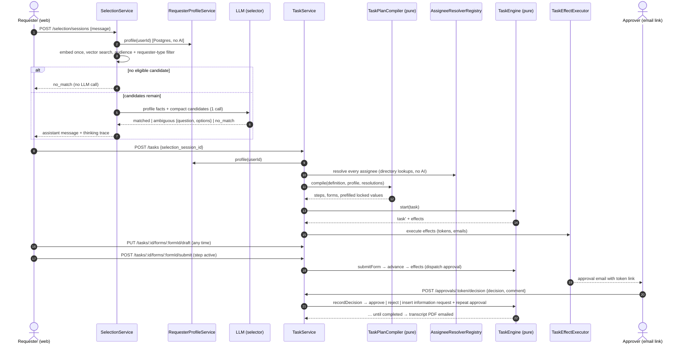

# Task Request Revamp — Phase Plan

This plan rebuilds the requester journey end to end, on top of the revamped workflow templates and the organisational structure (faculties, departments, divisions, designations, user affiliations):

1. **Assistant chat.** The requester describes a need in a chat UI modelled on modern generative-AI apps. The assistant uses the requester's affiliations to pick the right published workflow template, often with no clarifying question at all. When a template matches, it posts a result card with **Start task** and **More information** buttons.
2. **Ephemeral conversation.** The chat is held in a short-lived selection session, never in the user's history. It is copied into the task only when the requester starts the task.
3. **Task planning.** Starting a task compiles a complete, stored plan from the version-pinned workflow definition: ordered steps, a form for every information-gathering step, approvers resolved from the directory, and values prefilled from the requester's profile. Prefilled values are locked. Anything the system cannot know is left for the requester to fill in.
4. **Forms instead of popups.** Each information-gathering step has its own dynamic form, which replaces the old one-question-at-a-time popup. A form can be saved as a draft at any time, even for a step that has not started yet. It is submitted when its step is reached.
5. **Approvals with three outcomes.** An approver can **approve**, **reject** or **request more information**, each with a comment. Requesting more information inserts an *information request* step, followed by a repeat of the same approval.
6. **Transcript PDF.** When the task completes, a transcript PDF is rendered on demand, emailed to the requester and downloadable. It is never stored.

Each phase can be built on its own by an agent that first reads **§1 Ground rules**, **§2 Architecture**, **§3 Decisions** and **§4 Contracts**, then its own phase section. Every phase must leave `npm run typecheck && npm test` green in each app it touches, plus `npm run lint` in the web app. **Stop after each phase, run its verification block, then move on.**

> **Status (2026-11-13):** implemented, Phases 1–14. The reference screenshots live in `docs/UI/`. They are inspiration, not pixel specs: the dashboard shell, tokens and primitives built for the workflow template and user screens win wherever the two differ.
>
> **Refinements made during the build** (the contracts in §4 still hold unless noted):
>
> - **API.** `TaskTransitionService` (`task-transition.service.ts`) holds the shared "build the engine context, commit with the revision, then run the effects" sequence used by `TaskService`, `TaskFormService` and `ApprovalService`. `AssigneeResolutionService` drives the resolver registry for `TaskPlanService`. Extra pure helpers: `utils/task/task-view.util.ts` (computed values for views), `task-assignee-binding.util.ts`, `task-condition-namespace.util.ts` and `task-field-format.util.ts`. The selector's response schema is `data/schemas/selection-decision.schema.ts`; transcript labels live in `data/constants/transcript.constant.ts`. The approver view's `{ label, value }` pairs are named `ApproverLabelledValueDto` on both sides. The selector's `502` keeps the class code `SELECTION_ERROR` on `SelectionError`, and is raised as `SELECTION_FAILED` through `selection-session.error.ts`.
> - **Web, Phases 8–11.** The three badge wrappers live in one module, `shared/TaskStatusBadges.tsx`. `TaskStepPanel` renders `ApproverCard` directly instead of a separate `ApprovalStepPanel`. Extra modules: `lib/task-request/task-step-context.ts` (who requested an inserted step), `task-field-format.ts`, `task-request-menu-items.ts`, `lib/hooks/useStartTaskRequest.ts`, `forms/TaskFormEditor.tsx`, `shared/TaskRequestActionDialog.tsx`, `lib/api/http-status.ts` and `lib/utils/download.ts`.
> - **Web, Phase 12.** The decision rules (order, button variants, explanations, comment validation) live in `lib/task-request/approver-decision.ts` (tested). `ApproverDecisionDialog` composes `ConfirmDialog` rather than a second `<dialog>`. `ApproverHistory` sits in the left column between the summary and the decision panel. `ApproverSection.tsx` holds the shared section heading and definition list, and `ApprovalLinkUnavailable.tsx` renders both the invalid (404, through `not-found.tsx`) and expired (410) states. After a decision the page calls `router.refresh()`; a `409 APPROVAL_ALREADY_DECIDED` refreshes and shows a notice.
> - **Web, Phase 13.** The hint and its badge presentation are one source of truth in `lib/workflow-template/assignee-source-hint.ts` (`assigneeSourceHintBadge`), used by both the badge component and `toFlowGraph`'s height estimate. Conditional steps (`ConditionNode`) carry the badge too. `WorkflowFlowchart` takes `designationCodes` as an optional prop, so the task plan drawer renders without hints.

---

## Table of contents

0. [Current state and gaps](#0-current-state-and-gaps)
1. [Ground rules for every phase](#1-ground-rules-for-every-phase)
2. [Architecture](#2-architecture)
3. [Decisions](#3-decisions)
4. [Contracts](#4-contracts)
5. [Phase map](#5-phase-map)
6. [Phase 1 — API foundations](#phase-1--api-foundations)
7. [Phase 2 — Workflow definition extensions and generation](#phase-2--workflow-definition-extensions-and-generation)
8. [Phase 3 — Requester profile and directory resolvers](#phase-3--requester-profile-and-directory-resolvers)
9. [Phase 4 — Selection revamp](#phase-4--selection-revamp)
10. [Phase 5 — Task plan compiler and engine](#phase-5--task-plan-compiler-and-engine)
11. [Phase 6 — Task persistence, services and HTTP API](#phase-6--task-persistence-services-and-http-api)
12. [Phase 7 — Approvals, notifications and transcript](#phase-7--approvals-notifications-and-transcript)
13. [Phase 8 — Web foundations](#phase-8--web-foundations)
14. [Phase 9 — New task request assistant UI](#phase-9--new-task-request-assistant-ui)
15. [Phase 10 — Task workspace UI](#phase-10--task-workspace-ui)
16. [Phase 11 — Task request list UI](#phase-11--task-request-list-ui)
17. [Phase 12 — Approver page revamp](#phase-12--approver-page-revamp)
18. [Phase 13 — Workflow template audience and approver hints](#phase-13--workflow-template-audience-and-approver-hints)
19. [Phase 14 — Documentation, Postman and final verification](#phase-14--documentation-postman-and-final-verification)
20. [Out of scope and follow-ups](#20-out-of-scope-and-follow-ups)
21. [Appendix A — End-to-end acceptance script](#appendix-a--end-to-end-acceptance-script)

---

## 0. Current state and gaps

Read this before changing anything. Every item is a fact from the current code, and each one is closed by a decision in §3.

| # | Today | Problem for the new feature | Closed by |
|---|---|---|---|
| G-1 | `SelectionService` retrieves top-K templates and asks the LLM, which knows nothing about the requester. Faculty-scoped siblings always trigger a "Which faculty?" round. | Extra rounds cost money and annoy the requester. Affiliations already answer that question. | D-3, D-4, D-5 |
| G-2 | `selection_sessions` are stored forever, have no owner and expose `/answer`, `/choose` and `/workflow-template` to any `task:create` holder. | The chat is supposed to be ephemeral. Today any user can drive any session. | D-7 |
| G-3 | `scope.applies_to.constraints` holds free text (`"faculty" equals "Information Technology"`), not unit codes. | It cannot be matched to affiliations without fuzzy guessing. | D-4 |
| G-4 | `PlannerService` flattens all inputs plus one `person` requirement per dynamic assignee into a single requirement list. The UI asks for them one at a time in a popup. | There is no notion of which step collects which input, and nothing is prefilled. | D-9, D-10, D-12 |
| G-5 | Approver name and email are typed by the requester. `requester_email` is a self-asserted input that the generation prompt forces into every workflow. | The directory now knows both the requester and most approvers. | D-11, D-13 |
| G-6 | `ExecutionService.advance` moves **every** ready step to `pending_approval` and issues a token, whatever its type. `condition` is never evaluated, so the Dean step in the IT fixture always runs. | `data_collection` and `notification` steps would be emailed to approvers. Conditional steps show up wrongly on the step rail. | D-15, D-16 |
| G-7 | "Request more information" resets the step, appends a `followup:*` requirement and flips the task back to `collecting`. `finalize` detects a reopen through an audit entry. | The new flow needs a visible inserted step followed by a repeat approval. | D-17 |
| G-8 | `TaskDto` returns `steps[].approval_token` to the requester. | A requester could approve their own request through the API. | D-19 |
| G-9 | `CompletionDocumentService` already renders the PDF on demand and stores a metadata record with a hash. | Keep the renderer, but the content must reflect forms, inserted steps and comments. | D-21 |
| G-10 | The web `/dashboard/tasks*` and `/dashboard/approvals*` pages are empty stubs. The requester UI lives in `/old/portal` and `components/portal/*`, built on the old contracts. | The old portal cannot survive the contract change. | D-24 |
| G-11 | `Topbar` takes its title only from the active navigation item. | The task page must show the workflow title, as in the screenshot. | D-26 |

---

## 1. Ground rules for every phase

These rules are mandatory. They carry over §1 of `docs/organisational-structure-and-user-affiliations-phase-plan.md` and `docs/user-access-and-session-management-phase-plan.md`, and add the rules this change introduces.

### 1.1 Code standards (both apps)

| Rule | What it means here |
|---|---|
| **High standard, maintainable** | Small single-purpose modules. A function does one thing. A file holds one concept. If a component grows past one screen of JSX, split it. Pure logic (compiler, engine, eligibility, condition evaluation, form validation, conversation reducer) has no I/O and is unit-tested. |
| **SOLID and patterns where they earn their place** | **Strategy** for assignee resolution and form controls. **Registry** for resolvers keyed by resolution kind. **Pure engine plus effect executor** (Command) for task progression. **Decorator** for LLM usage logging. **Repository** for Postgres data, **Model** for Mongo data, as today. Depend on interfaces (`I*`) at service boundaries. Never add a pattern only to satisfy this row. |
| **Modular and reusable** | Every rule lives in exactly one place: eligibility, condition evaluation, field validation, step insertion, field ids, status labels. If you are about to copy logic, extract a util, hook or component instead. The API's field validator is the single source of field rules, and the web mirrors its **issue codes**, not its messages. |
| **Strict type safety** | No `any`. No unchecked `as` casts on request bodies, API payloads, Mongo documents or route params. Request input goes through validators that return typed values. Every exported function has explicit parameter and return types. Use discriminated unions wherever a shape depends on a kind: `TaskStepKind`, `FormFieldBinding`, `SelectionMessage`, `TaskEffect`. Use exhaustive `switch` with a `never` check. |
| **API ↔ web type consistency** | Every DTO in §4.5 has a hand-written mirror in `unblock-ai-web/src/types/`, with the same field names (snake_case) and the same enum values. Web enums use `enum` with identical string values, so a renamed value fails to compile on both sides. A DTO change updates its mirror in the same phase. |
| **No hardcoded strings** | Every fixed value is an `enum` or an `as const` object in a constants module: statuses, kinds, outcomes, error codes, issue codes, LLM operations, field namespaces, trace steps, route paths, icon names and query parameters. UI copy lives in typed copy modules. Labels for enum values are `Record<Enum, string>` maps, so adding an enum member fails to compile until it has a label. Never compare against a raw literal such as `"approved"`. Prompt text lives in `data/prompts/*.prompt.ts`. Email copy lives in `data/templates/*.template.ts`. |
| **Migrations are frozen** | Migration files use literal names and values and never import app enums. This is the only sanctioned exception to "no hardcoded strings". |
| **No unnecessary comments** | New code carries no comments, except a one-line *why* where the reason is truly non-obvious. Do not add JSDoc that restates a name. Do not strip existing comments from files you only touch lightly. Files this plan rewrites lose their obsolete comments. |
| **Naming** | Names must be unambiguous. API files follow `<name>.<kind>.ts` (`task-engine.service.ts`, `task-form.constant.ts`). Web files follow the existing convention: PascalCase components, kebab-case modules. Use British spelling (`organisation`, `normalise`), as the codebase does. The vocabulary is: *task request* (UI wording), *task* (code), *step*, *form*, *field*, *approval*, *decision*, *information request*, *requester*, *requester profile*, *assignee*, *selection session*, *transcript*. Never call an approver a *role*. The *role* word stays reserved for workflow actor roles. |
| **Best possible placement** | API: constants → `data/constants`, prompts → `data/prompts`, LLM response schemas → `data/schemas`, types → `lib/types/<domain>`, Postgres data → `repositories/<domain>-repository/` (four-file shape), Mongo data → `models/*.model.ts`, rules and orchestration → `services`, pure helpers → `utils/<domain>`, HTTP shaping → `utils/http/*-serializer.util.ts` and `*-request.util.ts`. Web: types → `src/types`, API calls → `src/lib/api`, pure logic → `src/lib/<feature>`, hooks → `src/lib/hooks`, components → `src/components/<feature>`. |
| **Narrow dependencies** | Services take only the collaborators and config slices they need, through an `*Options` object, as today. No service reads `config` from the module scope. `SelectionService` and `SelectorService` currently do, and they are fixed in Phase 4. |
| **JSON shape** | HTTP bodies use `snake_case`. Postgres-side TypeScript internals use `camelCase`, as today. Mongo documents keep `snake_case`, as today. Serializers convert to DTOs, and DTOs never expose Mongo `ObjectId`, `Date` or secrets. |
| **Rules first in services** | Every business rule is enforced in a service or a pure util, so in-memory repositories and `mongodb-memory-server` tests get the same coverage. |

### 1.2 AI usage rules (API)

The project's budget is limited. These rules are part of the design, not optimisations to add later.

| Rule | What it means here |
|---|---|
| **AI only where judgement is needed** | Only two operations call an LLM: **workflow selection**, which is per requester message, and **workflow template generation**, which is per admin generate. Everything else is deterministic: eligibility, approver lookup, prefill, form layout, the "More information" overview, the thinking trace, every chat message the assistant shows, condition evaluation, notifications and the PDF. |
| **Push knowledge to generation time** | Anything that is the same for every requester of a template version is decided once, when the version is generated: audience units, approver designation codes, which step collects which input. That is one call per template version, never one per task. |
| **Skip the call when the answer is known** | No eligible candidates means no LLM call. A finished round budget falls back to a manual choice list with no LLM call. Clarification turns reuse the frozen candidate set, so there is no second embedding. Picking from the capabilities list or the manual choice list never calls the LLM. |
| **Small prompts, small outputs** | Candidates are rendered compactly and capped at `RETRIEVAL_TOP_K`. The requester profile is rendered as numbered facts. The selector's output is a small JSON object with ids, not prose. All user-facing assistant text is composed from typed data by the web app. |
| **Stable prefix** | System prompts are static constants placed first. Dynamic content goes last, so provider-side prompt caching can apply. |
| **Right-sized model** | Each LLM operation can use its own model through `LLM_SELECTION_MODEL` (optional). Selection can then run on a smaller model than generation. |
| **Observable spend** | Every LLM call carries an `LlmOperation` label. The `UsageLoggingLlmAdapter` decorator logs token usage per operation, so costs can be measured. |

### 1.3 UI and UX standards (web)

All of §1.2 of the organisational-structure plan applies: design tokens only, the typography rhythm, every state designed, feedback, no lost work, keyboard and screen-reader first, responsive, shareable state and destructive-action rules. In addition:

| Rule | What it means here |
|---|---|
| **Consistent with workflow template and user screens** | Reuse `Card`, `Badge`, `Button`, `ButtonLink`, `Drawer`, `ConfirmDialog`, `FormField`, `TextInput`, `TextArea`, `Select`, `Switch`, `Table`, `Menu`, `SegmentedControl`, `SearchInput`, `Pagination`, `Skeleton`, `EmptyState`, `InlineAlert`, `Notice`, `Toast`, `Stepper`, `UnsavedChangesBar`, `LeavePageDialog` and `WorkspacePanel` patterns. Section headings use the same small uppercase label style as `WorkspacePanel` (`text-[11px] font-bold uppercase tracking-[.07em] text-muted`). |
| **Screenshots are inspiration** | Take from them the layout ideas: a centred greeting with a sparkle mark, right-aligned requester bubbles with an avatar, assistant messages with the sparkle mark, a **Show thinking** disclosure, a match card with action chips, a composer with a **What is this?** chip and a disclaimer, a two-column task workspace with a vertical step rail and a **View detailed plan** button, a two-column form with locked grey fields, and an approver card with a decision badge. Render them with the existing tokens and primitives. |
| **Assistant feels alive, cheaply** | Show a typing indicator while a request is in flight. Reveal the thinking trace entries one by one with a short CSS stagger. Auto-scroll the thread. Keep focus in the composer after sending. None of this needs streaming. |
| **Chat log semantics** | The thread is `role="log"` with `aria-live="polite"`. Option chips are buttons. The composer sends on Enter and inserts a newline on Shift+Enter. |
| **Locked means visibly locked** | A prefilled, non-editable field renders as a read-only control on the `bg-bg` surface, with a lock icon and an `aria-describedby` hint explaining where the value came from. |

### 1.4 Process rules

- API commands run from `unblock-ai-api/` and web commands from `unblock-ai-web/`.
- The web app runs **Next.js 16**. Before writing any web code, read `unblock-ai-web/AGENTS.md` and the relevant guides in `unblock-ai-web/node_modules/next/dist/docs/`. Pay particular attention to dynamic route `params` (a `Promise`), `PageProps`/`LayoutProps` globals, `useSearchParams` and `proxy.ts`.
- Do not edit already-applied migrations. Create new ones with `npm run migrate:mongo:create -- <name>` and `npm run migrate:pg:create -- <name>`.
- Do not commit unless asked.
- **A phase that changes a signature updates every call site in the same phase**, including `server.ts`, `tests/helpers/*`, `tests/perf/*`, `tests/evaluation/*`, `tests/live/*` and `tests/smoke/*`, so its typecheck gate can pass.
- This plan **overrides** the earlier "do not touch `src/app/old/**`" rule for `src/app/old/portal/**` only. Phase 8 deletes the old requester portal, because the contracts it calls are retired. `src/app/old/account/**` stays untouched.
- Phases 1–7 change API contracts that the web app does not consume until Phase 8. Between those points the web app still compiles against its old mirrors. That is expected, and the old portal stays broken at runtime until Phase 8 removes it.

---

## 2. Architecture

### 2.1 End-to-end flow



### 2.2 Layering (API)

```
routes/selection.route.ts ──> controllers/selection.controller.ts ──> services/selection.service.ts ─┬─> services/requester-profile.service.ts ──> repositories (user, user-affiliation, organisational-unit, designation)
                                                                                                    ├─> services/retrieval.service.ts ──> vector store
                                                                                                    ├─> services/selector.service.ts ──> ILlmAdapter (operation: workflow_selection)
                                                                                                    └─> models/selection-session.model.ts (TTL)

routes/task.route.ts ──> controllers/task.controller.ts ──> services/task.service.ts ─┬─> services/task-plan.service.ts ─┬─> utils/task/task-plan-compiler.util.ts (pure)
                                                                                      │                                └─> services/assignee-resolution/* (strategies + registry)
                                                         controllers/task-form.controller.ts ──> services/task-form.service.ts
                                                                                      ├─> services/task-engine.service.ts (pure)
                                                                                      ├─> services/task-effect-executor.service.ts ──> notification.service.ts, approval tokens
                                                                                      └─> models/task.model.ts (optimistic revision)

routes/approval.route.ts ──> controllers/approval.controller.ts ──> services/approval.service.ts ──> task-engine + task-effect-executor
                                                                    services/task-transcript.service.ts ──> utils/document/task-transcript.util.ts ──> IDocumentRenderer (pdf)
```

| Service | Responsibility |
|---|---|
| `RequesterProfileService` | Builds a `RequesterProfile` (user, memberships, designations, effective faculties, derived actor types and numbered profile facts) from the Postgres repositories. No AI. |
| `OrganisationCatalogueService` | Returns a snapshot of active units and designations, for prompts, validation and resolvers. |
| `SelectionService` | Owns the ephemeral conversation: retrieval once, deterministic eligibility, selector call, round budget, manual choice, catalogue, and session expiry. |
| `SelectorService` | One structured-output LLM call. Sanitises ids and matched facts. |
| `TaskPlanService` | Loads the pinned definition, resolves assignees through the registry, and calls the pure compiler. |
| `TaskEngineService` | A pure state machine: activation, conditions, approvals, information requests, termination and completion. It returns `TaskEffect[]` and never does I/O. |
| `TaskEffectExecutorService` | Executes effects after a successful write: issues approval tokens (hash stored), sends emails and stamps `notified_at`. Never throws into the caller. |
| `TaskService` | Create, read, list, cancel and delete tasks. Persists with an optimistic revision. |
| `TaskFormService` | Saves drafts and submits forms. Delegates field rules to `task-field-validator.util.ts`. |
| `ApprovalService` | Builds the token-based approver view and records decisions with comments. |
| `TaskTranscriptService` | Builds the transcript model and renders it to PDF on demand. |

### 2.3 Web architecture

```
app/dashboard/tasks/new/page.tsx            → TaskRequestAssistantScreen
app/dashboard/tasks/page.tsx                → TaskRequestsScreen
app/dashboard/tasks/[taskId]/page.tsx       → TaskWorkspaceScreen (?step=<stepId>)
app/approvals/[token]/page.tsx              → ApproverView (no shell)
        │
        ▼
components/task-requests/{assistant,workspace,forms,list,shared}/*  ──> lib/hooks/use*.ts (SWR)  ──> lib/api/{selection,tasks,approvals}.ts ──> lib/api/client.ts
        │
        └─> lib/task-request/*  (pure, unit-tested: conversation reducer, form draft reducer, field issue messages, status presentation, trace and fact messages, progress)
```

### 2.4 Where AI is spent

| Operation | Trigger | Embedding calls | LLM calls |
|---|---|---|---|
| Template generation | Admin presses **Generate** | 1 (retrieval text) | 1 to `WORKFLOW_TEMPLATE_GENERATION_MAX_ATTEMPTS` |
| Selection, first message | Requester sends the first message of a session | 1 | 0 if no eligible candidate, otherwise 1 |
| Selection, clarification answer | Requester answers an assistant question | 0 (frozen candidates) | 1, or 0 once the round budget is spent |
| Selection, message after a match | Requester types "Start the task" or refines the request | 0 (frozen candidates) | 1 |
| Selection, message after no match | Requester rephrases | 1 | 0 or 1 |
| Selection, choose from list | Manual choice or capabilities drawer | 0 | 0 |
| Task creation, forms, approvals, transcript | — | 0 | 0 |

---

## 3. Decisions

These are settled. Do not reopen them while implementing.

| # | Decision |
|---|---|
| D-1 | **Per-requester AI is limited to workflow selection.** Approver lookup, prefill, form layout, step overview, thinking trace, assistant wording, conditions and the PDF are deterministic. The requested *"targeted tools that fetch details and send them back to the AI"* are implemented as a **registry of deterministic resolvers** that the backend executes. The AI's part, knowing which unit codes and designation codes a template refers to, happens once per template version, at generation time (D-4, D-13). This is a deliberate change from an LLM tool-calling loop. It costs nothing per task, it cannot hallucinate an approver, and it is testable. |
| D-2 | **The requester profile is derived, never asked for.** `RequesterProfileService` reads the user, their memberships, designations and effective faculties. Requester actor types are derived from designation categories (`REQUESTER_ACTOR_TYPES_BY_DESIGNATION_CATEGORY`, §4.1). A user with no designations has unknown actor types, and the actor-type filter is then skipped for them. |
| D-3 | **Eligibility is deterministic and runs before the LLM.** A candidate is excluded when (a) its `scope.applies_to.organisational_unit_codes` is non-empty and none of the requester's units match, or (b) its `scope.applies_to.actor_type` is not `any` or `external` and the requester's known actor types do not include it. A requester's unit matches an audience code when it **is** that unit or its **parent** is that unit, so a department member matches its faculty's audience. Excluded candidates are reported in the thinking trace, never sent to the LLM. |
| D-4 | **Audience becomes structured at generation time.** The schema gains `scope.applies_to.organisational_unit_codes: string[]`. The generation prompt receives the live catalogue of active unit codes and names. Validation rejects unknown or archived codes, so the existing self-repair loop fixes them. `constraints` stays for non-unit attributes such as `level`, and the selector reads them. Versions generated before this change normalise to `[]`, which means open to all, and the selector then judges fit from the profile facts. |
| D-5 | **The selector sees the requester.** Its prompt receives numbered profile facts (`P1: Member of Department of Information Technology (Faculty of Information Technology)`, `P2: Holds Student in Department of Information Technology`) and each candidate's audience by name. It returns `matched_fact_ids`, a subset of the given ids, which the UI renders as "Details of your profile used". `reasoning` stays log-only. The prompt instructs the selector never to ask about something a fact already answers. |
| D-6 | **Assistant text is composed by the web app from typed data.** The API returns decision kinds, ids, question text, options, a match summary, a workflow overview and trace entries. The web app renders all wording from copy modules. The only free text from the LLM shown to users is the clarifying `question` and its `options`, which must be specific to the candidates. |
| D-7 | **The selection session is ephemeral and owned.** `selection_sessions` documents carry `created_by` and `expires_at` (`SELECTION_SESSION_TTL_HOURS`, default 24) with a Mongo TTL index. Only the owner may read or continue a session (404 otherwise). Starting a task copies the requester and assistant messages into `task.conversation` and deletes the session. An abandoned chat simply expires. The candidate set is frozen on the first retrieval and reused for clarification turns. A requester message after a `matched` decision also reuses the frozen candidates, with no embedding. The selector may then return `start_requested` when the requester confirms they want to start (for example, typing "Start the task", as in the screenshot), and the web app turns that into `POST /tasks`. It may also return `matched` (the same or another candidate), `ambiguous` or `no_match`. A requester message after a `no_match` re-runs retrieval on all requester messages joined together. |
| D-8 | **Capabilities without AI.** `GET /selection/catalogue` lists the published, non-archived templates the requester is eligible for (D-3). It reads the stored scopes and calls no embedding and no LLM. The web **See what Unblock can do** drawer uses it, and starting from it creates a task directly (`creation_source: catalogue`). |
| D-9 | **Inputs belong to form steps.** The schema gains `steps[].collects_inputs: string[]`. Only `data_collection` steps whose assignee is the requester may list input ids. Each requester input appears in at most one step. Inputs not listed anywhere are collected by a synthesised **entry form** step (`origin: entry_form`), placed before every workflow step that has no dependency. So a legacy definition, where every list is empty, compiles into "one entry form, then the workflow". |
| D-10 | **One stored form per form step, built at task creation.** The compiler maps each input type to a form control (`FORM_CONTROL_BY_INPUT_TYPE`) and a width (`FORM_FIELD_WIDTH_BY_CONTROL`: text areas full width, everything else half). The entry form also gets a locked **Your details** section (name, email, faculty, department, division from the profile) and, when needed, an **Approver details** section (D-12). `file` inputs are not collected in this release: they are left out of forms and listed in `task.unsupported_inputs`, which the UI shows as a notice. `enum` inputs have no options in the schema, so they render as text. |
| D-11 | **Requester identity comes from the account.** Name and email come from `UserRecord` and are locked. The generation prompt drops the mandatory `requester_email` input and tells the model never to create inputs for the requester's name, email, faculty, department, division or designations, but to reference `requester.<attribute>` instead. For legacy definitions, `REQUESTER_ATTRIBUTE_INPUT_ALIASES` maps well-known input ids (`full_name`, `requester_email`, `email`, `faculty`, `department`, …) onto profile attributes. Those inputs are prefilled and locked. Index number, phone number, batch and degree programme are **not** in the data model, so the requester fills them in. No new user fields are invented. |
| D-12 | **Assignee resolution precedence.** It is decided per workflow step by `AssigneeResolverRegistry`, keyed by `ActorResolution`. For `dynamic` and `static` actors: (1) if `role` equals an active designation code, look up holders in the **context units**, which are the requester's units (plus effective faculties) narrowed to the template audience (or all of the requester's units when the audience is empty), filtered to the designation's applicable unit types. For `static` actors, and for designations held only at university level, the context is every unit. (2) Exactly one holder who is not the requester → `resolved` (locked, `source: directory`). (3) More than one holder → `requester_choice`: a select field listing exactly those holders. The holders are stored on the assignee as `candidates`, so the pure engine can bind the chosen user id to a name and email without I/O. (4) No holder → retry with `fallback_role` if it is also a designation code. Otherwise → `requester_supplied`. (5) A role that is not a designation code → `requester_supplied` (a person field, name plus email), and **`fallback_role` is not used**, because the system lacks that data rather than finding the post vacant. Example: `academic_advisor` until that feature exists. (6) A holder who is the requester is skipped, the same as a vacancy. `requester` actors resolve to the requester. `system` actors resolve to the system. Approver details collected from the requester live in the entry form's **Approver details** section. |
| D-13 | **Approver roles become designation codes at generation time.** The generation prompt's role vocabulary is the live designation catalogue (`code — title — unit types`) followed by the static `SUGGESTED_ROLES` for roles the directory does not model. The organisational-structure plan (D-9) already aligned designation codes with role slugs, so most roles resolve with no mapping layer. |
| D-14 | **Task and step state model** (§4.1). Task status: `in_progress`, `completed`, `rejected` or `cancelled`. The old `collecting` and `ready` statuses disappear: a task starts the moment it is created, and its first active step is usually the entry form. Step status: `upcoming`, `awaiting_requester`, `awaiting_approver`, `completed`, `skipped` or `cancelled`. Step outcome: `completed`, `approved`, `rejected`, `request_more_info` or `skipped`. The UI's "Step n of N" counts steps that are not `skipped` and not `cancelled`. |
| D-15 | **The engine branches on step kind.** A `form` or `information_request` step becomes `awaiting_requester`. An `approval` (and a `review`) step becomes `awaiting_approver` and emits `DISPATCH_APPROVAL`. A `notification` step completes immediately and emits `SEND_STEP_NOTIFICATION`. An `automated_action` step completes immediately. A dependency on a non-approval step is satisfied by outcome `completed`, whatever `required_outcome` the generator wrote. A `skipped` dependency counts as satisfied. **Dead ends end the task.** If advancing reaches a fixpoint with no active step and the completion rule is unmet, the task ends: as `rejected` when any step has outcome `rejected` (the latest one drives `NOTIFY_TASK_REJECTED`), otherwise as `cancelled` with a warning log. Upcoming steps become `cancelled`, and `REVOKE_APPROVAL_LINKS` is emitted. A task can never sit `in_progress` with nothing to wait for. |
| D-16 | **Conditions are evaluated** when a step's dependencies are satisfied. The namespace holds `inputs.*`, `computed.*` (through the existing computed evaluator), `requester.*`, `steps.<id>.outcome` and `system.today`. `false` → `skipped`. A condition that cannot be evaluated yet, because a value is missing, runs the step: the engine never skips on missing data. |
| D-17 | **Request for more information inserts steps.** It is a pure util: `insertInformationRequest(steps, approvalStepId, question)`. The approval instance completes with outcome `request_more_info`. A new `information_request` step is inserted right after it, holding one required text-area field labelled with the approver's comment. A repeat of the same approval (`origin: approval_repeat`, same `definition_step_id`, same assignee) is inserted after that and depends on the information request. Every step that depended on the original approval is **rewired** to depend on the repeat. The cap is `TASK_MAX_INFORMATION_REQUESTS_PER_STEP` (default 3) per definition step. When the cap is reached, the approver no longer sees the option. The `followup:*` requirement path, the `reopen_count` field and the audit-based reopen detection are deleted. |
| D-18 | **Drafts any time, submission when active.** A form that is not yet submitted can be saved at any task status except terminal, even when its step is `upcoming`. A draft save validates the type and format of each provided, non-empty value, and ignores `required`. A submit is allowed only while the form's step is `awaiting_requester`. It validates `required` plus cross-field rules against the task-wide value map. A submitted form is read-only. Locked fields can never be written. |
| D-19 | **Approval tokens are hashed and never leave the approver channel.** Only `sha256(token)` is stored (`approval.token_hash`). The raw token exists only in the email link. No requester DTO contains a token or a hash. Tokens are invalidated (hash cleared) on decision, cancel and expiry. |
| D-20 | **Decisions carry comments.** `COMMENT_REQUIRED_DECISIONS = [rejected, request_more_info]`. The comment is optional on `approved`. `approved` advances. `rejected` (an outcome action of `terminate_workflow`) ends the task as `rejected` and cancels the steps still open. `request_more_info` follows D-17. A step whose definition declares `request_more_info: null` does not offer it. |
| D-21 | **The transcript is rendered on demand, never stored.** `GET /tasks/:id/transcript` renders a PDF for a `completed` task from the task document and its version-pinned definition. The completion email attaches the same render. The `completion_document` metadata record and the drift check are removed. The audit log records `transcript_emailed`. The transcript holds: header, requester details, the original conversation (requester messages only), every submitted form section in step order, information request questions and answers, the approval trail (step, approver, designation, decision, comment, time), skipped steps marked "Not required", and computed values. |
| D-22 | **Optimistic concurrency on tasks.** Every task document has `revision: number`. Each write is `findOneAndReplace({ _id, revision })` with `revision + 1`. A lost race raises `409 TASK_REVISION_CONFLICT`. The web app refetches and shows a toast. This replaces `updateStepAndStatusIfUnused` and the other partial updates. |
| D-23 | **Clean break for stored tasks.** Two Mongo migrations (§4.7). Phase 4 drops old selection sessions and recreates the collection with a TTL index. Phase 6 renames `tasks` to `legacy_tasks` (kept for reference, never read) and creates a fresh `tasks` collection. There is no data migration: the old shape cannot express forms, inserted steps or resolved assignees. |
| D-24 | **The old requester portal is removed.** `src/app/old/portal/**`, `src/components/portal/**`, `useSelectionSession`, `useTaskCollection`, `lib/workflow/toPlanNodes.ts`, `lib/workflow/applyTaskProgress.ts` (and its test) and `RequesterActorType` usage in `lib/auth/session.ts` are deleted in Phase 8. The API's old endpoints (`/selection/sessions/:id/answer`, `/selection/sessions/:id/workflow-template`, `/tasks/:id/next`, `/values`, `/finalize`, `/start`, `/status`, `/document`, `PATCH /tasks/:id/status`) are removed in Phases 4 and 6. |
| D-25 | **Approvers keep the token-based page.** The `/approvals/[token]` page is rebuilt for the new view and decisions. Signed-in approval inboxes (`/dashboard/approvals*`) stay stubs. Assignees now carry `user_id`, so building those inboxes later is a straightforward follow-up (§20). **Superseded by [`approver-inbox-phase-plan.md`](approver-inbox-phase-plan.md)**: the inbox is built, and the token page stays as a second channel. |
| D-26 | **The topbar heading can be overridden by a screen.** `PageHeadingProvider` (mounted in the dashboard layout) and `usePageHeading({ title, description })` let `TaskWorkspaceScreen` show the workflow title and "Proceed with your task, step by step". Without an override, the topbar falls back to the navigation item, as today. |
| D-27 | **LLM operations are labelled and can be routed.** `LlmCompletionRequest` gains `operation: LlmOperation`. `createLlmAdapters(config)` returns a `Readonly<Record<LlmOperation, ILlmAdapter>>`. Every adapter is wrapped in `UsageLoggingLlmAdapter`. `LLM_SELECTION_MODEL` (optional) overrides the deployment or model for `workflow_selection`, and defaults to the main one. |
| D-28 | **No new Postgres tables.** The only Postgres change is the repository method `IUserAffiliationRepository.findDesignationHolders(designationId, organisationalUnitIds | null)`, with Postgres and in-memory implementations. A `null` unit list means every unit. |

---

## 4. Contracts

Every phase builds against these definitions. Phases reference this section instead of restating it. Names are final. A shape may gain a field during implementation only if this section is updated in the same phase.

### 4.1 API enums and constants (`unblock-ai-api/src/data/constants/`)

Maps keyed by an enum use computed `[Enum.MEMBER]` keys, as `ORGANISATIONAL_UNIT_HIERARCHY` does. Maps keyed by the workflow schema's string unions (`StepType`, `InputType`, `ActorType`) use literal keys, which `Record<Union, …>` checks exhaustively. Alias lists are data, not identifiers.

```ts
// task.constant.ts (new; replaces TASK_STATUS, STEP_STATE, STEP_OUTCOME, OUTCOME_ACTION, REQUIREMENT_STATUS and TASK_AUDIT_TYPE in status.constant.ts)
export enum TaskStatus { IN_PROGRESS = "in_progress", COMPLETED = "completed", REJECTED = "rejected", CANCELLED = "cancelled" }
export const TERMINAL_TASK_STATUSES: readonly TaskStatus[] = [TaskStatus.COMPLETED, TaskStatus.REJECTED, TaskStatus.CANCELLED];

export enum TaskStepKind {
  FORM = "form",
  APPROVAL = "approval",
  INFORMATION_REQUEST = "information_request",
  NOTIFICATION = "notification",
  AUTOMATED_ACTION = "automated_action",
}
export const TASK_STEP_KIND_BY_WORKFLOW_STEP_TYPE: Readonly<Record<StepType, TaskStepKind>> = {
  approval: TaskStepKind.APPROVAL,
  review: TaskStepKind.APPROVAL,
  data_collection: TaskStepKind.FORM,
  notification: TaskStepKind.NOTIFICATION,
  automated_action: TaskStepKind.AUTOMATED_ACTION,
};

export enum TaskStepOrigin { WORKFLOW = "workflow", ENTRY_FORM = "entry_form", INFORMATION_REQUEST = "information_request", APPROVAL_REPEAT = "approval_repeat" }

export enum TaskStepStatus {
  UPCOMING = "upcoming",
  AWAITING_REQUESTER = "awaiting_requester",
  AWAITING_APPROVER = "awaiting_approver",
  COMPLETED = "completed",
  SKIPPED = "skipped",
  CANCELLED = "cancelled",
}
export const ACTIVE_TASK_STEP_STATUSES: readonly TaskStepStatus[] = [TaskStepStatus.AWAITING_REQUESTER, TaskStepStatus.AWAITING_APPROVER];

export enum TaskStepOutcome { COMPLETED = "completed", APPROVED = "approved", REJECTED = "rejected", REQUEST_MORE_INFO = "request_more_info", SKIPPED = "skipped" }

export enum ApprovalDecision { APPROVED = "approved", REJECTED = "rejected", REQUEST_MORE_INFO = "request_more_info" }
export const APPROVAL_DECISIONS: readonly ApprovalDecision[] = Object.values(ApprovalDecision);
export const COMMENT_REQUIRED_DECISIONS: readonly ApprovalDecision[] = [ApprovalDecision.REJECTED, ApprovalDecision.REQUEST_MORE_INFO];

export enum TaskCreationSource { SELECTION_SESSION = "selection_session", CATALOGUE = "catalogue" }

export enum TaskAuditEvent {
  TASK_CREATED = "task_created",
  STEP_ACTIVATED = "step_activated",
  STEP_SKIPPED = "step_skipped",
  FORM_DRAFT_SAVED = "form_draft_saved",
  FORM_SUBMITTED = "form_submitted",
  APPROVAL_DISPATCHED = "approval_dispatched",
  DECISION_RECORDED = "decision_recorded",
  INFORMATION_REQUESTED = "information_requested",
  TASK_COMPLETED = "task_completed",
  TASK_REJECTED = "task_rejected",
  TASK_CANCELLED = "task_cancelled",
  TRANSCRIPT_EMAILED = "transcript_emailed",
}

export enum TaskEffectKind {
  DISPATCH_APPROVAL = "dispatch_approval",
  NOTIFY_REQUESTER_ACTION_REQUIRED = "notify_requester_action_required",
  NOTIFY_INFORMATION_REQUESTED = "notify_information_requested",
  SEND_STEP_NOTIFICATION = "send_step_notification",
  NOTIFY_TASK_REJECTED = "notify_task_rejected",
  NOTIFY_TASK_COMPLETED = "notify_task_completed",
  REVOKE_APPROVAL_LINKS = "revoke_approval_links",
}

export enum TaskValueNamespace { INPUTS = "inputs", REQUESTER = "requester", ASSIGNEES = "assignees", RESPONSES = "responses" }

export const TASK_FIELD_LIMIT = {
  TEXT_MAX_LENGTH: 5000,
  COMMENT_MAX_LENGTH: 2000,
  SEARCH_MAX_LENGTH: 200,
  LIST_DEFAULT_LIMIT: 20,
  LIST_MAX_LIMIT: 100,
} as const;
```

```ts
// task-form.constant.ts (new)
export enum TaskFormStatus { DRAFT = "draft", SUBMITTED = "submitted" }
export enum FormValidationMode { DRAFT = "draft", SUBMIT = "submit" }
export enum FormFieldControl { TEXT = "text", TEXTAREA = "textarea", NUMBER = "number", DATE = "date", DATETIME = "datetime", EMAIL = "email", PHONE = "phone", SWITCH = "switch", SELECT = "select", PERSON = "person" }
export enum FormFieldWidth { HALF = "half", FULL = "full" }
export enum FormFieldValueSource { REQUESTER = "requester", REQUESTER_PROFILE = "requester_profile", DIRECTORY = "directory" }
export enum FormFieldBindingKind { INPUT = "input", REQUESTER_ATTRIBUTE = "requester_attribute", ASSIGNEE = "assignee", INFORMATION_RESPONSE = "information_response" }
export enum FormSectionKind { REQUESTER_DETAILS = "requester_details", REQUEST_DETAILS = "request_details", APPROVER_DETAILS = "approver_details", INFORMATION_RESPONSE = "information_response" }

export type CollectableInputType = Exclude<InputType, "file">;
export const UNSUPPORTED_INPUT_TYPES: readonly InputType[] = ["file"];

export const FORM_CONTROL_BY_INPUT_TYPE: Readonly<Record<CollectableInputType, FormFieldControl>> = {
  string: FormFieldControl.TEXT,
  text: FormFieldControl.TEXTAREA,
  number: FormFieldControl.NUMBER,
  date: FormFieldControl.DATE,
  datetime: FormFieldControl.DATETIME,
  boolean: FormFieldControl.SWITCH,
  email: FormFieldControl.EMAIL,
  phone: FormFieldControl.PHONE,
  enum: FormFieldControl.TEXT,
  person: FormFieldControl.PERSON,
};

export const FORM_FIELD_WIDTH_BY_CONTROL: Readonly<Record<FormFieldControl, FormFieldWidth>> = {
  [FormFieldControl.TEXT]: FormFieldWidth.HALF,
  [FormFieldControl.NUMBER]: FormFieldWidth.HALF,
  [FormFieldControl.DATE]: FormFieldWidth.HALF,
  [FormFieldControl.DATETIME]: FormFieldWidth.HALF,
  [FormFieldControl.EMAIL]: FormFieldWidth.HALF,
  [FormFieldControl.PHONE]: FormFieldWidth.HALF,
  [FormFieldControl.SWITCH]: FormFieldWidth.HALF,
  [FormFieldControl.SELECT]: FormFieldWidth.HALF,
  [FormFieldControl.TEXTAREA]: FormFieldWidth.FULL,
  [FormFieldControl.PERSON]: FormFieldWidth.FULL,
};

export enum FormFieldIssueCode {
  REQUIRED = "required",
  UNKNOWN_FIELD = "unknown_field",
  LOCKED = "locked",
  INVALID_TYPE = "invalid_type",
  INVALID_EMAIL = "invalid_email",
  INVALID_DATE = "invalid_date",
  INVALID_PHONE = "invalid_phone",
  TOO_SHORT = "too_short",
  TOO_LONG = "too_long",
  BELOW_MINIMUM = "below_minimum",
  ABOVE_MAXIMUM = "above_maximum",
  BEFORE_EARLIEST_DATE = "before_earliest_date",
  AFTER_LATEST_DATE = "after_latest_date",
  PATTERN_MISMATCH = "pattern_mismatch",
  NOT_AN_OPTION = "not_an_option",
}

export const FORM_VALUE_PATTERN = {
  EMAIL: /^[^\s@]+@[^\s@]+\.[^\s@]+$/,
  DATE: /^\d{4}-\d{2}-\d{2}$/,
  DATETIME: /^\d{4}-\d{2}-\d{2}T\d{2}:\d{2}$/,
  PHONE: /^\+?[0-9][0-9 ()-]{6,19}$/,
} as const;

export const DATE_BOUND_TODAY = "today";
```

```ts
// requester.constant.ts (new)
export enum RequesterAttribute { FULL_NAME = "full_name", EMAIL = "email", FACULTY = "faculty", DEPARTMENT = "department", DIVISION = "division", DESIGNATIONS = "designations" }
export const REQUESTER_ATTRIBUTES: readonly RequesterAttribute[] = Object.values(RequesterAttribute);
export const REQUESTER_ATTRIBUTE_INPUT_ALIASES: Readonly<Record<RequesterAttribute, readonly string[]>> = {
  [RequesterAttribute.FULL_NAME]: ["full_name", "name", "requester_name", "student_name", "staff_name", "applicant_name"],
  [RequesterAttribute.EMAIL]: ["email", "requester_email", "email_address", "student_email", "staff_email", "contact_email"],
  [RequesterAttribute.FACULTY]: ["faculty", "faculty_name", "requester_faculty"],
  [RequesterAttribute.DEPARTMENT]: ["department", "department_name", "requester_department"],
  [RequesterAttribute.DIVISION]: ["division", "division_name", "requester_division"],
  [RequesterAttribute.DESIGNATIONS]: ["designation", "designations", "position", "job_title"],
};
export enum RequesterProfileFactKind { MEMBER_OF_UNIT = "member_of_unit", HOLDS_DESIGNATION = "holds_designation" }
export const REQUESTER_PROFILE_FACT_ID_PREFIX = "P";
export const REQUESTER_ACTOR_TYPES_BY_DESIGNATION_CATEGORY: Readonly<Record<DesignationCategory, readonly ActorType[]>> = {
  [DesignationCategory.LEADERSHIP]: ["faculty", "staff"],
  [DesignationCategory.ACADEMIC]: ["faculty", "staff"],
  [DesignationCategory.ACADEMIC_SUPPORT]: ["staff"],
  [DesignationCategory.ADMINISTRATIVE]: ["staff"],
  [DesignationCategory.NON_ACADEMIC]: ["staff"],
  [DesignationCategory.STUDENT]: ["student"],
};
export const UNFILTERED_SCOPE_ACTOR_TYPES: readonly ActorType[] = ["any", "external"];
```

```ts
// assignee.constant.ts (new)
export enum AssigneeSource { DIRECTORY = "directory", REQUESTER_CHOICE = "requester_choice", REQUESTER_SUPPLIED = "requester_supplied", REQUESTER = "requester", SYSTEM = "system" }
export enum AssigneeResolutionNote { NOT_A_DESIGNATION = "not_a_designation", NO_HOLDER = "no_holder", MULTIPLE_HOLDERS = "multiple_holders", HOLDER_IS_REQUESTER = "holder_is_requester", RESOLVED_BY_FALLBACK = "resolved_by_fallback" }
```

```ts
// selection.constant.ts (new; replaces SELECTION_DECISION and SESSION_OUTCOME in status.constant.ts)
export enum SelectionDecisionKind { MATCHED = "matched", AMBIGUOUS = "ambiguous", NO_MATCH = "no_match", MANUAL_CHOICE = "manual_choice", START_REQUESTED = "start_requested" }
export const SELECTOR_DECISION_KINDS = [SelectionDecisionKind.MATCHED, SelectionDecisionKind.AMBIGUOUS, SelectionDecisionKind.NO_MATCH, SelectionDecisionKind.START_REQUESTED] as const;
export enum SelectionSessionStatus { OPEN = "open", MATCHED = "matched", NO_MATCH = "no_match" }
export enum SelectionMessageRole { REQUESTER = "requester", ASSISTANT = "assistant" }
export enum SelectionTraceStep {
  PROFILE_READ = "profile_read",
  CANDIDATES_RETRIEVED = "candidates_retrieved",
  CANDIDATES_REUSED = "candidates_reused",
  EXCLUDED_BY_AUDIENCE = "excluded_by_audience",
  EXCLUDED_BY_REQUESTER_TYPE = "excluded_by_requester_type",
  SELECTOR_CONSULTED = "selector_consulted",
  SELECTOR_NOT_NEEDED = "selector_not_needed",
  ROUND_LIMIT_REACHED = "round_limit_reached",
}
export const SELECTION_FIELD_LIMIT = { MESSAGE_MAX_LENGTH: 1000, MESSAGES_PER_SESSION_MAX: 20 } as const;
```

```ts
// llm.constant.ts (modified)
export enum LlmOperation { WORKFLOW_TEMPLATE_GENERATION = "workflow_template_generation", WORKFLOW_SELECTION = "workflow_selection" }
export const LLM_OPERATIONS: readonly LlmOperation[] = Object.values(LlmOperation);

// collection.constant.ts (modified)
export const COLLECTIONS = { /* existing */ LEGACY_TASKS: "legacy_tasks" } as const;
```

`status.constant.ts` is deleted in Phase 6, once its last consumer has moved to the enums above.

**Configuration** (types in `lib/types/config/config.type.ts`, read only in `config/*.config.ts`, documented in `.example.env` and `docs/guides/configuration.md`):

| Env | Config path | Default | Phase |
|---|---|---|---|
| `LLM_SELECTION_MODEL` | `llm.operationModels.workflow_selection` | unset, which means the main model | 2 |
| `RETRIEVAL_MIN_SCORE` | `retrieval.minScore` | `0` (off). Calibrate per embedding provider with `npm run evaluate:selection`. | 4 |
| `SELECTION_SESSION_TTL_HOURS` | `selection.sessionTtlHours` | `24` | 4 |
| `SELECTION_MAX_ROUNDS` | moves from `retrieval` to `selection.maxRounds` | `2` | 4 |
| `TASK_MAX_INFORMATION_REQUESTS_PER_STEP` | `task.maxInformationRequestsPerStep` | `3` | 5 |

### 4.2 Error codes

Each code has a typed factory in `src/errors/<domain>.error.ts`, in the same way `workflow-template.error.ts` does today. Enums live in `selection-error.constant.ts`, `task-error.constant.ts` and `approval-error.constant.ts`. `WORKFLOW_TEMPLATE_NOT_ELIGIBLE` joins `workflow-template-error.constant.ts`.

| Code | HTTP | Raised when |
|---|---|---|
| `SELECTION_SESSION_NOT_FOUND` | 404 | Unknown, expired or not owned by the caller |
| `SELECTION_SESSION_LIMIT_REACHED` | 409 | `MESSAGES_PER_SESSION_MAX` reached. The UI offers **Start over**. |
| `SELECTION_OPTION_NOT_OFFERED` | 400 | `choose` with a template that is not an eligible candidate of the session |
| `SELECTION_SESSION_NOT_MATCHED` | 409 | `POST /tasks` from a session that has no matched template |
| `SELECTION_FAILED` | 502 | The selector call failed or returned an invalid shape (existing `SelectionError`) |
| `WORKFLOW_TEMPLATE_NOT_ELIGIBLE` | 403 | The requester is outside the template's audience or requester type |
| `TASK_NOT_FOUND` | 404 | Unknown task, or not owned by the caller |
| `TASK_NOT_ACTIVE` | 409 | A mutation on a terminal task |
| `TASK_NOT_DELETABLE` | 409 | Delete while in progress with a dispatched approval (existing rule) |
| `TASK_REVISION_CONFLICT` | 409 | Optimistic concurrency loss (D-22) |
| `TASK_FORM_NOT_FOUND` | 404 | Unknown form id on the task |
| `TASK_FORM_ALREADY_SUBMITTED` | 409 | Draft or submit on a submitted form |
| `TASK_FORM_NOT_AWAITING_INPUT` | 409 | Submit while the form's step is not `awaiting_requester` |
| `TASK_FORM_INVALID` | 400 | Field issues. `details.issues` is a `FormFieldIssueDto[]`. |
| `TASK_TRANSCRIPT_UNAVAILABLE` | 409 | Transcript requested for a task that is not completed, or rendering is disabled |
| `APPROVAL_LINK_INVALID` | 404 | Bad signature, unknown hash, or the step no longer holds that token |
| `APPROVAL_LINK_EXPIRED` | 410 | `token_expires_at` has passed |
| `APPROVAL_ALREADY_DECIDED` | 409 | The step already has a decision |
| `APPROVAL_DECISION_NOT_ALLOWED` | 400 | A decision the step does not offer, including `request_more_info` past the cap |
| `APPROVAL_COMMENT_REQUIRED` | 400 | A missing comment for a decision in `COMMENT_REQUIRED_DECISIONS` |

### 4.3 Workflow definition extensions

`workflow.schema.json` uses strict mode: every property must be present, and arrays are never null.

| Location | New property | Rule |
|---|---|---|
| `$defs.scope.properties.applies_to` | `organisational_unit_codes: string[]` (required) | Active unit codes from the catalogue. `[]` means open to all units. |
| `$defs.step` | `collects_inputs: string[]` (required) | Ids of the requester inputs this step gathers. Non-empty only on `data_collection` steps whose assignee resolution is `requester`. |

Mirror both in `lib/types/workflow/{workflow,step}.type.ts` (`WorkflowScopeAppliesTo.organisational_unit_codes`, `WorkflowStep.collects_inputs`) and in `unblock-ai-web/src/types/workflow.ts`.

New validation checks:

| Check | File | Catches |
|---|---|---|
| `checkCollectedInputs` | `utils/workflow/graph-validator.util.ts` | an unknown input id; a non-requester input; an input listed twice; a non-empty list on a step that is not a requester `data_collection` step |
| `checkRequesterPaths` (part of `checkNamespacePaths`) | `utils/workflow/graph-validator.util.ts` | `requester.<x>` where `x` is not a `RequesterAttribute` |
| `checkAudienceCodes` | `utils/workflow/catalogue-validator.util.ts` | an unknown or archived unit code in `organisational_unit_codes` |

`ValidationService.validate(definition, catalogue: OrganisationCatalogue)` runs these three checks plus the existing ones.

`utils/workflow/definition-normaliser.util.ts` exports `normaliseWorkflowDefinition(stored: StoredWorkflowDefinitionInput): StoredWorkflowDefinition`. It fills a missing `organisational_unit_codes` or `collects_inputs` with `[]`. `StoredWorkflowDefinitionInput` is the stored type with those two properties made optional, so legacy documents type-check without casts. `WorkflowTemplateVersionModel` returns `StoredWorkflowDefinitionInput`. `WorkflowTemplateService` normalises it before anything else sees it.

### 4.4 Domain types (`src/lib/types/`)

```ts
// requester/requester.type.ts
export interface RequesterUnit { unit: OrganisationalUnitReference; parent: OrganisationalUnitReference | null; designations: DesignationReference[] }
export interface RequesterProfileFact {
  id: string;
  kind: RequesterProfileFactKind;
  unit: OrganisationalUnitReference;
  parent: OrganisationalUnitReference | null;
  designation: DesignationReference | null;
}
export interface RequesterProfile {
  userId: string;
  fullName: string;
  email: string;
  units: RequesterUnit[];
  effectiveFaculties: OrganisationalUnitReference[];
  actorTypes: ActorType[];
  facts: RequesterProfileFact[];
}
export type RequesterAttributeValues = Readonly<Record<RequesterAttribute, string | null>>;
```

```ts
// organisation/organisation-catalogue.type.ts
export interface OrganisationCatalogue {
  units: OrganisationalUnitRecord[];
  designations: DesignationRecord[];
  unitsByCode: ReadonlyMap<string, OrganisationalUnitRecord>;
  designationsByCode: ReadonlyMap<string, DesignationRecord>;
}
```

```ts
// selection/eligibility.type.ts
export interface WorkflowTemplateAudience { actorType: ActorType; organisationalUnitCodes: string[] }
export type CandidateExclusion = SelectionTraceStep.EXCLUDED_BY_AUDIENCE | SelectionTraceStep.EXCLUDED_BY_REQUESTER_TYPE;
export type CandidateEligibility =
  | { eligible: true; matchedFactIds: string[] }
  | { eligible: false; exclusion: CandidateExclusion };
```

```ts
// selection/session.type.ts (rewritten)
export interface SelectionOption { id: string; label: string; workflow_template_id: string | null }
export interface SelectionTraceEntry { step: SelectionTraceStep; count: number; workflow_template_titles: string[] }
export interface RequesterSelectionMessage { id: string; role: SelectionMessageRole.REQUESTER; text: string; sent_at: Date }
export interface AssistantSelectionMessage {
  id: string;
  role: SelectionMessageRole.ASSISTANT;
  decision: SelectionDecisionKind;
  workflow_template_id: string | null;
  question: string | null;
  options: SelectionOption[];
  matched_fact_ids: string[];
  trace: SelectionTraceEntry[];
  sent_at: Date;
}
export type SelectionMessage = RequesterSelectionMessage | AssistantSelectionMessage;
export interface SessionCandidate {
  workflow_template_id: string;
  workflow_template_version: number;
  title: string;
  score: number;
  alias_hits: string[];
  retrieval_summary: RetrievalSummary;
  audience: { actor_type: ActorType; organisational_unit_codes: string[] };
  matched_fact_ids: string[];
}
export interface SelectionSessionDocument {
  _id: ObjectId;
  created_by: string;
  status: SelectionSessionStatus;
  messages: SelectionMessage[];
  candidates: SessionCandidate[];
  rounds_used: number;
  selected_workflow_template_id: string | null;
  expires_at: Date;
  created_at: Date;
  updated_at: Date;
}
```

**File placement for the task types.** The old `task/task.type.ts` and `task/requirement.type.ts` stay until Phase 6 swaps the task backend. So the new types live in new files, which are **not** added to `lib/types/task/index.type.ts` until Phase 6. Until then, import them by direct path, so the barrel never exports two `TaskDocument`s.

| File | Phase | Holds |
|---|---|---|
| `task/task-value.type.ts` | 1 | `PersonValue`, `TaskFieldValue` |
| `task/task-form.type.ts` | 1 | `FormFieldBinding`, `FormFieldOption`, `TaskFormField`, `TaskFormSection`, `TaskFormRecord`, `FormFieldIssue`, `FormValuesInput` |
| `task/task-document.type.ts` | 5 | `RequesterSnapshot`, `TaskAssignee`, `TaskStepDependency`, `TaskApprovalRecord`, `InformationRequestRecord`, `TaskStepRecord`, `TaskConversationMessage`, `TaskAuditEntry`, `UnsupportedTaskInput`, `TaskDocument` |
| `task/task-engine.type.ts`, `task/task-plan.type.ts` | 5 | engine and plan types |
| `task/task-dto.type.ts` | 6 | the task DTOs of §4.5 |

```ts
// task/task-value.type.ts, task/task-form.type.ts, task/task-document.type.ts
export interface PersonValue { user_id: string | null; name: string; email: string }
export type TaskFieldValue = string | number | boolean | PersonValue | null;

export interface RequesterSnapshot {
  user_id: string;
  full_name: string;
  email: string;
  units: Array<{ id: string; code: string; name: string; unit_type: OrganisationalUnitType; parent_name: string | null; designation_titles: string[] }>;
}

export interface TaskAssignee {
  source: AssigneeSource;
  user_id: string | null;
  full_name: string | null;
  email: string | null;
  designation_title: string | null;
  organisational_unit_name: string | null;
  field_id: string | null;
  note: AssigneeResolutionNote | null;
  candidates: PersonValue[];
}

export interface TaskStepDependency { step_id: string; required_outcome: TaskStepOutcome }

export interface TaskApprovalRecord {
  token_hash: string | null;
  token_expires_at: Date | null;
  notified_at: Date | null;
  decision: ApprovalDecision | null;
  comment: string | null;
  decided_at: Date | null;
  allows_information_request: boolean;
  terminates_on_rejection: boolean;
}

export interface InformationRequestRecord { requested_by_step_id: string; question: string; response_field_id: string }

export interface TaskStepRecord {
  id: string;
  definition_step_id: string | null;
  kind: TaskStepKind;
  origin: TaskStepOrigin;
  name: string;
  description: string | null;
  instructions_to_approver: string | null;
  depends_on: TaskStepDependency[];
  condition: Condition | null;
  status: TaskStepStatus;
  outcome: TaskStepOutcome | null;
  form_id: string | null;
  assignee: TaskAssignee | null;
  approval: TaskApprovalRecord | null;
  information_request: InformationRequestRecord | null;
  activated_at: Date | null;
  completed_at: Date | null;
}

export type FormFieldBinding =
  | { kind: FormFieldBindingKind.INPUT; input_id: string }
  | { kind: FormFieldBindingKind.REQUESTER_ATTRIBUTE; attribute: RequesterAttribute }
  | { kind: FormFieldBindingKind.ASSIGNEE; step_id: string }
  | { kind: FormFieldBindingKind.INFORMATION_RESPONSE; step_id: string };

export interface FormFieldOption { value: string; label: string; description: string | null }

export interface TaskFormField {
  id: string;
  label: string;
  description: string | null;
  control: FormFieldControl;
  width: FormFieldWidth;
  required: boolean;
  locked: boolean;
  value_source: FormFieldValueSource;
  validation: InputValidation | null;
  options: FormFieldOption[];
  binding: FormFieldBinding;
}

export interface TaskFormSection { id: string; kind: FormSectionKind; title: string; fields: TaskFormField[] }

export interface TaskFormRecord {
  id: string;
  step_id: string;
  title: string;
  status: TaskFormStatus;
  sections: TaskFormSection[];
  saved_at: Date | null;
  submitted_at: Date | null;
}

export interface TaskConversationMessage { role: SelectionMessageRole; text: string; sent_at: Date }
export interface TaskAuditEntry { event: TaskAuditEvent; step_id: string | null; detail: string | null; created_at: Date }
export interface UnsupportedTaskInput { input_id: string; label: string }

export interface TaskDocument {
  _id: ObjectId;
  reference: string;
  revision: number;
  created_by: string;
  requester: RequesterSnapshot;
  workflow_template_id: string;
  workflow_template_version: number;
  title: string;
  status: TaskStatus;
  creation_source: TaskCreationSource;
  conversation: TaskConversationMessage[];
  steps: TaskStepRecord[];
  forms: TaskFormRecord[];
  values: Record<string, TaskFieldValue>;
  unsupported_inputs: UnsupportedTaskInput[];
  audit: TaskAuditEntry[];
  created_at: Date;
  updated_at: Date;
  completed_at: Date | null;
}
```

**Assignee field values.** A `PERSON` field (`REQUESTER_SUPPLIED`) stores a `PersonValue` with `user_id: null`. A `SELECT` field (`REQUESTER_CHOICE`) stores the chosen holder's user id as a string. `NOT_AN_OPTION` validation and `applyAssigneeFieldValues` both read the step's `assignee.candidates`. `candidates` is `[]` for every other source and is never serialised to the requester (the options already carry names).

**Ids.** Field ids are namespace paths, built only by `utils/task/task-field-id.util.ts`: `inputs.<input_id>`, `requester.<attribute>`, `assignees.<step_id>` and `responses.<step_id>`. `values` is keyed by field id, so the condition evaluator and `not_before_field: "inputs.departure_date"` read it directly. Step ids are built only by `utils/task/task-step-id.util.ts`: the definition step id for the first instance, `entry_form` for the synthesised entry form, `<definition_step_id>__information_request_<n>` and `<definition_step_id>__repeat_<n>`. Form ids are `<step_id>__form`. The separators and fixed ids are constants in `task.constant.ts`.

**Order.** `steps` is stored in display order. Insertions (D-17) splice into that array. The DTO's `position` is the 1-based array index.

```ts
// task/task-engine.type.ts
export type TaskEffect =
  | { kind: TaskEffectKind.DISPATCH_APPROVAL; step_id: string }
  | { kind: TaskEffectKind.NOTIFY_REQUESTER_ACTION_REQUIRED; step_id: string }
  | { kind: TaskEffectKind.NOTIFY_INFORMATION_REQUESTED; step_id: string }
  | { kind: TaskEffectKind.SEND_STEP_NOTIFICATION; step_id: string }
  | { kind: TaskEffectKind.NOTIFY_TASK_REJECTED; step_id: string }
  | { kind: TaskEffectKind.NOTIFY_TASK_COMPLETED }
  | { kind: TaskEffectKind.REVOKE_APPROVAL_LINKS };
export interface TaskEngineContext { definition: WorkflowDefinition; now: Date; maxInformationRequestsPerStep: number }
export interface TaskEngineResult { task: TaskDocument; effects: TaskEffect[] }
```

```ts
// task/task-plan.type.ts
export interface AssigneeResolution { step_id: string; assignee: TaskAssignee; options: FormFieldOption[] }
export interface TaskPlanInput { definition: WorkflowDefinition; profile: RequesterProfile; resolutions: AssigneeResolution[] }
export interface CompiledTaskPlan { steps: TaskStepRecord[]; forms: TaskFormRecord[]; values: Record<string, TaskFieldValue>; unsupported_inputs: UnsupportedTaskInput[] }

// task/task-form.type.ts
export interface FormFieldIssue { field_id: string; code: FormFieldIssueCode; limit: string | number | null }
export type FormValuesInput = Readonly<Record<string, unknown>>;
```

```ts
// assignee/assignee-resolver.type.ts
export interface AssigneeResolverContext { actor: Actor; stepId: string; profile: RequesterProfile; audience: WorkflowTemplateAudience; catalogue: OrganisationCatalogue }
export interface IAssigneeResolver { resolve(context: AssigneeResolverContext): Promise<AssigneeResolution> }
```

### 4.5 DTOs (HTTP) and web mirrors

Every DTO below is mirrored field for field in `unblock-ai-web/src/types/{requester,selection,task,task-form,approval}.ts`. Dates are ISO strings on the wire. Serializers live in `utils/http/{selection,task,approval}-serializer.util.ts`. The web mirrors declare `enum`s with the same string values for every API enum used here.

```ts
export interface RequesterProfileFactDto { id: string; kind: RequesterProfileFactKind; unit: OrganisationalUnitReferenceDto; parent: OrganisationalUnitReferenceDto | null; designation: DesignationReferenceDto | null }
export interface RequesterSnapshotDto { full_name: string; email: string; units: Array<{ code: string; name: string; unit_type: OrganisationalUnitType; parent_name: string | null; designation_titles: string[] }> }

export interface WorkflowOverviewAssigneeDto { source: AssigneeSource; label: string | null }
export interface WorkflowOverviewStepDto { id: string; name: string; kind: TaskStepKind; assignee: WorkflowOverviewAssigneeDto | null; is_conditional: boolean }
export interface WorkflowOverviewDto { workflow_template_id: string; title: string; one_liner: string; description: string; steps: WorkflowOverviewStepDto[]; information_needed: string[]; requires_approver_details: boolean }

export interface SelectionMatchDto { overview: WorkflowOverviewDto; matched_facts: RequesterProfileFactDto[] }
export interface SelectionOptionDto { id: string; label: string; workflow_template_id: string | null }
export interface SelectionTraceEntryDto { step: SelectionTraceStep; count: number; workflow_template_titles: string[] }
export interface RequesterSelectionMessageDto { id: string; role: SelectionMessageRole.REQUESTER; text: string; sent_at: string }
export interface AssistantSelectionMessageDto {
  id: string; role: SelectionMessageRole.ASSISTANT; decision: SelectionDecisionKind;
  question: string | null; options: SelectionOptionDto[]; match: SelectionMatchDto | null; trace: SelectionTraceEntryDto[]; sent_at: string;
}
export type SelectionMessageDto = RequesterSelectionMessageDto | AssistantSelectionMessageDto;
export interface SelectionSessionDto { id: string; status: SelectionSessionStatus; messages: SelectionMessageDto[]; expires_at: string }
export interface SelectionCatalogueDto { workflow_templates: WorkflowOverviewDto[] }

export interface PersonValueDto { user_id: string | null; name: string; email: string }
export type TaskFieldValueDto = string | number | boolean | PersonValueDto | null;
export interface TaskFormFieldDto {
  id: string; label: string; description: string | null; control: FormFieldControl; width: FormFieldWidth;
  required: boolean; locked: boolean; value_source: FormFieldValueSource; validation: InputValidation | null;
  options: FormFieldOption[]; value: TaskFieldValueDto;
}
export interface TaskFormSectionDto { id: string; kind: FormSectionKind; title: string; fields: TaskFormFieldDto[] }
export interface TaskFormDto { id: string; step_id: string; title: string; status: TaskFormStatus; sections: TaskFormSectionDto[]; saved_at: string | null; submitted_at: string | null; editable: boolean; submittable: boolean }

export interface TaskAssigneeDto { source: AssigneeSource; full_name: string | null; email: string | null; designation_title: string | null; organisational_unit_name: string | null; note: AssigneeResolutionNote | null }
export interface TaskApprovalDto { decision: ApprovalDecision | null; comment: string | null; decided_at: string | null; notified_at: string | null }
export interface TaskInformationRequestDto { requested_by_step_id: string; question: string }
export interface TaskStepDto {
  id: string; position: number; kind: TaskStepKind; origin: TaskStepOrigin; name: string; description: string | null;
  status: TaskStepStatus; outcome: TaskStepOutcome | null; is_conditional: boolean;
  form_id: string | null; assignee: TaskAssigneeDto | null; approval: TaskApprovalDto | null; information_request: TaskInformationRequestDto | null;
  activated_at: string | null; completed_at: string | null;
}
export interface TaskProgressDto { completed: number; total: number; current_step_ids: string[] }
export interface TaskAvailableActionsDto { can_cancel: boolean; can_delete: boolean; can_download_transcript: boolean }
export interface TaskConversationMessageDto { role: SelectionMessageRole; text: string; sent_at: string }
export interface TaskDto {
  id: string; reference: string; title: string; status: TaskStatus; creation_source: TaskCreationSource;
  workflow_template_id: string; workflow_template_version: number;
  requester: RequesterSnapshotDto; conversation: TaskConversationMessageDto[];
  steps: TaskStepDto[]; forms: TaskFormDto[]; unsupported_inputs: UnsupportedTaskInput[];
  progress: TaskProgressDto; available_actions: TaskAvailableActionsDto;
  created_at: string; updated_at: string; completed_at: string | null;
}
export interface TaskSummaryDto { id: string; reference: string; title: string; status: TaskStatus; current_steps: Array<{ id: string; name: string; status: TaskStepStatus }>; progress: TaskProgressDto; created_at: string; updated_at: string }
export interface TaskListResponseDto { tasks: TaskSummaryDto[]; page: { total: number; limit: number; offset: number } }
export interface FormFieldIssueDto { field_id: string; code: FormFieldIssueCode; limit: string | number | null }

export interface ApproverViewDto {
  task: { reference: string; title: string; submitted_at: string; requester: RequesterSnapshotDto };
  step: { id: string; name: string; description: string | null; instructions_to_approver: string | null; is_repeat: boolean };
  approver: TaskAssigneeDto;
  sections: Array<{ title: string; fields: Array<{ label: string; value: string }> }>;
  computed: Array<{ label: string; value: string }>;
  information_exchanges: Array<{ asked_by: string; question: string; answer: string | null; asked_at: string; answered_at: string | null }>;
  history: Array<{ step_name: string; actor_name: string | null; decision: ApprovalDecision | null; outcome: TaskStepOutcome; comment: string | null; at: string }>;
  plan: Array<{ name: string; kind: TaskStepKind; status: TaskStepStatus; assignee: TaskAssigneeDto | null; is_current: boolean }>;
  allowed_decisions: ApprovalDecision[];
  comment_required_decisions: ApprovalDecision[];
  decided: { decision: ApprovalDecision; comment: string | null; decided_at: string } | null;
}
export interface ApprovalDecisionInputDto { decision: ApprovalDecision; comment: string | null }
export interface ApprovalDecisionResultDto { decision: ApprovalDecision; task_status: TaskStatus; next_step_name: string | null }
```

Derived flags, computed only in serializers:

- `AssistantSelectionMessageDto.match`: set for `matched` and `start_requested`, `null` otherwise.
- `WorkflowOverviewDto.information_needed`: the labels of the requester inputs (template data, not UI wording). `requires_approver_details` is true when any approver role is not a designation code. The web app renders the "approver details" wording.
- `TaskFormDto.editable`: the form is not submitted and the task is not terminal.
- `TaskFormDto.submittable`: the form is editable and its step is `awaiting_requester`.
- `TaskStepDto.is_conditional`: `condition !== null`.
- `TaskProgressDto.total`: steps whose status is neither `skipped` nor `cancelled`.
- `TaskProgressDto.completed`: steps whose status is `completed`.
- `TaskAvailableActionsDto.can_delete`: follows `TaskService.isDeletable`.
- `TaskAvailableActionsDto.can_download_transcript`: the task is `completed` and documents are enabled.
- `WorkflowOverviewAssigneeDto` (overview, no requester context):
  - `source: DIRECTORY` with `label` = the designation title, when the role is an active designation code.
  - `source: REQUESTER_SUPPLIED` with `label` = the title-cased role, otherwise.
  - `source: REQUESTER` or `SYSTEM` with `label: null`. The web app renders "You" or "Automatic" from its copy module. The API never sends UI wording.

### 4.6 HTTP API

All routes require `task:create` except the approval routes. `/tasks/:id*` routes keep `requireTaskOwnership`. `/selection/sessions/:id*` routes check ownership inside the service and return 404 when the caller is not the owner.

| Method and path | Body / query | Response | Notes |
|---|---|---|---|
| `POST /selection/sessions` | `{ message }` | `201 SelectionSessionDto` | First message: profile, retrieval, eligibility, selector |
| `GET /selection/sessions/:id` | — | `200 SelectionSessionDto` | Restores the conversation after a refresh |
| `POST /selection/sessions/:id/messages` | `{ message }` | `200 SelectionSessionDto` | A clarification answer or a new request (D-7) |
| `POST /selection/sessions/:id/choose` | `{ workflow_template_id }` | `200 SelectionSessionDto` | Manual choice; no LLM |
| `DELETE /selection/sessions/:id` | — | `204` | **Start over** |
| `GET /selection/catalogue` | — | `200 SelectionCatalogueDto` | Eligible published templates (D-8) |
| `POST /tasks` | `{ source: "selection_session", selection_session_id }` or `{ source: "catalogue", workflow_template_id }` | `201 TaskDto` | Compiles, starts and returns the task |
| `GET /tasks` | `status?`, `search?`, `limit?`, `offset?` | `200 TaskListResponseDto` | The caller's own tasks, most recently updated first |
| `GET /tasks/:id` | — | `200 TaskDto` | |
| `GET /tasks/:id/workflow-definition` | — | `200 { definition: WorkflowDefinition }` | The pinned version, for the plan drawer's flowchart |
| `PUT /tasks/:id/forms/:formId/draft` | `{ values: Record<field_id, value or null> }` | `200 TaskDto` | Draft rules (D-18) |
| `POST /tasks/:id/forms/:formId/submit` | `{ values: Record<field_id, value or null> }` | `200 TaskDto` | Merges, validates in submit mode, advances the engine |
| `POST /tasks/:id/cancel` | — | `200 TaskDto` | Revokes links and cancels open steps |
| `DELETE /tasks/:id` | — | `204` | Existing deletion rule and audit log |
| `GET /tasks/:id/transcript` | — | `200 application/pdf` | Completed tasks only (D-21) |
| `GET /approvals/:token` | — | `200 ApproverViewDto` | No session |
| `POST /approvals/:token/decision` | `ApprovalDecisionInputDto` | `200 ApprovalDecisionResultDto` | No session |

Removed: `POST /selection/sessions/:id/answer`, `GET /selection/sessions/:id/workflow-template`, `GET /tasks/:id/next`, `POST /tasks/:id/values`, `POST /tasks/:id/finalize`, `POST /tasks/:id/start`, `GET /tasks/:id/status`, `GET /tasks/:id/document` and `PATCH /tasks/:id/status`.

### 4.7 Mongo migrations

There are two migrations, so each phase's runtime stays consistent. Use literal names only (§1.1).

**Phase 4: `<timestamp>_ephemeral-selection-sessions.migration.ts`**

- **up:** drop `selection_sessions` and recreate it with `selection_session_expiry` on `{ expires_at: 1 }` (`expireAfterSeconds: 0`) and `selection_session_owner` on `{ created_by: 1, created_at: -1 }`.
- **down:** drop `selection_sessions` and recreate it without indexes.

**Phase 6: `<timestamp>_task-request-revamp.migration.ts`**

- **up:**
  - If `tasks` exists, rename it to `legacy_tasks`.
  - Create `tasks` with these indexes:
    - `task_reference_unique` on `{ reference: 1 }` (unique)
    - `task_created_by_updated` on `{ created_by: 1, updated_at: -1 }`
    - `task_created_by_status` on `{ created_by: 1, status: 1 }`
    - `task_workflow_template_status` on `{ workflow_template_id: 1, status: 1 }`
    - `task_approval_token_hash` on `{ "steps.approval.token_hash": 1 }` (partial: only where the field is a string)
- **down:**
  - Drop the new `tasks`.
  - Rename `legacy_tasks` back to `tasks` and recreate `task_workflow_template_status`.

### 4.8 Pure rules (single sources of truth)

| Rule | Lives in | Used by |
|---|---|---|
| Requester actor types and profile facts | `utils/requester/requester-profile.util.ts` | `RequesterProfileService` |
| Requester attribute values (name, email, faculty, …) | `utils/requester/requester-attribute.util.ts` | compiler, condition namespace |
| Legacy input id to requester attribute (D-11) | `utils/requester/requester-attribute-input.util.ts` | compiler |
| Audience and requester-type eligibility (D-3) | `utils/selection/candidate-eligibility.util.ts` | selection, catalogue, task creation |
| Context units for assignee lookup (D-12) | `utils/assignee/assignee-context-unit.util.ts` | directory resolver |
| Input type to control and width (D-10) | `utils/task/task-form-layout.util.ts` | compiler |
| Plan compilation (D-9, D-10, D-12) | `utils/task/task-plan-compiler.util.ts` | `TaskPlanService` |
| Field ids and step ids | `utils/task/task-field-id.util.ts`, `utils/task/task-step-id.util.ts` | compiler, engine, forms |
| Field validation, draft and submit (D-18) | `utils/task/task-field-validator.util.ts` (replaces `value-validator.util.ts`) | `TaskFormService` |
| Condition evaluation (D-16) | `utils/workflow/condition-evaluator.util.ts` | engine |
| Information request insertion (D-17) | `utils/task/information-request-insertion.util.ts` | engine |
| Deterministic workflow overview ("More information") | `utils/workflow/workflow-overview.util.ts` | selection, catalogue |
| Transcript model (D-21) | `utils/document/task-transcript.util.ts` (replaces `completion-document.util.ts`) | `TaskTranscriptService` |
| Web: form draft state and client-side issues | `src/lib/task-request/task-form-draft.ts`, `src/lib/task-request/task-field-validation.ts` | form components |
| Web: conversation state | `src/lib/task-request/selection-conversation.ts` | assistant screen |

---

## 5. Phase map

| Phase | App | Depends on | Delivers |
|---|---|---|---|
| 1 | API | — | Enums, error codes, additive types, pure utils (profile, eligibility, context units, conditions, ids, form layout, field validator) + tests |
| 2 | API + web mirror | 1 | Schema extensions, normaliser, catalogue service, catalogue-aware validation, revised generation prompt and fixtures, LLM operations and usage logging |
| 3 | API | 1, 2 | `findDesignationHolders`, `RequesterProfileService`, assignee resolver registry + tests |
| 4 | API | 2, 3 | Ephemeral, owned selection sessions; eligibility before the LLM; profile-aware selector; catalogue; new selection routes; first Mongo migration |
| 5 | API | 1, 3 | New task document types, pure plan compiler, pure task engine, information-request insertion + tests |
| 6 | API | 4, 5 | Task migration, model with revisions, plan/task/form services, effect executor (tokens), task routes; old task, approval, planner and execution code removed |
| 7 | API | 6 | Approval service and routes, notifications, transcript PDF |
| 8 | Web | §4, 7 | Type mirrors, API modules, hooks, routes, icons, tokens, page heading override, pure logic + tests; old portal removed |
| 9 | Web | 8 | New task request assistant (chat, match card, overview, capabilities drawer) |
| 10 | Web | 8 | Task workspace (step rail, form, approval, information request, outcome, plan drawer, transcript) |
| 11 | Web | 8 | Task request list |
| 12 | Web | 8 | Approver page revamp |
| 13 | Web | 2, 8 | Workflow template editor: audience and approver-source hints |
| 14 | Both | all | Docs, Postman, end-to-end verification |

Phases 3 and 5 can run in parallel after Phase 2. Phases 9–13 can run in parallel after Phase 8.

---

## Phase 1 — API foundations

**Goal:** every name, value and pure rule the later API phases need exists, is typed and is tested. Nothing existing changes behaviour.

**Create**

- Constants: `task.constant.ts`, `task-form.constant.ts`, `requester.constant.ts`, `assignee.constant.ts`, `selection.constant.ts`, `task-error.constant.ts`, `selection-error.constant.ts`, `approval-error.constant.ts`, as in §4.1 and §4.2. Add the step-id and field-id separators and fixed ids (`ENTRY_FORM_STEP_ID`, `INFORMATION_REQUEST_STEP_SUFFIX`, `APPROVAL_REPEAT_STEP_SUFFIX`, `FORM_ID_SUFFIX`, `FIELD_ID_SEPARATOR`) to `task.constant.ts`.
- Error factories: `src/errors/task.error.ts`, `selection-session.error.ts`, `approval.error.ts`, one function per code (e.g. `taskFormInvalid(issues: FormFieldIssue[]): ValidationError` with `details: { issues }`). Add `workflowTemplateNotEligible(id)` to `workflow-template.error.ts`. Add a `GoneError` (410) to `src/errors/` and export it from `index.error.ts`.
- Types (§4.4): `lib/types/requester/{requester.type.ts,index.type.ts}`, `lib/types/organisation/{organisation-catalogue.type.ts,index.type.ts}`, `lib/types/selection/eligibility.type.ts`, `lib/types/assignee/{assignee-resolver.type.ts,index.type.ts}` (`AssigneeResolution` lives here; `task-plan.type.ts` re-imports it), `lib/types/task/task-value.type.ts`, `lib/types/task/task-form.type.ts`. Register the new folders in `lib/types/index.type.ts`, except the two task files (see the file placement note in §4.4).
- Pure utils, each with one exported concern:
  - `utils/requester/requester-profile.util.ts`: `buildRequesterProfile(user, memberships): RequesterProfile`. Facts are numbered `P1…Pn` in membership order: one `MEMBER_OF_UNIT` fact per membership, then one `HOLDS_DESIGNATION` fact per designation. Actor types come from `REQUESTER_ACTOR_TYPES_BY_DESIGNATION_CATEGORY`, de-duplicated. Reuse `resolveEffectiveFaculties`.
  - `utils/requester/requester-attribute.util.ts`: `requesterAttributeValues(profile): RequesterAttributeValues`. Single-valued attributes are `null` when ambiguous, e.g. two departments. `designations` joins titles with `", "`.
  - `utils/requester/requester-attribute-input.util.ts`: `matchRequesterAttribute(input: WorkflowInput): RequesterAttribute | null`, using `REQUESTER_ATTRIBUTE_INPUT_ALIASES`. It only matches inputs collected from the requester. `email` only matches inputs of type `email`.
  - `utils/selection/candidate-eligibility.util.ts`: `evaluateCandidateEligibility(audience: WorkflowTemplateAudience, profile, catalogue): CandidateEligibility` (D-3). `matchedFactIds` are the facts whose unit (or its parent) matches an audience code.
  - `utils/assignee/assignee-context-unit.util.ts`: `contextUnitIds(profile, audience, designation, catalogue): string[] | null`. It returns `null` for "every unit" (static actors, and designations applicable only to `division` when the requester has no division membership).
  - `utils/workflow/condition-evaluator.util.ts`: `evaluateCondition(condition, namespace: ConditionNamespace): boolean | null`. `null` means not evaluable yet. Supports every `ConditionOperator`. `ConditionNamespace` is a `ReadonlyMap<string, TaskFieldValue>` keyed by namespace path.
  - `utils/task/task-field-id.util.ts`: `inputFieldId`, `requesterFieldId`, `assigneeFieldId`, `informationResponseFieldId`, `parseFieldId`.
  - `utils/task/task-step-id.util.ts`: `informationRequestStepId(definitionStepId, n)`, `approvalRepeatStepId(definitionStepId, n)`, `formIdForStep(stepId)`.
  - `utils/task/task-form-layout.util.ts`: `fieldLayoutForInput(input): { control; width } | null` (`null` for unsupported types).
  - `utils/task/task-field-validator.util.ts`: `validateFormValues({ fields, values, allValues, mode }): { values: Record<string, TaskFieldValue>; issues: FormFieldIssue[] }`. It coerces (numbers from numeric strings, trims strings), checks type, format, length, min/max, date bounds (`today`, absolute dates and `*_field` references through `allValues`), pattern and options. `REQUIRED` applies only in `SUBMIT` mode. Writes to locked fields → `LOCKED`. Unknown ids → `UNKNOWN_FIELD`. It never throws. Port every rule from `utils/task/value-validator.util.ts`, which stays until Phase 6.

**Tests** (`tests/unit/utils/`): one file per util. Include: facts numbering and actor types for a student, a lecturer and a user with no designations; ambiguity returning `null`; legacy alias matching including the email-type guard; eligibility for an audience faculty with a department member, an audience department with only a faculty member, `any`, and unknown actor types; context units for HoD, Dean, Registrar and the CSE+IT dual member from the seed; every condition operator plus missing values; every validator issue code in both modes; and cross-field date bounds.

**Verification**

```bash
npm run typecheck && npm test
```

**Done when:** no string literal for a status, kind, outcome, attribute, issue code or error code exists outside `data/constants`, and every util above has a test file.

---

## Phase 2 — Workflow definition extensions and generation

**Goal:** new templates carry a structured audience, designation-coded approver roles and step-scoped inputs. Old versions keep working. Every LLM call is labelled and its usage logged.

**Create**

- `services/organisation-catalogue.service.ts`: `OrganisationCatalogueService.getCatalogue(): Promise<OrganisationCatalogue>`. It lists non-archived units and designations through the existing repositories, and builds the code maps.
- `utils/workflow/definition-normaliser.util.ts` (§4.3).
- `utils/workflow/catalogue-validator.util.ts`: `checkAudienceCodes`.
- `services/llm-adapter/usage-logging.llm-adapter.ts`: `UsageLoggingLlmAdapter implements ILlmAdapter`. It wraps an adapter and logs `{ operation, model, inputTokens, outputTokens, totalTokens, durationMs }` at `info`.
- `tests/helpers/organisation-catalogue.helper.ts`: builds an `OrganisationCatalogue` from the UoM seed data modules, for validation and prompt tests.

**Modify**

- `data/schemas/workflow.schema.json`, `lib/types/workflow/{workflow,step}.type.ts`, `unblock-ai-web/src/types/workflow.ts`: the two properties of §4.3.
- `utils/workflow/graph-validator.util.ts`: `checkCollectedInputs`, and the `requester.<attribute>` check inside `checkNamespacePaths`.
- `services/validation.service.ts`: `validate(definition, catalogue)`.
- `models/workflow-template-version.model.ts`: return `StoredWorkflowDefinitionInput`. `services/workflow-template.service.ts`: normalise in `getDefinition`, `getPublishedDefinition`, `get`, `getVersion` and the list paths that expose definitions.
- `data/prompts/workflow-template-generation.prompt.ts`: export `buildWorkflowTemplateGenerationSystemPrompt(catalogue: OrganisationCatalogue): string` instead of the constant. Keep the static rules first and append the two catalogue blocks last. Changes:
  - Remove **Requester contact input — always required**.
  - Add **The requester is already known**: never create inputs for the requester's name, email, faculty, department, division or designations; reference them as `requester.<attribute>`, listing the `RequesterAttribute` values.
  - Add **Audience**: fill `scope.applies_to.organisational_unit_codes` with codes from the unit catalogue when the text restricts the workflow to faculties, departments or divisions, and `[]` otherwise. Never invent a code. `constraints` keeps non-unit attributes only.
  - Rewrite **Suggested role vocabulary**: first the designation catalogue (`code — title — applicable unit types`), with the instruction to use a designation code whenever the approver is a designation holder; then `SUGGESTED_ROLES` for roles the directory does not model; then the coin-a-role rule. Explain that non-designation roles are supplied by the requester at run time.
  - Add **Information collected later**: model it as a `data_collection` step assigned to the requester with `collects_inputs`. Inputs not listed in any step are collected up front automatically. Every step has `collects_inputs`, `[]` unless it is such a step.
  - The unit catalogue block lists `code — name — unit type — parent code`, active units only.
- `utils/workflow/build-workflow-template-generation-messages.util.ts` and `services/workflow-template-generation.service.ts`: take `organisationCatalogueService`, fetch the catalogue once per generation, build the prompt with it, and pass it to `validate`.
- `data/samples/expected/it_faculty_overseas_leave.json` and `departmental_event_workshop.json`: add `organisational_unit_codes` (`["FIT"]` for the IT workflow; the matching unit for the workshop, or `[]` if it is unrestricted), add `collects_inputs: []` to every step, remove the `full_name` and `requester_email` inputs, and update any `requester_email` reference. Keep both files valid against the updated schema and the seed catalogue. They are few-shot examples, test fixtures and gold data at once.
- LLM operations (D-27):
  - `lib/types/ai/llm.type.ts`: `LlmCompletionRequest.operation: LlmOperation`.
  - `lib/types/config/config.type.ts` and `config/llm.config.ts`: `operationModels: Partial<Record<LlmOperation, string>>`, read from `LLM_SELECTION_MODEL`.
  - `services/llm-adapter/index.llm-adapter.ts`: `createLlmAdapters(config): Readonly<Record<LlmOperation, ILlmAdapter>>`, which builds one provider adapter per distinct model (Azure: deployment; Gemini: model) and wraps each in `UsageLoggingLlmAdapter`.
  - `server.ts`: wire `createLlmAdapters`. Generation uses `[LlmOperation.WORKFLOW_TEMPLATE_GENERATION]`, and the selector uses `[LlmOperation.WORKFLOW_SELECTION]`.
  - Update every `generateCompletion` call site and test fake to pass `operation`.
- `.example.env`, `docs/guides/configuration.md`: `LLM_SELECTION_MODEL`.

**Tests**

- `checkCollectedInputs`, `checkAudienceCodes` and the requester path check: positive and negative cases.
- Normaliser: a legacy definition without the new keys normalises, and an already-normalised one is unchanged.
- Prompt builder: contains the catalogue codes, the designation codes and the requester-attribute rule, and no longer contains `requester_email`.
- Both fixtures pass `ValidationService.validate` with the seed catalogue.
- `UsageLoggingLlmAdapter` delegates and logs. `createLlmAdapters` reuses one adapter when no override is configured.
- Existing generation and workflow-template tests are updated, not deleted.

**Verification**

```bash
npm run typecheck && npm test
# web mirror only:
cd ../unblock-ai-web && npm run typecheck && npm run lint && npm test
# optional, costs one generation per case:
npm run smoke-test:llm
```

**Done when:** generating the IT overseas-leave sample produces `organisational_unit_codes: ["FIT"]`, `dynamic` roles `head_of_department` and `dean`, no name or email inputs, and a usage log line labelled `workflow_template_generation`.

---

## Phase 3 — Requester profile and directory resolvers

**Goal:** given a user and a workflow definition, the backend knows who the requester is and who approves each step, with no AI.

**Create**

- `services/requester-profile.service.ts`: `RequesterProfileService.getProfile(userId): Promise<RequesterProfile>`. It uses `IUserRepository.findById` and `IUserAffiliationRepository.findMembershipsByUserId`, then `buildRequesterProfile`. It throws `userNotFound` for unknown users.
- `services/assignee-resolution/`, following the `llm-adapter/` and `mailer/` folder shape:
  - `assignee-resolver.interface.ts`: re-exports `IAssigneeResolver` from the types.
  - `directory.assignee-resolver.ts`: `DirectoryAssigneeResolver` implements D-12 steps 1–6 for `dynamic` and `static` actors. It uses `contextUnitIds` and `findDesignationHolders`. The holder is mapped into a `TaskAssignee` (`source: DIRECTORY`, with designation title and unit name). For `REQUESTER_CHOICE`, one `FormFieldOption` per holder (value = user id, label = name, description = designation title and unit name), plus the holders as `PersonValue`s in `assignee.candidates`. For `REQUESTER_SUPPLIED`, a `note` explains why.
  - `requester.assignee-resolver.ts`, `system.assignee-resolver.ts`.
  - `index.assignee-resolver.ts`: `createAssigneeResolverRegistry(deps): Readonly<Record<ActorResolution, IAssigneeResolver>>`.
- `services/assignee-resolution.service.ts`: `AssigneeResolutionService.resolveAll(definition, profile, catalogue): Promise<AssigneeResolution[]>`. It resolves every step's assignee once, memoising by `(role, fallback_role, relative_to)`, so steps sharing an approver cost one lookup.

**Modify**

- `repositories/user-affiliation-repository/user-affiliation-repository.interface.ts`: `findDesignationHolders(designationId: string, organisationalUnitIds: readonly string[] | null): Promise<DesignationHolderRecord[]>`.
- Postgres implementation: one query joining `user_designations` and `users` (filter `u.status` to active), ordered by full name. In-memory implementation: the same semantics over `InMemoryOrganisationStore`.
- `server.ts`: construct the profile service, the catalogue service (if not already done in Phase 2), the registry and the resolution service. They are not consumed by any route yet.
- Sample data for the end-to-end checks. The UoM seed has no IT student, no IT Head of Department and no FIT Dean. Append three profiles to `UNIVERSITY_OF_MORATUWA_SAMPLE_USERS`, so they become `u17@u.c`, `u18@u.c` and `u19@u.c`:
  - **Kavindu Jayawardena**: `task:create`; FIT (no designation), IT `student`.
  - **Sunethra Ratnayake**: `task:create`, `task:approve`; FIT `dean`.
  - **Dinesh Wijesinghe**: `task:create`, `task:approve`; FIT (no designation), IT `head_of_department`, `senior_lecturer_grade_i`.

  Add a new seeder, `npm run seed:pg:create -- task-request-sample-users`, that re-applies the sample user list behind `SEED_SAMPLE_USERS` and creates only missing users, the same way the existing sample-user seeder does. The earlier seeder has already run and will not run again.

**Tests**

- Repository (in-memory, plus Postgres where the suite has it): holders by unit, by every unit, inactive users excluded.
- `RequesterProfileService` with the in-memory registry and the organisation fixtures.
- `DirectoryAssigneeResolver`:
  - an IT student → IT HoD resolved, FIT Dean resolved;
  - `academic_advisor` → `REQUESTER_SUPPLIED` with `NOT_A_DESIGNATION`, and `fallback_role` ignored;
  - a vacant HoD with `fallback_role: dean` → the Dean with `RESOLVED_BY_FALLBACK`;
  - the CSE+IT dual member with an empty audience → `REQUESTER_CHOICE` with two options;
  - the same member with audience `FIT` → the IT HoD only;
  - a requester who holds the designation → skipped;
  - Registrar (static) → resolved institution-wide.
- `AssigneeResolutionService` memoisation: one repository call for two steps with the same role.

**Verification**

```bash
npm run typecheck && npm test
```

**Done when:** for the IT fixture and Kavindu (`u17@u.c`), `resolveAll` returns a `REQUESTER_SUPPLIED` advisor, Dinesh as HoD and Sunethra as Dean.

---

## Phase 4 — Selection revamp

**Goal:** a cheap, profile-aware and ephemeral selection conversation, plus an AI-free catalogue.

**Create**

- `config/selection.config.ts` with `selection.{ sessionTtlHours, maxRounds }`. Move `maxSelectionRounds` out of `retrieval`, and add `retrieval.minScore`.
- The Phase 4 Mongo migration (§4.7).
- `utils/workflow/workflow-overview.util.ts`: `buildWorkflowOverview(templateId, definition, catalogue): WorkflowOverview`. Steps come in topological order (reuse `topologicalStepOrder`), with an entry-form step prepended when any requester input is unassigned. `information_needed` lists the labels of requester inputs that are not legacy requester attributes or unsupported types. `requires_approver_details` is true when any `dynamic` or `static` role is not an active designation code.
- `utils/http/selection-serializer.util.ts`, `utils/http/selection-request.util.ts` (validates `message` length against `SELECTION_FIELD_LIMIT`).
- `data/schemas/selection-decision.schema.ts` (replaces `decision.schema.ts`): adds `matched_fact_ids: string[]` and restricts `decision` to `SELECTOR_DECISION_KINDS`.

**Modify**

- `lib/types/selection/{session,decision,candidate}.type.ts`: as §4.4. `SelectorDecision` gains `matched_fact_ids`.
- `models/selection-session.model.ts`: `insert`, `findOwned(id, userId)`, `replace(session)` (whole document; sessions are single-writer), `deleteOwned(id, userId)`. Every read filters on `expires_at > now`, so a session past expiry is never served before the TTL monitor removes it.
- `models/workflow-template-version.model.ts`: `findAudiences(keys: Array<{ workflow_template_id; version }>): Promise<Map<string, WorkflowTemplateAudience>>`. One query projecting `definition.scope.applies_to`, normalised.
- `models/workflow-template.model.ts`: `listPublishedForCatalogue()`, projecting id, title, current version and retrieval summary.
- `services/retrieval.service.ts`: drop candidates below `minScore`. No other change.
- `data/prompts/selector.prompt.ts`:
  - System prompt additions: the requester's profile facts are authoritative, so never ask about anything they answer; return the ids of the facts that decided the match in `matched_fact_ids`; candidate audiences are already filtered to the requester, so prefer asking about purpose (local vs overseas, leave vs travel) over identity.
  - The user message renders, in this order: the conversation, `## Requester profile` (`P1: …` lines), and `## Candidate workflows` (compact: id, title, one-liner, applies to (audience unit names + requester types), use when, NOT FOR). Drop the retrieval score from the prompt.
- `services/selector.service.ts`: options-injected `llmAdapter` (no module-level `config`); `decide(candidates, transcript, profile)`; sanitising also filters `matched_fact_ids` to the ids that were given.
- `services/selection.service.ts`, rewritten:
  - `start(userId, message)`: create a session, read the profile, retrieve, load audiences for the candidates (one query), evaluate eligibility, record trace entries, then `decideAndRecord`.
  - `postMessage(sessionId, userId, message)`: if the last assistant decision was `no_match`, re-retrieve on all requester messages joined with `"\n"`; otherwise reuse the frozen eligible candidates (`CANDIDATES_REUSED`). Then `decideAndRecord`. When the session is `MATCHED`, the selector prompt also names the matched template and allows `start_requested` for it. `start_requested` with any other id is sanitised to `matched` for that id. `start_requested` does not count as a round.
  - `decideAndRecord`: with no eligible candidate → `NO_MATCH` and `SELECTOR_NOT_NEEDED`; with `rounds_used >= maxRounds` → `MANUAL_CHOICE`, options = eligible candidates (each with `workflow_template_id`), and `ROUND_LIMIT_REACHED`; otherwise call the selector (`SELECTOR_CONSULTED`). `AMBIGUOUS` increments `rounds_used`. `MATCHED` sets `selected_workflow_template_id` and status.
  - `choose(sessionId, userId, workflowTemplateId)`: must be an eligible candidate; records an assistant `MATCHED` message without an LLM call.
  - `get`, `discard`, `catalogue(userId)` (all published templates → audiences → eligibility → overviews; no AI).
  - `consumeMatch(sessionId, userId): Promise<{ workflowTemplateId: string; conversation: TaskConversationMessage[] }>`, and `delete(sessionId)`, both for Phase 6.
  - Every message `id` is `randomUUID()`.
- `controllers/selection.controller.ts`, `routes/selection.route.ts`: §4.6 selection routes. Remove `/answer` and `/workflow-template`.
- `services/task.service.ts` (old): its `create` calls the new `consumeMatch` so the old route compiles until Phase 6.
- `tests/evaluation/evaluate-selection.script.ts`, `tests/live/selection-quality.live.test.ts`, `tests/perf/operations/task-request.operation.ts`, `data/samples/selection/queries.json`: adapt to the new service signatures. Queries get a requester profile fixture.
- `.example.env`, `docs/guides/configuration.md`: `RETRIEVAL_MIN_SCORE`, `SELECTION_SESSION_TTL_HOURS`.

**Delete:** `data/schemas/decision.schema.ts`, and the `SELECTION_DECISION` and `SESSION_OUTCOME` entries of `status.constant.ts`.

**Tests**

- Unit (fake LLM adapter and fake vector store):
  - zero eligible candidates → no LLM call;
  - audience exclusion appears in the trace;
  - a matched response carries matched facts and an overview;
  - a clarification turn reuses candidates with no embedding call;
  - the round cap → manual choice with no LLM call;
  - choose rejects a template that was not offered;
  - a message after a match reuses candidates with no embedding call, and "start the task" yields `start_requested`;
  - a message after `no_match` re-retrieves;
  - hallucinated ids and fact ids are sanitised.
- Integration (`tests/integration/selection.route.test.ts`): ownership (another user gets 404), expiry, the catalogue only lists eligible templates, the message length limit, and `DELETE`.

**Verification**

```bash
npm run typecheck && npm test
npm run migrate:mongo:up
npm run evaluate:selection   # optional, costs one selector call per query; compare rounds-to-match with the previous run
```

**Done when:** with the IT and Engineering overseas-leave templates generated from `data/samples/demo-drafts/{it,eng}_overseas_leave.txt` and published, Kavindu (`u17@u.c`, IT student) asking "I want to apply for overseas leave" gets `matched` for the IT template in one selector call, and Hasitha (`u12@u.c`, CSE student) gets the Engineering one. Neither is asked about faculty.

---

## Phase 5 — Task plan compiler and engine

**Goal:** a pure, fully tested core that turns a definition plus a profile plus resolutions into a task, and moves that task through its whole life.

**Create**

- `lib/types/task/task-document.type.ts`, `task-engine.type.ts`, `task-plan.type.ts` (§4.4; not in the barrel yet).
- `utils/task/task-plan-compiler.util.ts`: `compileTaskPlan(input: TaskPlanInput): CompiledTaskPlan`:
  1. Partition requester inputs: unsupported (`file`) → `unsupported_inputs`; legacy requester attributes (`matchRequesterAttribute`) → locked fields in **Your details**; inputs listed in a step's `collects_inputs` → that step's form; the rest → the entry form.
  2. Create the entry form step (`ENTRY_FORM_STEP_ID`, kind `FORM`, origin `ENTRY_FORM`, no dependencies) whenever it has at least one editable field. Every workflow step without dependencies then depends on it (`required_outcome: completed`). When there is no editable field, there is no entry form, and the **Your details** section moves to the first form step if there is one.
  3. Create one step per workflow step, in topological order: kind from `TASK_STEP_KIND_BY_WORKFLOW_STEP_TYPE`; dependencies mapped (`completed` for non-approval targets); `condition` copied; `approval` record for approval steps (`allows_information_request` = `outcomes.request_more_info !== null`, `terminates_on_rejection` = `outcomes.rejected?.action === "terminate_workflow"`); `assignee` from the matching resolution.
  4. Build forms: sections `REQUESTER_DETAILS` (entry form only; name, email, faculty, department, division — fields whose value is `null` are omitted), `REQUEST_DETAILS` (input fields in definition order), `APPROVER_DETAILS` (entry form only; one `PERSON` field per `REQUESTER_SUPPLIED` resolution and one `SELECT` field per `REQUESTER_CHOICE` resolution, labelled with the step name and designation or role). Empty sections are omitted.
  5. Seed `values` with the locked requester attribute values. Steps whose status starts as `upcoming`.
- `utils/task/information-request-insertion.util.ts`: `insertInformationRequest(task, approvalStepId, question, now): TaskDocument` (D-17). It creates the information request step and its form (one `TEXTAREA` field, `INFORMATION_RESPONSE` binding, required, labelled with the question, section `INFORMATION_RESPONSE`), the repeat approval (copied assignee, fresh approval record), splices both after the approval and rewires dependants.
- `utils/task/task-condition-namespace.util.ts`: `buildConditionNamespace(task, definition, now): ConditionNamespace`. Includes values of **submitted** forms and locked fields only, `computed.*` through the computed evaluator, `steps.<definition_step_id>.outcome` from the latest instance, and `system.today`.
- `utils/task/task-assignee-binding.util.ts`: `applyAssigneeFieldValues(task, form): TaskDocument`. It writes submitted `ASSIGNEE` field values onto their steps. A `PERSON` value becomes the assignee's name and email. A `SELECT` value (a user id) is looked up in that step's `assignee.candidates`, and the matching holder becomes the assignee, keeping its `user_id`.
- `services/task-engine.service.ts`: `TaskEngineService` (pure, no constructor dependencies):
  - `start(task, context): TaskEngineResult`.
  - `submitForm(task, formId, context)`: marks the form submitted and its step status `completed` with outcome `completed`, applies assignee values, then advances.
  - `recordDecision(task, stepId, decision, comment, context)`: validates that the decision is allowed, including the cap; `approved` → status `completed`, outcome `approved`, then advance; `rejected` → if `terminates_on_rejection`, every open or upcoming step → `cancelled`, the task → `rejected`, effects `REVOKE_APPROVAL_LINKS` and `NOTIFY_TASK_REJECTED`; otherwise status `completed`, outcome `rejected`, then advance; `request_more_info` → `insertInformationRequest`, then advance (activates the information request) and effect `NOTIFY_INFORMATION_REQUESTED`.
  - `cancel(task, context)`: open and upcoming steps → `cancelled`, effect `REVOKE_APPROVAL_LINKS`.
  - The private `advance` runs to a fixpoint: an upcoming step whose dependencies are satisfied (outcome match, `skipped` counts, `completed` for non-approval targets) has its condition evaluated → `skipped` (`false`) or activation by kind (D-15). Notification and automated steps complete in the same pass. Then completion is evaluated with the definition's `completion` rule over the **latest instance** of each required definition step, accepting `approved`, `completed` and `skipped`. Completion → the task becomes `completed`, `completed_at` is set, remaining upcoming steps → `cancelled`, effect `NOTIFY_TASK_COMPLETED`. Otherwise, a fixpoint with no active step applies the dead-end rule of D-15. Each transition appends a `TaskAuditEntry`.
  - Activation of a form step emits `NOTIFY_REQUESTER_ACTION_REQUIRED` only when the activation was caused by `recordDecision`. In `start` and `submitForm`, the requester is already looking at the screen.
- `lib/types/config/config.type.ts`, `config/task.config.ts`: `task.maxInformationRequestsPerStep`.

**Tests** (`tests/unit/utils/` and `tests/unit/services/task-engine.service.test.ts`), using both sample fixtures and hand-built definitions:

- Compiler: the IT fixture → entry form with Your details (locked name and email), request details, approver details (advisor person field), HoD and Dean directory assignees; a definition with `collects_inputs` on a later step → two forms; a file input → `unsupported_inputs`; a choice resolution → a select field with options.
- Engine:
  - start → entry form `awaiting_requester`;
  - submit → advisor `awaiting_approver` plus `DISPATCH_APPROVAL`;
  - approve chain;
  - the Dean step skipped for a 10-day trip and run for a 40-day trip;
  - a condition on a not-yet-submitted value → step runs;
  - reject terminates, cancels the rest and revokes links;
  - `request_more_info` → information request plus repeat inserted, dependants rewired, the repeat dispatched after the answer;
  - the cap removes the option;
  - parallel entry steps;
  - a notification step completes immediately;
  - a non-terminating rejection with no downstream path → the dead-end rule ends the task as `rejected`;
  - a later form step activated by a decision → `NOTIFY_REQUESTER_ACTION_REQUIRED`;
  - cancel.
- Insertion util: ids, positions and rewiring with two dependants.

**Verification**

```bash
npm run typecheck && npm test
```

**Done when:** the engine tests replay the full IT overseas-leave story, including one information request, using only pure functions.

---

## Phase 6 — Task persistence, services and HTTP API

**Goal:** swap the task backend to the new model and expose the task routes of §4.6. Old task-flow code is removed.

**Create**

- The Phase 6 Mongo migration (§4.7).
- `lib/types/task/task-dto.type.ts` (§4.5). Update `lib/types/task/index.type.ts` to export `task-value`, `task-form`, `task-document`, `task-engine`, `task-plan` and `task-dto`.
- `services/task-plan.service.ts`: `TaskPlanService.compile(definition, profile, catalogue): Promise<CompiledTaskPlan>`, which calls `AssigneeResolutionService.resolveAll` and then `compileTaskPlan`.
- `services/task-form.service.ts`: `saveDraft(taskId, formId, values)` and `submit(taskId, formId, values)`, per D-18. Both load the task, guard (`TASK_NOT_ACTIVE`, `TASK_FORM_NOT_FOUND`, `TASK_FORM_ALREADY_SUBMITTED`, `TASK_FORM_NOT_AWAITING_INPUT`), run `validateFormValues`, throw `taskFormInvalid(issues)` on issues, merge (`null` clears a value), call the engine (submit only), persist with the revision, and hand effects to the executor.
- `services/task-effect-executor.service.ts`: `TaskEffectExecutorService.execute(task, effects): Promise<TaskDocument>`. In this phase: `DISPATCH_APPROVAL` issues a token (`issueApprovalToken` from `utils/approval/token.util.ts`, adapted to return `{ token, tokenHash, expiresAt }`), stores the hash and expiry, and then persists. `REVOKE_APPROVAL_LINKS` clears hashes. The notification effects are no-ops until Phase 7 and are logged at `debug`. Token issuance happens **before** the write that carries the hashes. The raw token is handed to the notifier after the write succeeds.
- `utils/http/task-serializer.util.ts` (§4.5 derived flags; never serialises `token_hash`), `utils/http/task-request.util.ts` (create body union, list query, form values body).
- `controllers/task-form.controller.ts`.

**Modify**

- `models/task.model.ts`, rewritten: `insert`, `findById`, `findOwnedSummaryPage(userId, filter)` (status, search on `reference`/`title` (case-insensitive, escaped), sort `updated_at` desc, `limit`/`offset`, `total` via `countDocuments`), `findCreatorById`, `replaceWithRevision(task, expectedRevision)`, `findByApprovalTokenHash(hash)`, `deleteById`, `nextSequence`.
- `services/task.service.ts`, rewritten: `create(userId, input)` (§2.1: consume the session or check the catalogue template, profile, catalogue, eligibility, plan, requester snapshot, `TaskEngineService.start`, insert, execute effects, delete the session), `get`, `list`, `getWorkflowDefinition`, `cancel`, `delete` (keep the `isDeletable` rule and audit record, adapted: a step counts as dispatched when its `approval.token_hash` is set, its `approval.notified_at` is set, or it has a decision, because a failed send still leaves a live link), `isOwnedBy`.
- `controllers/task.controller.ts`, `routes/task.route.ts`: §4.6 task routes, except the transcript route (Phase 7).
- `server.ts`: wire the new services. Remove `PlannerService`, `ExecutionService`, `ApprovalService`, `ApprovalController`, `createApprovalRouter`, `CompletionDocumentService` and the old task wiring.
- `routes/index.route.ts`: remove the approval router until Phase 7 restores it.
- `services/notification.service.ts`: delete the methods that depended on the old task type. The class shell stays, to be filled in Phase 7.

**Delete**

- `services/planner.service.ts`, `services/execution.service.ts`, `services/approval.service.ts`, `services/completion-document.service.ts`, `controllers/approval.controller.ts`, `routes/approval.route.ts`
- `utils/task/requirement-builder.util.ts`, `utils/task/value-validator.util.ts`, `utils/document/completion-document.util.ts`, `utils/approval/outcome-resolver.util.ts`, `utils/approval/answer-format.util.ts` (move `formatFieldValue` to `utils/task/task-field-format.util.ts` first, and use it from Phase 7)
- `lib/types/task/{task,requirement}.type.ts`, `lib/types/approval/approval.type.ts`, the `CompletionDocument*` types in `lib/types/document/document.type.ts`
- `data/constants/status.constant.ts`
- Their tests, replaced by the new ones below. `titleCaseRole` moves to `utils/shared/text.util.ts` if anything still uses it.

**Tests**

- `tests/unit/services/task.service.test.ts`, `task-form.service.test.ts`, `task-effect-executor.service.test.ts` (in-memory Mongo).
- `tests/integration/task.route.test.ts`: create from a matched session and from the catalogue; an ineligible catalogue template → 403; draft save with partial and invalid values → 400 with issues; draft on an upcoming form → 200; submit on an upcoming form → 409; submit → approval dispatched with a hash stored and no token in the DTO; a revision conflict → 409; list filters and pagination; cancel; the delete rules.
- `tests/integration/task-ownership.route.test.ts`: updated for the new routes.

**Verification**

```bash
npm run typecheck && npm test
npm run migrate:mongo:up && npm run migrate:mongo:status
```

**Done when:** `POST /tasks` for Kavindu and the IT template returns a task whose entry form shows locked name and email, an advisor person field, and Dinesh and Sunethra on the HoD and Dean steps. Submitting the form stores an approval token hash on the advisor step.

---

## Phase 7 — Approvals, notifications and transcript

**Goal:** approvers decide through the emailed link, requesters are told what happened, and a completed task yields its transcript.

**Create**

- `lib/types/approval/approval.type.ts` (rewritten for §4.5 `ApproverViewDto`, `ApprovalDecisionInputDto`, `ApprovalDecisionResultDto`).
- `services/approval.service.ts`: `getView(token)` and `decide(token, input)`. `resolveToken` verifies the signature, looks up the step by `sha256(token)`, checks that the step still holds that hash (`APPROVAL_LINK_INVALID`), checks expiry (`APPROVAL_LINK_EXPIRED`, 410) and decision state (`APPROVAL_ALREADY_DECIDED`). `decide` validates the comment (`APPROVAL_COMMENT_REQUIRED`, max `COMMENT_MAX_LENGTH`), calls `TaskEngineService.recordDecision`, clears the decided step's hash, persists with the revision and runs the executor. A decided link keeps working for `getView`, which then shows `decided`.
- `utils/http/approval-serializer.util.ts`, `controllers/approval.controller.ts`, `routes/approval.route.ts` (§4.6).
- `services/task-transcript.service.ts`: `TaskTranscriptService.render(task, definition): Promise<RenderedDocument | null>`. Never throws; returns `null` when disabled or on a renderer failure, and logs it.
- `utils/document/task-transcript.util.ts`: `buildTaskTranscript(task, definition, options): TaskTranscript` (D-21 content, in step order, with skipped steps labelled).
- `lib/types/document/document.type.ts`: `TaskTranscript` and its section types, replacing `CompletionDocument`.
- `data/templates/requester-notification.template.ts`: subjects and bodies for *action required*, *information requested*, *rejected* and *completed*, each linking to `${appPublicUrl}/dashboard/tasks/<id>` (the path is built by a `taskDetailUrl` helper beside the template, not inline).

**Modify**

- `services/notification.service.ts`: `sendApprovalRequest(task, step, token)`, `sendRequesterActionRequired(task, step)`, `sendInformationRequested(task, step)`, `sendTaskRejected(task, step)`, `sendTaskCompleted(task, transcript)`, `sendStepNotification(task, step)`. All recipients come from `task.requester` and `step.assignee`. None of them reads a form value. They never throw, as today.
- `data/templates/approval-email.template.ts`: show the requester's name and units, the step name, and whether it is a repeat review after an information request.
- `services/task-effect-executor.service.ts`: implement the notification effects. `NOTIFY_TASK_COMPLETED` renders the transcript, attaches it when `DOCUMENT_ATTACH_TO_EMAIL` is on and within `maxAttachmentBytes`, and appends `TRANSCRIPT_EMAILED`. Stamp `approval.notified_at` after a successful send.
- `services/document/{document.interface,pdf.document,text.document}.ts`, `utils/document/{pdf-layout,document-format}.util.ts`: render `TaskTranscript`. Add `transcriptFileName(reference)` to `document-format.util.ts`.
- `controllers/task.controller.ts`, `routes/task.route.ts`: `GET /tasks/:id/transcript` (`TASK_TRANSCRIPT_UNAVAILABLE` unless the task is completed and rendering succeeds).
- `routes/index.route.ts`, `server.ts`: restore the approval router and wire the new services.
- `routes/debug.route.ts`: adapt or drop calls to removed notification methods, keeping the existing TEMPORARY note.
- `tests/smoke/smoke-test-document.script.ts`, `smoke-test-mail.script.ts`: use the new builders.

**Tests**

- `tests/unit/services/approval.service.test.ts`: every guard; a comment is required for reject and more information; an information request inserts steps and emails the requester; a repeat approval dispatches a new token after the answer; rejection terminates and revokes the other links.
- `tests/unit/services/notification.service.test.ts`, `document.service.test.ts`: content of each email; transcript sections include the information request Q&A and a skipped step.
- `tests/integration/approval.route.test.ts`: the full happy path through HTTP: create → submit → advisor `request_more_info` → answer → advisor approve → HoD approve → completed → `GET /tasks/:id/transcript` returns a PDF. Expired link → 410. Reused link → 409.

**Verification**

```bash
npm run typecheck && npm test
npm run smoke-test:document
MAIL_TRANSPORT=console npm run dev   # walk Appendix A through Postman; approval URLs print to stdout
```

**Done when:** Appendix A steps 1–9 pass through the API with the console mailer.

---

## Phase 8 — Web foundations

**Goal:** the web app speaks the new contracts, and every pure rule, hook, route and label the screens need exists and is tested. The old portal is gone.

**Create**

- Types (§4.5 mirrors, enums with identical values): `src/types/requester.ts`, `src/types/selection.ts` (rewritten), `src/types/task.ts` (rewritten), `src/types/task-form.ts`, `src/types/approval.ts` (rewritten). Keep the "change this file in the same commit" header on each.
- API modules (each exports path builders for SWR keys, plus calls through `apiRequest` and `apiBlob`):
  - `lib/api/selection.ts`: `selectionSessionPath`, `selectionCataloguePath`, `selectionApi.{start, get, sendMessage, choose, discard}`.
  - `lib/api/tasks.ts`: `taskListPath(filter)`, `taskPath`, `taskWorkflowDefinitionPath`, `tasksApi.{create, saveDraft, submitForm, cancel, remove, transcript}`.
  - `lib/api/approvals.ts`: `approvalsApi.{getView, decide}`.
- Hooks (`lib/hooks/`):
  - `useSelectionConversation.ts`: owns the session id in the `session` query parameter, so a refresh restores the chat through `GET /selection/sessions/:id`. Exposes `{ session, pendingMessage, isSending, error, send, choose, startOver }`. Uses the `selection-conversation` reducer for the optimistic requester bubble. Restarts cleanly on `SELECTION_SESSION_NOT_FOUND`.
  - `useSelectionCatalogue.ts`
  - `useTaskRequests.ts`: list, with URL-driven `status`, `search` (debounced 250 ms) and `page`.
  - `useTaskRequest.ts`: SWR on `taskPath`, with `refreshInterval: TASK_REQUEST_POLL_INTERVAL_MS` while any step is `awaiting_approver`, and none otherwise.
  - `useTaskFormDraft.ts`: local draft state from `task-form-draft`, client-side issues, `saveDraft`, `submit`. Maps `TASK_FORM_INVALID` `details.issues` onto fields. Exposes `isDirty` for `useUnsavedChangesGuard`.
  - `useTaskRequestActions.ts`: cancel, delete, download transcript, each with toast feedback and `revalidateApiPaths`.
  - `usePageHeading.ts`, backed by `components/providers/PageHeadingProvider.tsx` (D-26).
- Pure modules (`lib/task-request/`), each with a `*.test.ts`:
  - `task-request-copy.ts`: every string for the assistant, workspace, forms, list, plan drawer and approver page, grouped by screen like `WORKFLOW_TEMPLATE_COPY`.
  - `task-request-constant.ts`: `TASK_REQUEST_POLL_INTERVAL_MS`, `ASSISTANT_TRACE_STAGGER_MS`, the `session` and `step` query parameter names, and the `SELECTION_FIELD_LIMIT` mirror.
  - `task-status-presentation.ts`: `Record<TaskStatus, { label; tone }>`, `Record<TaskStepStatus, { label; tone; icon }>`, `Record<ApprovalDecision, { label; actionLabel; tone; icon }>`, `Record<TaskStepKind, { label; icon }>`.
  - `assignee-presentation.ts`: `assigneeDisplayName(assignee)` and `assigneeSourceLabel(source)` (`Record<AssigneeSource, string>`).
  - `selection-trace-message.ts`: `Record<SelectionTraceStep, (entry) => string>`.
  - `requester-fact-message.ts`: renders a `RequesterProfileFactDto` as a sentence ("You are a member of Department of Information Technology, under Faculty of Information Technology").
  - `selection-conversation.ts`: reducer and actions.
  - `task-form-draft.ts`: reducer, `initialDraftFromForm`, `changedValues`, `isDraftDirty`.
  - `task-field-validation.ts`: a client mirror of the API field rules, returning the same `FormFieldIssueCode`s. The server stays authoritative.
  - `task-field-issue-message.ts`: `Record<FormFieldIssueCode, (field, limit) => string>`.
  - `task-progress.ts`: `visibleSteps`, `stepNumber(step, task)` ("Step 2 of 5", skipping skipped and cancelled steps), `selectedStepId(task, stepParam)` (the param if valid, otherwise the first current step, otherwise the last completed step).
  - `task-error-message.ts`: `Record` from task, selection and approval error codes to copy, with a fallback.
- Routes: `RoutePath` gains nothing for dynamic pages. Add `taskDetailPath(taskId, stepId?)` and `TASK_STEP_QUERY_PARAMETER` to `lib/routing/route-path.ts`.
- `app/dashboard/tasks/[taskId]/page.tsx`: server component; `requireRouteAccess(RoutePath.TASKS)`; awaits `params`; renders `TaskWorkspaceScreen` (filled in Phase 10; a skeleton screen until then).

**Modify**

- `types/icon.ts` and `components/ui/icons/Icon.tsx`: add `SPARKLE`, `SEND`, `LIGHTBULB`, `DOWNLOAD`, `LOCK`, `CLOCK`, `CHECK_CIRCLE`, `CROSS_CIRCLE`, `QUESTION`, `ARROW_UP_RIGHT`, `DOCUMENT`, `CHAT`, `REFRESH`.
- `app/globals.css`: add `--assistant-from` (the accent) and `--assistant-to` (a pink) with their `@theme` colours, for the sparkle mark only. This is the only new token pair.
- `components/dashboard/topbar/Topbar.tsx`: prefer `usePageHeading()`'s override over the nav item. `app/dashboard/layout.tsx`: mount `PageHeadingProvider` inside `SessionProvider`.
- `lib/auth/session.ts`: remove `getRequesterContext` and the `RequesterActorType` import, since the server derives the requester context now.

**Delete:** `src/app/old/portal/**`, `src/components/portal/**`, `lib/hooks/useSelectionSession.ts`, `lib/hooks/useTaskCollection.ts`, `lib/workflow/toPlanNodes.ts`, `lib/workflow/applyTaskProgress.ts` and `applyTaskProgress.test.ts`, `components/approvals/ApproverList.tsx` and `ReasonDialog.tsx` (Phase 12 replaces them; until then `ApproverView` renders a minimal placeholder that compiles against the new DTO). Remove any `LegacyRoutePath` entry for the portal.

**Tests:** every module in `lib/task-request/`: reducers, presentation maps that cover every enum value, the trace and fact messages, the validation mirror against a table of cases shared in spirit with the API tests, and progress numbering with skipped and inserted steps.

**Verification**

```bash
npm run typecheck && npm run lint && npm test
```

**Done when:** `grep -r "components/portal\|useSelectionSession\|RequirementValue" src` returns nothing, and every enum label map uses `satisfies Record<…>` or `Record<…>` typing.

---

## Phase 9 — New task request assistant UI

**Goal:** `/dashboard/tasks/new` is a polished, Claude-like assistant that finds the right workflow, explains why, and starts the task.

**Create** (`components/task-requests/assistant/`)

| Component | Behaviour |
|---|---|
| `TaskRequestAssistantScreen.tsx` | Client screen. Empty session → `AssistantWelcome`; otherwise → `AssistantConversation`. `AssistantComposer` is always pinned to the bottom. Guards navigation with `useUnsavedChangesGuard` while a conversation exists ("Your conversation will be discarded"). |
| `AssistantMark.tsx` | The two-sparkle glyph, using the `assistant-from`/`assistant-to` tokens and decorative `aria-hidden`. Sizes `sm` and `lg`. |
| `AssistantWelcome.tsx` | Centred: large `AssistantMark`, "Hey there, {first name}" (from `useCurrentUser`), subline, and a pill button **See what Unblock can do** that opens `CapabilitiesDrawer`. Below it, up to three suggestion chips from the catalogue's first templates' one-liners. Clicking a chip fills the composer. |
| `AssistantConversation.tsx` | `role="log"`, `aria-live="polite"`, max-width reading column, auto-scrolls to the newest message, renders messages in order plus the pending requester bubble and `AssistantTypingIndicator`. |
| `RequesterMessageBubble.tsx` | Right-aligned accent-tinted bubble (`bg-accent/10`, `rounded-card`) with the user's `Avatar`. |
| `AssistantMessage.tsx` | Left-aligned with `AssistantMark`. Exhaustive switch on `decision` → `AssistantMatchCard`, `AssistantQuestion` (ambiguous), `AssistantManualChoice`, `AssistantNoMatch`, `AssistantStartingTask` (start requested). Always renders `AssistantThinkingTrace` above the body. |
| `AssistantStartingTask.tsx` | "Starting **{title}** for you…". When it is the newest message, it triggers the same create-and-route action as **Start this task**, exactly once per message id. On failure it shows the error with a **Start this task** retry button. |
| `AssistantThinkingTrace.tsx` | A **Show thinking** disclosure (`<details>`-style button with `aria-expanded`), listing trace entries with icons, staggered in by `ASSISTANT_TRACE_STAGGER_MS`. Collapsed by default on every message except the newest. |
| `AssistantMatchCard.tsx` | "Based on your request and your profile, the matching process is **{title}**." A **Details of your profile used** list built from `matched_facts`. Two action chips: **Start this task** (primary; calls `tasksApi.create` with the session id and routes to `taskDetailPath`) and **Tell me more** (toggles `AssistantWorkflowOverview`). Busy and error states on Start. |
| `AssistantWorkflowOverview.tsx` | Deterministic overview: one-liner, numbered steps with kind icon and assignee label ("You", designation title, "Automatic", or "You'll name this person"), conditional steps marked "Only when needed", and **Information you'll need**. Reused by `CapabilitiesDrawer`. |
| `AssistantQuestion.tsx` | The question plus option chips. Clicking a chip sends its label as the requester's message. Free typing in the composer also works. |
| `AssistantManualChoice.tsx` | "I couldn't narrow it down. Pick the one that fits:" plus selectable cards (title and one-liner) → `choose`. |
| `AssistantNoMatch.tsx` | Explains that nothing matched. When the trace shows audience exclusions, says matching processes exist for other units. Offers **Browse what Unblock can do** and **Start over**. |
| `AssistantTypingIndicator.tsx` | Three dots with a CSS pulse and `aria-label` "Unblock is thinking". |
| `AssistantComposer.tsx` | Auto-growing `TextArea` (1–6 rows), placeholder "How can I help you today?", character limit from `SELECTION_FIELD_LIMIT`, Enter sends, Shift+Enter adds a newline, disabled while sending. A **What is this?** chip opens a small popover explaining the assistant and that nothing is saved until a task is started. A circular send `Button` with an icon and `aria-label`. A muted disclaimer underneath: "Unblock can make mistakes. Check the details before you start a task." A **Start over** icon button appears once a session exists. |
| `CapabilitiesDrawer.tsx` | `Drawer` listing `useSelectionCatalogue()` results with `SearchInput` filtering (client-side), each as an expandable `AssistantWorkflowOverview` with **Start this task** (`source: catalogue`). Loading skeleton, empty state, error with retry. |

**Modify:** `app/dashboard/tasks/new/page.tsx` renders `TaskRequestAssistantScreen`.

**Verification**

```bash
npm run typecheck && npm run lint && npm test
npm run dev   # API running; sign in as u17@u.c
```

Manual checks: an empty state at 1280px and 375px; send → typing → match card with profile facts; **Tell me more**; **Start this task** lands on the workspace; an ambiguous query shows option chips; a refresh mid-conversation restores it; **Start over** clears it; keyboard only (Tab to chips, Enter to send); the screen reader announces new messages.

**Done when:** the requester can go from an empty page to a started task with one sentence and one click, and no assistant wording comes from the API except the clarifying question and its options.

---

## Phase 10 — Task workspace UI

**Goal:** `/dashboard/tasks/[taskId]` shows the task step by step, lets the requester fill forms (draft and submit), shows approvals and information requests, and offers the transcript.

**Create** (`components/task-requests/`)

| Component | Behaviour |
|---|---|
| `workspace/TaskWorkspaceScreen.tsx` | `useTaskRequest`; sets the topbar heading to the task title and "Proceed with your task, step by step" (`usePageHeading`); `QueryState` for loading and error; two columns on `lg` (`grid-cols-[minmax(0,1fr)_300px]`) with a vertical divider; below `lg` the rail becomes a horizontal `Stepper` summary above the panel. The selected step comes from the `step` query parameter (`selectedStepId`). |
| `workspace/TaskOutcomeBanner.tsx` | For terminal tasks: completed (success, with **Download transcript**), rejected (danger, with who rejected it, at which step and the comment), cancelled (neutral). |
| `workspace/TaskUnsupportedInputsNotice.tsx` | `Notice` listing `unsupported_inputs` ("Supporting documents are not collected online yet"). |
| `workspace/TaskStepRail.tsx`, `TaskStepRailItem.tsx` | Vertical list: "STEP n OF N" eyebrow, step name, status icon (check for completed, pulse dot for active, hollow dot for upcoming, dash for skipped "Not required"). Inserted steps are indented with a small "Requested by {approver}" caption. Each item is a link to `?step=<id>` (`aria-current="step"` when selected). A **View detailed plan** `Button` sits at the bottom. |
| `workspace/TaskStepPanel.tsx` | Eyebrow "STEP n OF N", heading by kind and status ("Waiting for your input", "Waiting for approval", "More information requested", "Completed", "Not required"), subline. Exhaustive switch on `kind` → `FormStepPanel`, `ApprovalStepPanel`, `InformationRequestPanel`, `AutomaticStepPanel`. |
| `workspace/FormStepPanel.tsx` | Renders `TaskForm` with `useTaskFormDraft`. Footer: **Save draft** (secondary; enabled when dirty) and **Submit and continue** (primary; only when `submittable`). When `editable` but not `submittable`: an info `Notice` "You can fill this in now. It can be submitted when this step is reached." Submitted forms render read-only. `UnsavedChangesBar` and `LeavePageDialog` through `useUnsavedChangesGuard`. Success toasts; after submit, navigate to the new current step. |
| `workspace/ApprovalStepPanel.tsx`, `ApproverCard.tsx` | Card: approver name (or designation when unresolved), "Reason for approval: {designation title}", decision `Badge` (Approved, Rejected, More information requested, or Awaiting decision with a clock icon), divider, then the comment or a muted "No remarks given". Shows "Sent on {date}" from `notified_at`. Repeat reviews show "Reviewing again after your answer". |
| `workspace/InformationRequestPanel.tsx` | Quotes the approver's question (name, designation, date). The response form (`TaskForm`) is submitted with **Send answer**. Read-only once answered. |
| `workspace/AutomaticStepPanel.tsx` | For notification and automated steps: a short status line. |
| `workspace/TaskPlanDrawer.tsx` | `Drawer` with a `SegmentedControl`: **Steps** (every step with kind, assignee, status, decision, comment and timestamps, including skipped and inserted steps) and **Flow** (`WorkflowFlowchart` with the pinned definition from `taskWorkflowDefinitionPath`, read-only). |
| `workspace/TaskWorkspaceActions.tsx` | A `Menu` in the panel header: **Cancel request** (`ConfirmDialog`, `available_actions.can_cancel`), **Delete request** (`ConfirmDialog tone="danger"`, `can_delete`, then routes to the list), **Download transcript** (`can_download_transcript`). |
| `forms/TaskForm.tsx` | Sections in order. Each section has the small uppercase heading, then a responsive grid (`sm:grid-cols-2`; `full` width spans two columns). |
| `forms/TaskFormFieldControl.tsx` | Exhaustive switch on `control` → `TextInput` (text, email with `type=email`, phone with `type=tel`, number with `inputMode="decimal"`, date with `type=date`, datetime with `type=datetime-local`), `TextArea`, `Switch`, `Select` (options), `PersonFieldControl`. Wrapped in `FormField` (label, required marker, description hint, issue message). |
| `forms/PersonFieldControl.tsx` | Name and email inputs side by side, as one field value. |
| `forms/LockedFieldValue.tsx` | A read-only control on `bg-bg` with a `LOCK` icon and a hint ("From your profile", "From the university directory"), keyed by `value_source`. |
| `shared/TaskStatusBadge.tsx`, `shared/TaskStepStatusBadge.tsx`, `shared/ApprovalDecisionBadge.tsx` | Thin wrappers around `Badge` using the presentation maps. |

**Verification**

```bash
npm run typecheck && npm run lint && npm test
```

Manual checks, signed in as `u17@u.c`, with approvals made through the console-mailer links:

- The entry form: locked fields are grey with a lock icon. Invalid WhatsApp-style input shows an inline issue. **Save draft**, leave and come back keeps the values.
- A later-step form can be drafted early, and its submit button is disabled with the notice.
- Submit → the rail advances and the approver card shows Awaiting decision.
- After an information request: the inserted step and repeat appear on the rail, the question is shown, and the answer is sent.
- After completion: the banner and transcript download work.
- 375px: the rail collapses to the stepper summary.
- Keyboard-only submission works.

**Done when:** the whole IT overseas-leave story (Appendix A) can be completed by the requester in the UI with no API tool.

---

## Phase 11 — Task request list UI

**Goal:** `/dashboard/tasks` lists the requester's tasks in the same style as the workflow template list.

**Create** (`components/task-requests/list/`)

- `TaskRequestsScreen.tsx`: `PageHeader` actions slot with **New task request** (`ButtonLink` to `RoutePath.TASKS_NEW`); a toolbar with `SearchInput` (reference or title) and `SegmentedControl` (All, In progress, Completed, Rejected, Cancelled) bound to URL parameters; `TaskRequestTable`; `Pagination`; a skeleton while loading; `EmptyState` with the primary action; error with retry; "no matches" state.
- `TaskRequestTable.tsx`: responsive `Table`, with columns *Request* (title plus reference in `CodeChip`), *Status* (`TaskStatusBadge`), *Current step* (name and `TaskStepStatusBadge`, or "—"), *Progress* ("2 of 5" plus a thin bar), *Last updated* (`DateTime`). The row links to the workspace. A row `Menu` offers Open, Cancel and Delete, reusing `useTaskRequestActions` and the same dialogs as the workspace.

**Modify:** `app/dashboard/tasks/page.tsx` renders `TaskRequestsScreen`.

**Verification:** `npm run typecheck && npm run lint && npm test`, then check filters survive a refresh and the table stacks into cards at 375px.

**Done when:** every state (loading, empty, no matches, error, populated) is designed, and the URL holds the filters.

---

## Phase 12 — Approver page revamp

**Goal:** an approver opening the emailed link sees the whole request clearly and decides with a comment.

**Create** (`components/approvals/`)

- `ApproverView.tsx` (rewritten): no dashboard shell. A slim header with `BrandMark`, then a two-column layout on `lg` that mirrors the requester workspace: the left column has `ApproverTaskSummary` and `ApproverDecisionPanel`, and the right column has `ApproverPlanRail`.
- `ApproverTaskSummary.tsx`: request title, reference, submitted date, requester card (name, email, units with designations), one `Card` per submitted form section (definition list), calculated values, and information exchanges (question, answer, dates).
- `ApproverHistory.tsx`: earlier decisions, with decision badge and comment.
- `ApproverDecisionPanel.tsx`: the step name, `instructions_to_approver`, a "Repeat review" notice when `is_repeat`, then three decision buttons (`allowed_decisions` only: Approve = primary, Request more information = secondary, Reject = danger). Selecting one opens `ApproverDecisionDialog`. Once decided, a read-only result card replaces the buttons.
- `ApproverDecisionDialog.tsx`: a native `<dialog>` like `ConfirmDialog`, with a comment `TextArea` (required for `comment_required_decisions`, with a counter up to `COMMENT_MAX_LENGTH`), and a decision-specific explanation ("The requester will be asked to answer your comment, and the request will come back to you").
- `ApproverPlanRail.tsx`: reuses `TaskStepRailItem`'s visual language (not its links) for `plan`.
- Expired (410) and invalid (404) links each get their own page state with copy explaining what to do. `app/approvals/[token]/page.tsx` handles 410 alongside 404.

**Modify:** `app/approvals/layout.tsx` uses `font-admin` and the dashboard background, so the page matches the rest of the app.

**Verification:** `npm run typecheck && npm run lint && npm test`. Then decide through the UI on all three outcomes, try a missing required comment, reuse a decided link, and use an expired link (set `APPROVAL_TOKEN_TTL_DAYS=0` temporarily).

**Done when:** an approver can make every decision with the keyboard only, and the requester's workspace reflects it within one poll interval.

---

## Phase 13 — Workflow template audience and approver hints

**Goal:** admins can see, before publishing, who a template is for and which approvers will be found in the directory versus supplied by the requester.

**Create**

- `lib/workflow-template/assignee-source-hint.ts` (+ test): `assigneeSourceHint(actor, designationCodes: ReadonlySet<string>): AssigneeSource`. Mirrors D-12 without a requester: directory when the role is a designation code, requester-supplied otherwise, plus `requester` and `system`.
- `components/workflow-templates/workspace/WorkflowTemplateAudienceSummary.tsx`: "Applies to" chips resolving `organisational_unit_codes` to unit names through `useOrganisationData`, plus the requester type. Shows "Everyone" when the list is empty.

**Modify**

- `lib/workflow/toFlowGraph.ts`: accept `designationCodes` and put the hint on step node data.
- `components/workflow-templates/flowchart/nodes/StepNode.tsx`: a small badge, "Directory" (success tone) or "Requester provides" (warn tone).
- `components/workflow-templates/workspace/WorkflowTemplateFlowchartPanel.tsx`: render `WorkflowTemplateAudienceSummary` in its header meta.
- `lib/workflow-template/workflow-template-copy.ts`: the new labels.

**Verification:** `npm run typecheck && npm run lint && npm test`, then open the IT template in the editor.

**Done when:** the IT template shows "Applies to: Faculty of Information Technology", the advisor step shows "Requester provides", and HoD and Dean show "Directory".

---

## Phase 14 — Documentation, Postman and final verification

**Goal:** documentation and tooling describe the system as built.

**Modify**

- `docs/overview.md`: rewrite areas E (selection), F (task planning → task plan and forms), G (approval execution) and H (frontend), and update "Not built yet" and the HTTP quick index.
- `unblock-ai-api/docs/api/api-documentation.md`: every route in §4.6 with request and response bodies and error codes. Remove the retired routes.
- `unblock-ai-api/docs/architecture/project-overview.md`, `folder-structure.md`, `error-handling.md`; `docs/guides/configuration.md`, `database-migrations.md` (the two new migrations and the `legacy_tasks` rename), `database-seeding.md` (the new sample users).
- `unblock-ai-api/docs/postman/*`: a **Task requests** folder chaining session → task → form draft → submit, an **Approvals** folder that reads the approval URL from an environment variable you paste in from the console mailer, and **Transcript**. Remove the retired requests.
- `docs/demo-script.md`, `README.md`, `PROJECT_DOCUMENTATION.md`: the new requester journey.
- Add a one-line "Superseded by `task-request-revamp-phase-plan.md`" note at the top of `docs/task-planner-design.md`, `task-planner-implementation-plan.md`, `approval-execution-design.md`, `approval-execution-implementation-plan.md`, `requester-contact-gap.md`, `requester-contact-implementation-plan.md`, `web-task-approval-*.md` and `completion-document-email-phase-plan.md`.
- This plan: set the status note to implemented, with any refinements made during the build.

**Verification**

```bash
cd unblock-ai-api && npm run typecheck && npm test
cd ../unblock-ai-web && npm run typecheck && npm run lint && npm test && npm run build
```

Then walk Appendix A end to end in the browser.

**Done when:** Appendix A passes in the UI, and the AI usage log for the whole walk shows exactly the selection calls listed in §2.4.

---

## 20. Out of scope and follow-ups

| Item | Why deferred, and the hook left for it |
|---|---|
| ~~Signed-in approval inbox (`/dashboard/approvals*`)~~ | **Superseded by [`approver-inbox-phase-plan.md`](approver-inbox-phase-plan.md)** — built. Approvers decide in the app or by emailed link. |
| Academic advisor directory | Not modelled yet. When it is, add an `AcademicAdvisorAssigneeResolver` to the registry (Open/Closed). Templates and tasks need no change. |
| Student attributes (index number, batch, degree programme, level) | Not in the user model, so requesters type them (D-11). Adding them would extend `RequesterAttribute`, prefill and the `level` constraint filter. |
| File uploads | `file` inputs are listed as unsupported (D-10). |
| Enum options | The schema has no options for `enum` inputs. They render as text. |
| Re-issuing expired approval links, reminders, escalation (`sla`) | Expiry returns 410. A requester-side **Resend link** action would re-run `DISPATCH_APPROVAL` for the step. |
| Inputs collected from non-requester actors, and approver `response_fields` | Ignored by the compiler, as before. |
| Editing or withdrawing a submitted form | Submitted forms are read-only. Cancelling the task is the escape hatch. |
| Streaming assistant responses | Not needed: one short structured call per turn. The UI gives progress feedback through the typing indicator and trace. |
| Per-user rate limiting of selection calls | Bounded today by `MESSAGES_PER_SESSION_MAX` and the round cap. |
| AI-assisted mapping for legacy template versions | Deliberately not built (D-1). Regenerating a template applies the new prompt. Legacy versions still work through the normaliser and the alias map. |
| Delegation or out-of-office approvers | Would be a resolver concern. |

---

## Appendix A — End-to-end acceptance script

Preconditions: migrations applied; `SEED_SAMPLE_USERS=true` and `npm run seed:pg:run` done (including the Phase 3 seeder); `MAIL_TRANSPORT=console`. As a `workflow:manage` user, generate and publish the IT and Engineering overseas-leave templates from `data/samples/demo-drafts/`.

1. Sign in as Kavindu (`u17@u.c`). Open **New task request**. The greeting uses his first name. **See what Unblock can do** lists the IT template and not the Engineering one.
2. Send "I want to take 1 month overseas leave for a research visit. Guide me through the process." The assistant matches the IT template with no question. **Show thinking** lists the profile read, the candidates retrieved, the Engineering template excluded by audience, and the selector consulted. The profile details mention the Department and Faculty of Information Technology.
3. **Tell me more** shows the steps: your details, the academic advisor ("You'll name this person"), Head of Department, Dean ("Only when needed").
4. Type "Start the task" (or press **Start this task**). The workspace opens with the IT template title in the topbar. Step 1 of 4 is **Waiting for your input**. Name and email are locked. Destination, dates, reason and the academic advisor's name and email are editable.
5. Fill some fields, **Save draft**, reload: the values persist. Complete the form with a 40-day trip and **Submit and continue**. Step 2 shows the advisor's card as Awaiting decision, and the console prints the advisor approval URL.
6. Open the URL. The approver page shows Kavindu's details and answers. Choose **Request more information** with no comment: blocked. Add "Please attach the invitation letter details" and confirm.
7. Back as Kavindu: the rail shows the inserted **More information requested** step and the repeat advisor review. Answer and **Send answer**. A new advisor URL is printed.
8. Approve as the advisor. The HoD step dispatches to Dinesh. Approve. The Dean step dispatches to Sunethra (40 days > 30). Approve.
9. The task is **Completed**. The console shows the completion email with the transcript attached. **Download transcript** returns a PDF containing the conversation, form answers, the information request Q&A and the approval trail with comments.
10. Repeat steps 2–4 as Hasitha (`u12@u.c`, CSE student): the Engineering template matches. Reject at the first approval with a comment. The task becomes **Rejected**, the banner shows who rejected it and why, and the remaining steps show as cancelled.
11. Start a third task as Kavindu with a 10-day trip and approve through: the Dean step shows **Not required**, and progress counts 3 steps.
12. Check the API log: one `workflow_selection` usage line per selector call above, and none during task creation, forms, approvals or transcript rendering.
